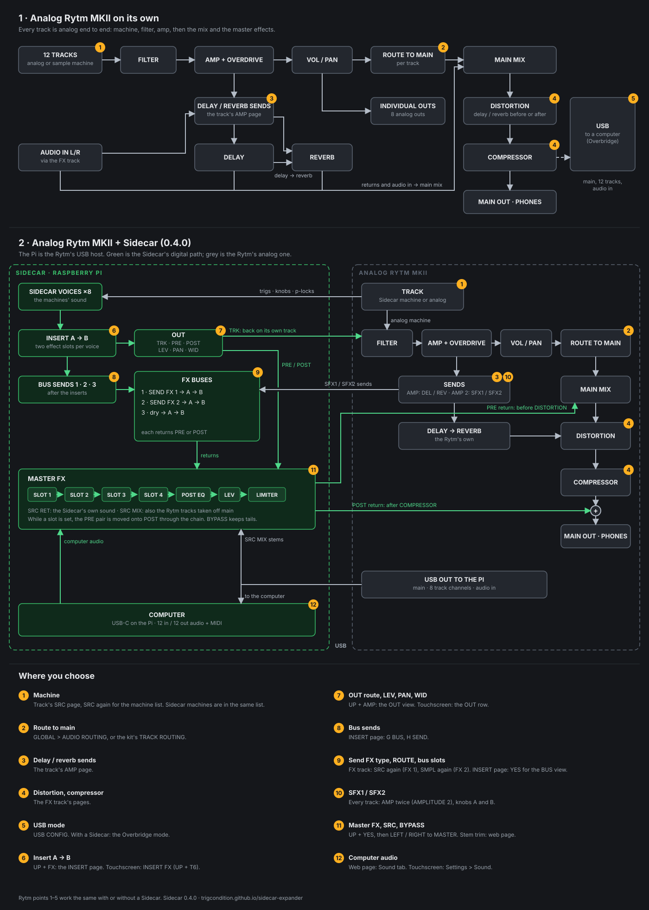

Sidecar is an **expander**: it takes a lot of DSP off your Elektron box and gives it to a Raspberry Pi. You keep playing the box as you always have. The Pi adds new voices and effects, and the box's own outputs play them.

## One USB cable

The Pi plugs into the box's USB port and acts as its **USB host**, the job a computer does for Overbridge. The one cable carries two things at once:

- **Audio, over Overbridge.** The box streams all its audio channels to the Pi: the main mix, each track, the audio inputs. The Pi streams its own sound back into the box.
- **Events, over USB MIDI.** The box sends its sequencer trigs, its knob turns, p-locks, LFO moves and key presses. The Pi answers with what to show and what to play. These are small SysEx messages that the box's mod adds ([Host-link protocol](/sidecar-expander/developers/host-link-protocol/)).

On the Rytm the only setting this needs is USB CONFIG in the **Overbridge** mode ([Hardware you need](/sidecar-expander/introduction/hardware/)).

## The Pi makes the sound

When a track plays a Sidecar machine, the Rytm sends its trig and knob values to the Pi. The Pi renders the voice with its built-in engines (PLAITS, JUNO, FM, MD, the samplers and more) or a [user machine](/sidecar-expander/using/user-machines/) you installed, such as SOPHIE, and sends the audio back. Up to eight Sidecar voices sound at once.

The voice comes back in one of three places, set per track with the [OUT route](/sidecar-expander/using/stereo-out/):

- **TRK** (the default): on its own track, through the Rytm's **analog** filter, overdrive and amp, like an analog voice.
- **PRE**: in stereo, straight into the Rytm's mix, before its distortion and compressor.
- **POST**: in stereo, after them.

The Pi also runs the effects the box doesn't have: [insert effects](/sidecar-expander/using/insert-fx/) on every voice, two [send effects](/sidecar-expander/using/send-effects/) that every Rytm track can feed, and in 0.4.0 a [master FX](/sidecar-expander/using/master-fx/) chain. It records every channel to the card ([recorder](/sidecar-expander/using/recorder/)), and it can pass the Rytm's audio and MIDI on to a computer over its own USB-C port ([USB audio and MIDI](/sidecar-expander/using/usb-audio-midi/)).

## The box is a remote terminal

The mods also turn the box's screen and controls into a **remote terminal** for the Pi:

- The Pi **draws whole pages** and sends them to the box's screen, in the box's own font: the machines' settings, the inserts, the master FX, the sequencer's poly tracks, the pools, the recorder, a scope.
- The box sends back **every key and knob** while such a page is open, and the Pi decides what they do.

So Sidecar can add new ways of working that the box's firmware never had, and new pages need only a new Pi card, no new firmware flash. You control everything from the box itself. The [web page](/sidecar-expander/using/web-ui/) and an optional [touchscreen](/sidecar-expander/using/touchscreen/) are there for setup and for what a big screen does best.

This is also why other boxes can follow: on the [Analog Four MKII](/sidecar-expander/using/analog-four/) the same terminal and the same engine already run. Most of the porting work is hooking into each box's own project, kit and sound data.

## What stays the same

The box keeps all of its own: its analog voices, sequencer, effects and outputs work as before, and its kits store the Sidecar settings with everything else. Unplug the Pi and the box is a normal box again. See [What the Rytm keeps doing](/sidecar-expander/introduction/what-is-sidecar/#what-the-rytm-keeps-doing).

## Signal flow

The top half is the Rytm on its own. The bottom half shows the Rytm with a Sidecar: green is the Pi's digital path, grey the Rytm's analog one. The numbered badges are the places where you choose something; the list at the bottom says where.

[Open the diagram on its own](/sidecar-expander/diagrams/sidecar-signal-flow.png) to zoom in or share it.
