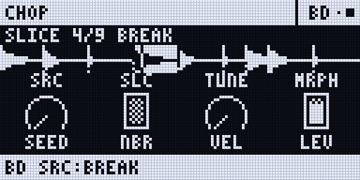
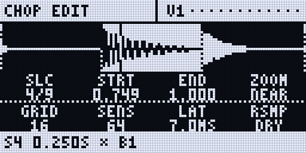
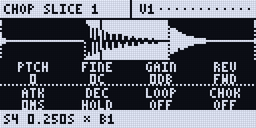

:::caution[New in 0.3.0]
Sidecar (Pi) only, with the Rytm firmware 0.3.0. Built and tested on the Mac and in the emulator. in testing
:::

**CHOP** is a Sidecar machine that cuts one sample into up to **64 slices** and plays them from the Rytm's trigs, its pads in CHRO mode and the Sidecar sequencer. Every slice has its own settings (pitch, gain, reverse, envelope, loop, choke group and more). The settings never change the sample itself.

## Getting started

1. On a track's SRC page, pick **CHOP** in the Rytm's machine list (after LIVE IN). Any track can play it.
2. **Get a sample in:** turn **SRC** (knob A) to open the SAMPLES [bank list](/sidecar-expander/using/pools/#choosing-and-loading-on-the-rytm). Pick a row, or press **FUNC + YES** on a row to load a WAV or AIFF from the card. A take from the [sampler](/sidecar-expander/using/sampling/) lands in the same SAMPLES list.
3. The sample is cut into **16 equal slices** to start with. Play a trig: it plays slice **SLC** (knob B).
4. To chop it your way, open the **slice editor**: push encoder **B..H** on the SRC page ([below](#the-slice-editor-on-the-rytm)).

A sample is held whole in memory, up to 87 seconds (a longer one: its first 87 s).

## Which slice plays

- **A Rytm trig** plays slice **SLC**. P-lock SLC for a different slice on each step. A trig with a NOTE lock plays that many slices up or down from SLC.
- **The CHRO pads** play 12 slices from SLC: the first pad plays SLC, the next pad SLC + 1, and so on. The Rytm's octave keys (UP / DOWN in CHRO) move the window.
- **A poly track** ([Poly mode](/sidecar-expander/using/sequencer/)): the step's note **is** the slice (the lowest note is slice 1), so the piano roll becomes a slice lane. Up to 8 slices sound at once.
- Past the last slice, the count starts again at slice 1.
- A slice plays to its end; a looped slice loops while it is held.

## The knobs

| Knob | | |
|---|---|---|
| A **SRC** | the sample | a row of the SAMPLES pool |
| B **SLC** | the slice the trigs play | 1..64, p-lockable |
| C **TUNE** | every slice's pitch | -24..+24 semitones |
| D **MRPH** | MORPH | crossfades the slice with the next one, live |
| E **SEED** | SHUFFLE | 0: the slices in order; 1..127: a shuffled order (the same seed, the same order) |
| F **NBR** | NEIGHBOUR CHANCE | that share of hits plays the slice before or after instead |
| G **VEL** | velocity | how much velocity sets the level |
| H **LEV** | level | |

**Page 2** (SMPL) overrides a slice's own setting for one hit, so a p-lock can change one trig: **STUT** (stutter x2..x16), **SLEN** (the stutter's length), **TAPE** (OFF / STOP / SPIN), **TTIM** (the tape's time), **ATK**, **DEC**, **DIR** (FWD / REV), **LOOP** (OFF / FWD / PING). Fully down: the slice's own setting.

## Chopping

| Way | What it does |
|---|---|
| **GRID** | 2..64 equal slices, each start moved to the nearest zero crossing |
| **TRANSIENT** | a slice at each hit in the sample, with a sensitivity |
| **LAZY** | the sample plays from its start; tap a pad, a trig or the screen where you hear a slice begin. STOP keeps the markers as the slices, CANCEL drops them |
| **MANUAL** | ADD a marker, DELETE one, MERGE with the next slice, move a slice's START and END |

**UNDO** takes back the last edit (one level; UNDO again brings it back).

## Lazy chopping, step by step

Lazy chopping: you tap along while the sample plays, and every tap becomes a slice. All on the Rytm, no touchscreen needed:

1. On the CHOP track, open the **SRC** page and **push any of the encoders B..H**: the slice editor opens (A's push opens the source list instead).
2. **Push G (LAZY).** The sample starts playing from its beginning.
3. **Tap in time** wherever you hear a slice begin: the **pads**, the **trig keys** or **T1..T16** all work. Each tap drops a marker.
4. Tapped one wrong? **Push D** takes back the last marker.
5. **YES** keeps the markers as the slices; **NO** throws them away. (Pushing G again also stops.)

Then check the result: **YES** plays the selected slice, **LEFT / RIGHT** step through them. A marker that is slightly off: move it with **STRT / END** (with **FUNC** held, one sample frame at a time). On the touchscreen the same works with the **LAZY** key and a tap on the pads.

## The slice editor on the Rytm

On CHOP's SRC page, **push encoder B..H** (A's push stays the source list). The editor shows the selected slice and its neighbours with the markers. **PAGE** steps through three views:

| View | A | B | C | D | E | F | G | H |
|---|---|---|---|---|---|---|---|---|
| EDIT (turn) | SLC (select) | STRT | END | ZOOM | GRID n | SENS | LAT | RSMP (DRY / +FX) |
| EDIT (push) | ADD | DEL | MERGE | UNDO | GRID | TRANSIENT | LAZY (again: STOP) | RESAMPLE |
| SLICE 1 | PTCH | FINE | GAIN | REV | ATK | DEC | LOOP | CHOK |
| SLICE 2 | NUDG | STUT | SLEN | SDEC | TAPE | TTIM | NBR | RSET (push: the slices back in order) |

- **YES** plays the selected slice; **LEFT / RIGHT** select the slice before / after.
- **T1..T16** select and play the 16 slices of a bank (their LEDs show the bank, the selected slice orange); **DOWN** the next bank: **A..D**, 4 x 16 = 64 slices.
- STRT / END move a pixel a detent; with **FUNC** held, one sample frame.
- **LAZY:** push G, then tap the pads, the trigs or T1..T16 in time with the sample; push D undoes the last marker; **YES** keeps them, **NO** drops them.
- **NO** leaves the editor.

<small>Renders of the Rytm-screen pages: the Sidecar's own page code on the host, with made-up data.</small>

### Per-slice settings

| Setting | Range | |
|---|---|---|
| PTCH / FINE | -24..+24 semitones / -50..+50 cents | |
| GAIN | -24..+12 dB | |
| REV | FWD / REV | |
| ATK / DEC | 0..2000 ms / HOLD .. 10 s | |
| LOOP | OFF / FWD / PING | while held |
| CHOK | OFF, G1..G4 | slices in a group cut each other |
| NUDG | -50..+50 ms | the start moved, the end kept |
| STUT / SLEN / SDEC | x1..x16 / 1..100 % / 0..90 % | the slice's first part repeated, each repeat quieter |
| TAPE / TTIM | OFF / STOP / SPIN, 20 ms .. 4 s | the pitch falls to zero at the slice's end, or rises from zero at its start |
| NBR | 0..100 % | the chance that a hit plays a neighbour instead |

## On the touchscreen

A CHOP track's **VOICE** page (UP + T4) is a chop screen:

- **the waveform**, large, with numbered markers: **drag a marker** to move it, tap a slice to select it, drag elsewhere to scroll, **ZOOM - / +**;
- **16 pads** with bank tabs **A..D**: a tap selects and plays a slice (in LAZY: a tap drops a marker);
- **the slice list**: each slice's start, length and settings; the arrows move the cursor, **- / +** edit;
- **keys:** LAZY (again: STOP), TAP, UNDO, GRID (4 8 16 32), TRANS, ADD, DEL, RSMP.

## The weird tools

- **SHUFFLE** (SEED): the slices in a shuffled order, the same for the same seed. A scene or PERF lock on SEED changes it live. RSET (the editor's SLICE 2, push H) puts the order back.
- **STUTTER** and **TAPE STOP / SPIN-UP** per slice, or per hit from page 2.
- **MORPH** (MRPH): the slice crossfaded with the next one while it plays.
- **NEIGHBOUR CHANCE**: some hits play the slice next door, repeatably.
- **RESAMPLE SLICE** (the editor's push H): the slice is played once through its voice's inserts (with **+FX**, the send effects too) and recorded into the SAMPLES pool. **YES** then makes the recording the slice's own sample; **NO** keeps the old one.

## Limitations

- Sidecar (Pi) only: the Sidecar Mini has no CHOP.
- The CHRO pads start at SLC, not always at slice 1.
- No live source yet (recording trigs into memory to chop): planned.
- Pinch to zoom is not built on the touchscreen: use ZOOM and drag.
