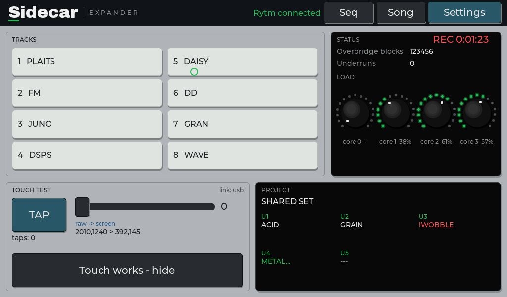
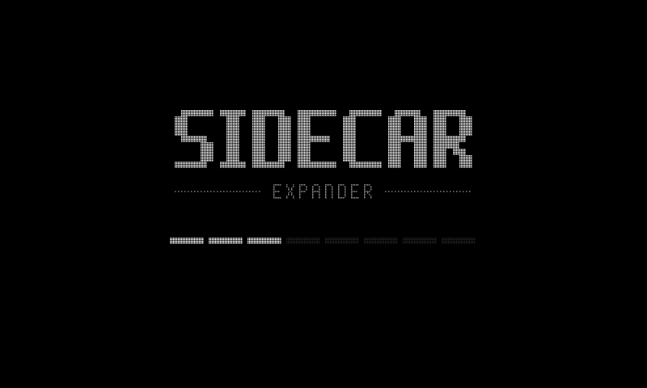
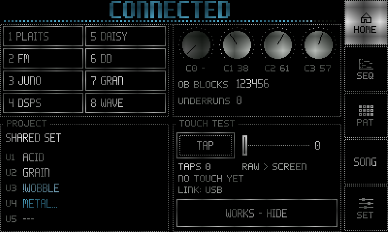
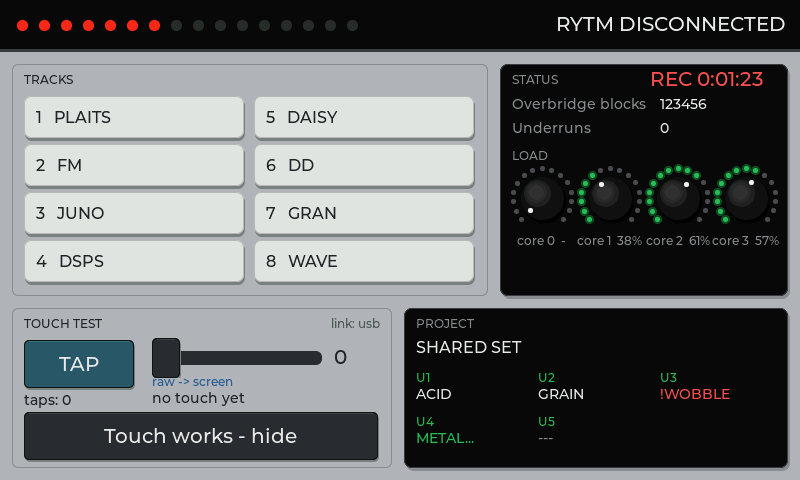
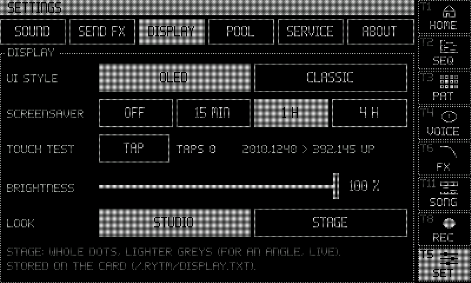

:::caution[New in 0.3]
Sidecar 0.3.0 (Pi) redraws the whole display: two themes and the STAGE look, the 1024x600 size, a new boot screen and the connection animation. The pages themselves (HOME, SEQ, PAT, VOICE, INSERT FX, SONG, REC, SCOPE, STATUS, PROJECT, POOL, SET) are on [The touchscreen](/sidecar-expander/using/touchscreen/). The 0.2.0 display is described in the [0.2 docs](/sidecar-expander/0.2/using/display/).
:::

The Pi can drive a touch display: HDMI with USB touch, or a DSI touchscreen on the Pi's display connector. Connect it before power-on: the screen is set up at boot. The display is optional; everything it shows is also on the Rytm or the web page.

## Which displays work

| Display | Pi 4 | Pi 5 |
|---|---|---|
| 5" / 7" HDMI LCD with USB touch, 800x480 (Waveshare) | <span class="sc-ok">hardware</span> (the 5") | <span class="sc-ok">hardware</span>, scaled (slightly soft) |
| 7" HDMI 1024x600 with USB touch: the GeeekPi EP-0194 | expected, to be confirmed: needs the `config.txt` lines below | expected |
| 7" DSI compatible with the official display v1 (OSOYOO 7" DSI V4.0) | <span class="sc-ok">hardware</span> | <span class="sc-test">in testing</span> (built, not yet run) |
| Official Raspberry Pi 7" Touch Display (v1, DSI) | expected (the same path as the compatibles) | <span class="sc-test">in testing</span> (built, not yet run) |
| Raspberry Pi Touch Display 2 | not supported | not supported (untested; portrait 720x1280) |

**Connecting.** HDMI goes to the Pi's **micro-HDMI 0** (next to the power socket), USB touch to a USB-A port. With a DSI display and HDMI both connected, the Sidecar draws on the DSI display; `dsi=0` in `cmdline.txt` keeps it on HDMI. With no DSI panel answering, the Sidecar uses HDMI (both boards).

- To turn a DSI display by 180 degrees: `lcd_rotate=2` under `[pi4]` in `config.txt` (Pi 4) or `dsi_rotate=180` in `cmdline.txt` (Pi 5). `dsitouch_inv=1`, `2` or `3` mirrors the DSI touch in x, y or both.
- On the Pi 5 a 15-pin DSI display needs a 22-pin to 15-pin display cable.
- On the Pi 5 the HDMI display needs `hdmi_force_hotplug=1` under `[pi5]` (it is on the card).
- Do not add `ignore_lcd=1`, `disable_touchscreen=1` or a `vc4-kms` overlay to `config.txt`.

## Screen sizes

The UI has two sizes, each with its own layout in both themes: **800x480** and **1024x600** (OLED: 512x300 dots). On the larger size the roll, the lists, the timeline and the meters get more room; text and touch targets keep their size. The size follows the frame buffer the Pi's firmware sets from `config.txt`:

- 800x480 or 1024x600: that layout, 1:1.
- Any other size (Pi 4): the 800x480 layout in the middle, unscaled, with black borders.
- Pi 5 on HDMI: the firmware picks the mode (1920x1080 measured), and the UI is scaled to it: the 1024x600 layout when the display prefers 1024x600, else 800x480.
- To force a size: `res=800x480`, `res=1024x600` or `res=auto` in `cmdline.txt` or on its own line in `/.rytm/display.txt`; read at boot.

**The GeeekPi EP-0194 (1024x600)** on a Pi 4: the HDMI block of `config.txt` becomes

```
[pi4]
hdmi_force_hotplug=1
hdmi_group=2
hdmi_mode=87
hdmi_cvt=1024 600 60 6 0 0 0
disable_overscan=1
```

Nothing else is needed: the frame buffer is then 1024x600 and the UI follows. On the Pi 5 only `hdmi_force_hotplug=1` matters (it is on the card); if the 1024x600 layout is not picked, put `res=1024x600` in `cmdline.txt`. The boot log's `display: EDID:` line says what the panel reports.



## Boot screen

SIDECAR / EXPANDER in the dot-matrix font over a row of eight segments, drawn straight after the engine starts; a segment lights per boot stage (the SD card, the send FX, the card, the console, the render cores, USB, the display). The home page follows a few seconds later. With `uistyle=classic` in `cmdline.txt` the boot screen has the CLASSIC look; `display=0` turns it off with the display.



## Themes and looks

Two themes, each with every page, switched with **Settings > Display > UI style** (applied at once, stored on the card):

- **OLED** (the default): the screen drawn as a zoomed-in dot-matrix OLED, 400x240 dots of 2x2 pixels with a dark grid between, dotted outlines, inverted selection, knobs as dot rings.
- **CLASSIC**: the controls drawn as the Rytm's hardware: rubber keys, trig keys with LEDs, knob caps with LED rings, the teal FUNC key, black display windows.

**LOOK: STUDIO / STAGE** (OLED): STUDIO is the dot look (the default); **STAGE** draws every dot as a whole cell, without the grid lines, and lifts every grey a step, for reading at an angle and on a stage.

Pictures of both themes and the STAGE look: [The touchscreen](/sidecar-expander/using/touchscreen/#themes-and-looks).

## The connection animation

When the Rytm's link comes up or drops, a banner slides over the top of the screen, modelled on the Rytm's own CONNECTED splash: it opens as a curtain from the left, the word slides in, a row of dots (CLASSIC: LEDs) sweeps across, lit left to right for **CONNECTED** (about 1.4 s) and put out right to left for **DISCONNECTED** (about 1.1 s), then the curtain leaves to the right. It plays only on a change of the link, never on a page change.




## Settings > Display



<small>Screenshots: rendered off-device by the Sidecar's own UI code, with made-up data.</small>

| Setting | |
|---|---|
| **UI style** | OLED or CLASSIC (also `uistyle=oled\|classic` on the console or the web page) |
| **Screensaver** | Off, 15 min, 1 h (default) or 4 h without a touch: the screen goes black. Any touch wakes it, and that touch only wakes the screen. Rytm activity does not keep it awake. |
| **Touch test** | a tap counter and the raw touch readout. It leaves HOME after the first tap; it lives here from then on. |
| **Brightness** | 5 to 100 %. It dims the picture (the panel has no software backlight control); even the darkest setting stays readable, so you can always find the slider again. |
| **Look** | STUDIO or STAGE |

All of these are stored on the card in `/.rytm/display.txt` and can be set from the web page too. `screensaver=`, `brightness=`, `touchtest=` and `uistyle=` in `cmdline.txt` override the file at boot.

## Power warning

A weak supply shows in the title bar in the alert look, with a short text naming the board's supply (the 15 W supply for a Pi 4, the 27 W adapter for a Pi 5), and on the web page's Power tile.

## Touch

If touch is offset or mirrored, read the raw values from the touch test and set `touchscreen=minx,maxx,miny,maxy` in `cmdline.txt`. Touch errors on the panel's USB link are recovered automatically.

## Cost

The display runs on the core that also handles USB, but the audio is interrupt-driven and does not wait for it. Only what changed is redrawn: a page change takes roughly 5 to 20 ms on a Pi 4 (estimated from the Mac), the meters and the clock far less. `display=0` in `cmdline.txt` turns the display off.
