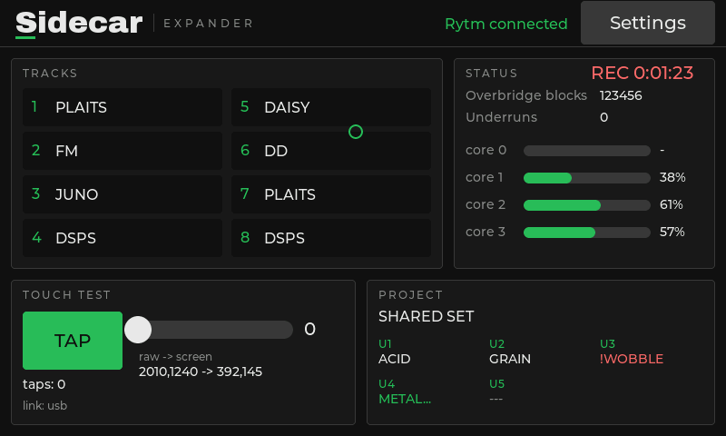
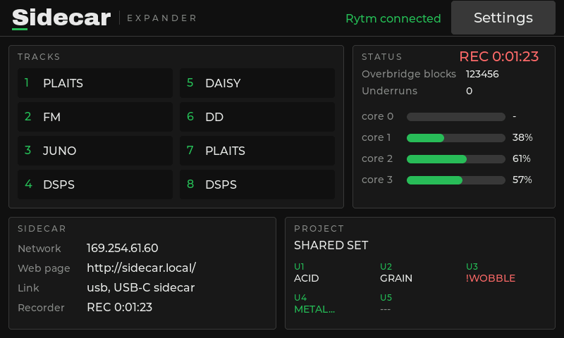
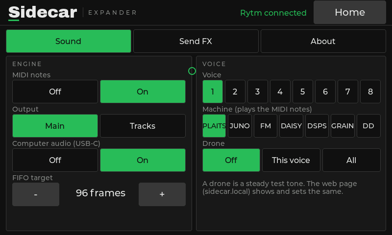
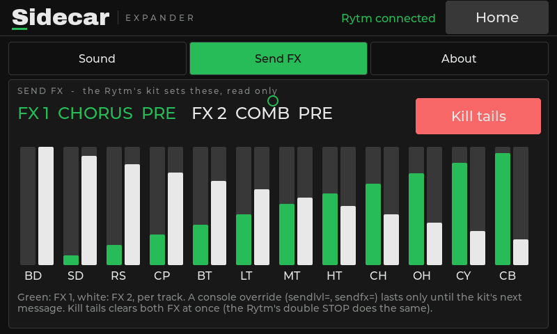
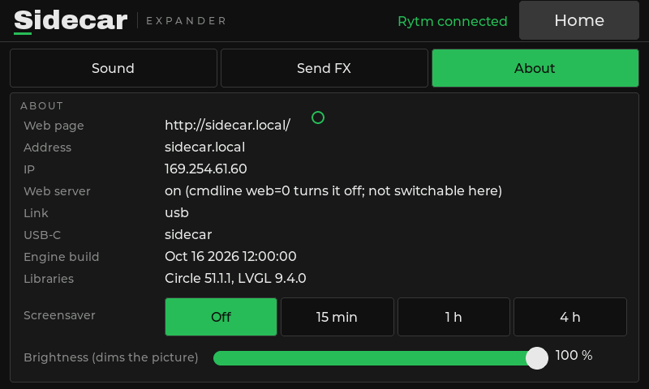

The Pi can drive an **800x480 display**: HDMI with USB touch, or a DSI touchscreen on the Pi's display connector. Connect it before power-on.

| Display | Status |
|---|---|
| 5" / 7" HDMI LCD with USB touch (800x480): HDMI to the Pi's **micro-HDMI 0** (next to the power socket), touch to a free **USB-A** port | hardware (a 5" HDMI LCD) |
| Official Raspberry Pi 7" Touch Display (v1, DSI) | expected, being confirmed |
| Compatible 7" DSI displays such as the OSOYOO 7" DSI V4.0 | expected, being confirmed |
| Raspberry Pi Touch Display 2 | not supported |

With a DSI display and HDMI both connected, the Sidecar draws on the DSI display; `dsi=0` in `cmdline.txt` keeps it on HDMI. Do not add `ignore_lcd=1`, `disable_touchscreen=1` or a `vc4-kms` overlay to `config.txt`.

## Boot screen

The Sidecar wordmark with a progress bar, drawn within a third of a second of the engine starting. The home screen follows a few seconds later.

## Home

<small>Screenshots: the 1021 display rendered off-device with mock data. The restyled display is hardware-tested.</small>

- The title bar, with **Rytm connected** (green) or **Rytm not connected** (red).
- **Tracks:** the Sidecar's voices 1-8 with their current machine (numbered by voice: 1 BD, 2 BT, 3 SD, 4 LT, 5 CH/OH, 6 MT/HT, 7 CY/CB, 8 RS/CP).
- **Project:** the Rytm's project and its U1..U5 machines as the Rytm shows them (`!ROOM NAME`, `!MISS NAME` etc. when it cannot play, with the reason; `NAME...` loading, `---` empty).
- **Status:** Overbridge blocks, underruns (red once nonzero), load bars for the render cores, and `REC` while recording.
- **Touch test:** a tap button and a slider to check the touch panel. Once touch works, press **Touch works – hide**: a **SIDECAR** panel (network, web page, link, recorder) takes its place. The About page has a Show / Hide toggle to bring it back; the choice is stored as `touchtest=` in `/.rytm/display.txt`.

## Settings

<small>Screenshots: the 1021 display rendered off-device with mock data.</small>

The **Settings** button (top right) opens the settings pages and becomes **Home**. Every control is at least 48 px high.

| Page | |
|---|---|
| **Sound** | MIDI notes, output (Main/Tracks), computer audio, the buffer target; per voice: machine and test drone |
| **Send FX** | both effects' TYPE and the 12 send levels (read only: the Rytm's kit owns them; **FX 1 green, FX 2 white**), and **Kill tails** |
| **About** | the web address, IP, network, the build, the screensaver, the touch test (show / hide) and brightness |

The display, the web page and the console share one state: a change on one shows on all.

## Screensaver and brightness

- **Screensaver:** after 1 hour without a touch (default) the screen goes black. Choose Off, 15 min, 1 h or 4 h. Any touch wakes it; that touch only wakes the screen. Rytm activity does not keep it awake.
- **Brightness:** 5 to 100 %. It dims the picture (the panel has no software backlight control); even the darkest setting stays readable, so you can always find the slider again.
- Both are stored on the card (`/.rytm/display.txt`) and can be set from the web page too.

## Touch

If touch is offset or mirrored, read the raw values from the touch readout and set `touchscreen=minx,maxx,miny,maxy` in `cmdline.txt`. Touch errors on the panel's USB link are recovered automatically.

## Cost

The display runs on the core that also handles USB, but the audio is interrupt-driven and does not wait for it. At rest an update takes about 0.3 ms. `display=0` in `cmdline.txt` turns it off.
