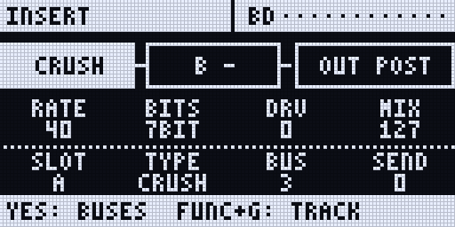

:::caution[New in 0.3]
New in 0.3.0 (the Rytm firmware 0.3.0 with the Sidecar 0.3.0 card), Sidecar (Pi) only. Built and tested on the Mac and in the emulator; not yet confirmed on a real Rytm.
:::

Every Sidecar voice gets an **INSERT** chain of two slots, A and B, before it goes back into the Rytm's track. Three **FX buses** take sends from the voices. <span class="sc-test">in testing</span>

## Signal flow

```
Sidecar voice -> INSERT A -> INSERT B -> OUT: TRK  the Rytm's track (analog filter, amp)
                                           PRE  the Rytm's main mix, before its master FX (stereo)
                                           POST the Rytm's main mix, after its master FX (stereo)
                                      \-> sends to bus 1, 2, 3
bus 1 = SEND FX 1 -> its chain (A, B) -> PRE or POST
bus 2 = SEND FX 2 -> its chain (A, B) -> PRE or POST
bus 3 = dry       -> its chain (A, B) -> PRE or POST (ROUTE)
```

- Buses 1 and 2 **are** the two [send effects](/sidecar-expander/using/send-effects/): their TYPE, P1..P5 and the Rytm tracks' sends are unchanged. A kit without insert settings sounds exactly as before.
- Bus 3 has no send effect of its own: a dry bus of the voices' sends through its two slots (a bus compressor, a shared filter, ...).
- A voice's sends are taken after its inserts: the bus hears the inserted voice, not the Rytm's analog processing of it.
- **The OUT route** decides where the voice goes after its inserts: its own track (**TRK**, the default) or the Rytm's main mix in stereo, before (**PRE**) or after (**POST**) the Rytm's master distortion and compressor. On PRE and POST the insert chain runs in stereo. See [Stereo and the OUT route](/sidecar-expander/using/stereo-out/).

## Effects

| TYPE | P1 | P2 | P3 | P4 |
|---|---|---|---|---|
| FILTER | CUT 20 Hz..20 kHz | RES | MODE LP > BP > HP | DRV 0..+24 dB |
| CRUSH | RATE | BITS 16..2 | DRV 0..+18 dB | MIX |
| DRIVE | DRV 0..+30 dB | SHPE saturation > fold | TONE | MIX |
| EQ | LOW shelf ±15 dB | MID bell ±15 dB | HIGH shelf ±15 dB | FREQ (the bell) 200 Hz..8 kHz |
| COMP | THR 0..-40 dB | RAT 1..20 | SPD (attack and release) | GAIN 0..+24 dB |
| DELAY | TIME 1..80 ms | FDBK | MOD | MIX |
| TREMOLO | RATE 0.1..20 Hz | DPTH | SHPE sine > square | PAN |
| RINGMOD | FREQ 10 Hz..5 kHz | SHPE sine > square | MOD | MIX |
| AMP (0.3.0) | MODL: an amp capture from `/NAM/` | GAIN -18..+18 dB into it | TONE tilt ±6 dB | LEV -36..+6 dB |

Changing TYPE crossfades without a click and loads the effect's defaults. Parameters are smoothed, so p-lock jumps do not zipper.

## AMP: amp captures (NAM)

<span class="sc-test">in testing</span> New in 0.3.0. **AMP** puts a real amp on a Sidecar voice: a **Neural Amp Modeler** (NAM) capture of a guitar amp, pedal or preamp, run by TONE3000's NAM A2-Lite engine. Pick AMP as a slot's TYPE, then pick a capture with MODL. Drive a kick, a bass or a synth through it.

| Knob | Label | What |
|---|---|---|
| P1 | **MODL** | the capture: the files in the card's `/NAM/` folder, in name order, spread over the knob. It shows the file's short name (`PLEXICR`) |
| P2 | **GAIN** | -18..+18 dB into the capture (64 = 0 dB): more drive |
| P3 | **TONE** | a tilt after it, -6..+6 dB around 650 Hz (64 = flat) |
| P4 | **LEV** | the output, -36..+6 dB (109 = 0 dB) |

Every knob takes p-locks and LFOs, MODL too: a lock can change the amp per step. A new capture loads in the background: the slot keeps playing the old one (or dry) until the new one is ready, then crossfades to it in 10 ms. A capture used before comes back at once.

### Add your own captures

1. **Get A2-Lite captures** from [TONE3000](https://www.tone3000.com): thousands of amps and pedals. Download the **A2** version: its `*_a2.nam` file holds an A2-Lite model, and the Sidecar takes that one. Older NAM models (A1 "Standard", "Lite", "Feather", "Nano", A2-Full, LSTMs) are refused: the Sidecar plays **A2-Lite only**.
2. **Copy them into `/NAM/`** on the Sidecar's card: on the web page's **Files** tab (upload into the `NAM` folder; make it with **New folder** if it is not there), or with the card in a computer.
3. **Rescan:** the list is read again when you type `amp=rescan` on the web page's console (Log & console), and at the next start.
4. Pick **AMP** in an insert slot ([Editing](#editing)) and turn **MODL**.

- **Formats:** `.nam` (NAM's own JSON, including TONE3000's A2 downloads) and `.namb` (TONE3000's binary format). Captures at 48 kHz only (or with no rate in the file).
- **Limits:** up to 64 files, names up to 47 characters, a file up to 512 KB.
- **Names:** the knob shows the first 7 letters of the file name, upper case, without spaces, `_` and `-` (`Plexi Crunch.nam` shows `PLEXICR`). Name your files so the first 7 letters tell them apart.
- **The kit remembers the file by name**, so adding files later does not change which amp a kit plays. A file that is gone is logged, and the knob keeps its value.
- **A2 "Amp + Cab" captures** include the speaker cabinet. An "Amp Head" capture has no cab; a cab after the amp is planned.

MODL's text shows on the Rytm's INSERT page and on the touchscreen's INSERT FX page.

**What MODL shows when it cannot play** (the slot then passes the voice through TONE and LEV, dry):

| Text | Meaning |
|---|---|
| `PLEXIC~` | that capture is loading |
| `LOADING` | the `/NAM/` folder is being read |
| `NO NAM` | no `.nam` or `.namb` file in `/NAM/` |
| `NOTLITE` | not an A2-Lite model (or a file over 512 KB) |
| `BADFILE` | a damaged or cut-short file, or not a NAM model |
| `NOT 48K` | a capture made at another sample rate |
| `MAX 6` | six AMP slots play already |
| `NO RAM` | no memory for it |

**Where and how much:** on the voices' chains only (not on the buses). AMP is mono: on a stereo voice (OUT PRE / POST) it plays the sum on both sides. **At most 6 AMP slots play at once**: one costs about 4 % of a Pi 4 core (measured by the boot bench); a seventh shows `MAX 6` and plays dry.

## Editing

- **On the Rytm:** **UP + FX** opens the remote page **INSERT** (or INSERT FX in the SIDECAR MENU; TRK + FX, the older form, still works). The TRACK view shows the selected track's voice: a strip `[A TYPE] > [B TYPE] > [OUT]`, A..D the slot's P1..P4, E SLOT, F TYPE, G BUS, H SEND. FUNC + G picks another track. **YES**: the BUS view (A..D, E SLOT, F TYPE, G BUS 1..3, H ROUTE for bus 3); **YES** again: the OUT view (A OUT, B LEV, C PAN, D WID, E DEC); NO goes back. **UP + AMP** opens the page straight on the selected track's OUT view. **RIGHT**, from any of its views, opens the **EQ view**: a post EQ after the two slots, A HPF, B LPF, C LOW, D HIGH (LEFT or NO goes back; YES swaps between the voice's EQ and its bus's). The EQ has no p-locks.

The INSERT page **replaces the Rytm's page** like SRC: no page dots and no LEFT / RIGHT siblings. Leave with **NO**, or press **UP + FX** again; **UP + AMP** again aims the OUT view at the track now selected.


<small>Render of the Rytm-screen page: the Sidecar's own page code on the host, with made-up data.</small>

- **On the touchscreen:** the **INSERT FX** page (FX, UP + T6 on the Rytm, or Settings > Send FX > Inserts): the voice's two slots as dials with their values, a key per track, the three sends, each bus's chain and return, and the **OUT** row (TRK / PRE / POST, LEV, PAN, WID). It follows the Rytm's selected track; the knobs are the Rytm's (`KNOBS ON RYTM`), the TYPE and OUT keys edit.
- **P-locks:** on a [poly track](/sidecar-expander/using/sequencer/#p-locks-on-poly-steps), hold trigs and press **FX** twice: the INS lock page (A..D INSERT A P1..P4, E..H INSERT B P1..P4).
- **LFOs:** targets I1..I8 (the voices' chains) and B1..B3 (the buses' chains), on top of the knob or lock; O1..O8 move the OUT route's LEV, PAN and WID ([LFOs](/sidecar-expander/using/lfo/#targets)).


<small>Screenshot: rendered off-device by the Sidecar's own page code, with made-up data.</small>

Settings, the OUT route included, are saved per kit on the Sidecar's card (`/.rytm/ins/<project>/kNNN.txt`), a second after the last edit. They follow the Rytm's kit **SAVE** and **RELOAD** (YES + KIT / NO + KIT, or the KIT menu): a saved kit's insert settings come back when you reload it ([Saving and reloading](/sidecar-expander/using/key-combinations/#saving-and-reloading-the-rytms-own-keys)).

## Limitations

- Sidecar (Pi) only.
- The web page shows the chains (in its status) but has no editor for them yet.
- Insert locks exist only on poly tracks.
- CPU: 8 voices with two slots each cost about 1.3 to 2.2 % of a Pi 4 core (estimated from the Mac). AMP costs about 4 % of a core a slot, at most 6 at once.
- AMP: A2-Lite captures at 48 kHz only; no cab IR after the amp yet.
