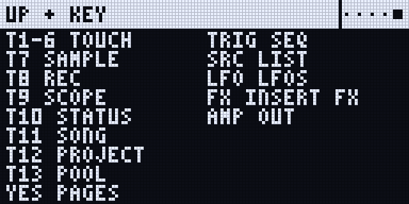
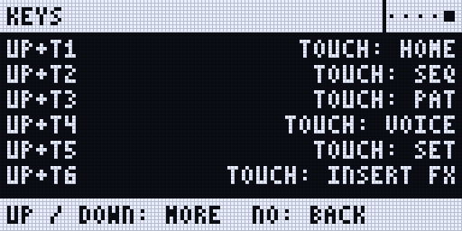
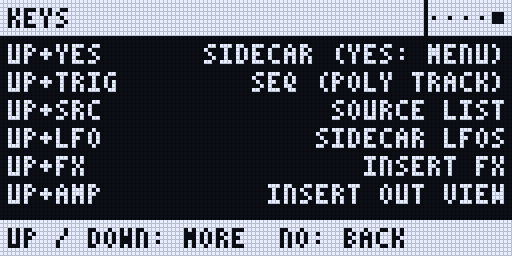
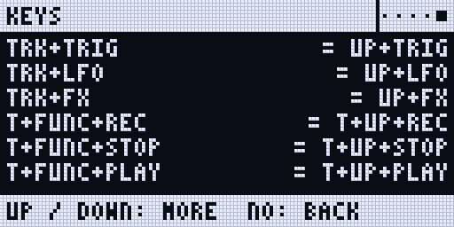
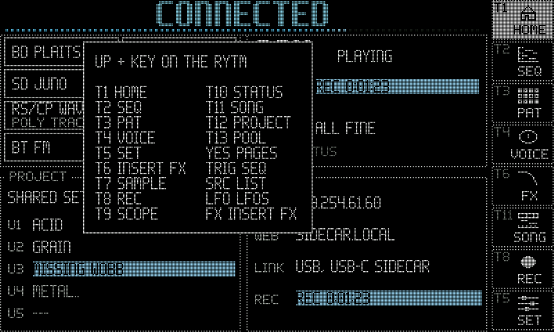

:::caution[New in 0.3]
For the 0.3 test line: Rytm build `rui1048` with the Sidecar's 0.3 test build, Sidecar (Pi) (UP as the Sidecar key since `rui1046`, UP + AMP since `rui1047`, POLY CONFIG in the track menu since `rui1048`; tested in the emulator). Rows marked 0.2 also work with the 0.2.0 release's `rui1027d`, where the Sidecar key is still TRK (TRK + YES, TRK + LFO).
:::

**UP is the Sidecar key.** Hold UP and press a second key. The stock Rytm leaves all of these combinations free, so nothing of the Rytm's own is lost. UP alone still moves the cursor in the Rytm's menus.

- **Hold UP alone** (about half a second) on the Rytm's main screen: the **combo map**. The Rytm shows every UP + key on one screen, in two columns, and lights T1..T13 in their pages' colours. Its first row, `T1-6 TOUCH`, stands for the six pages only a touchscreen has; a touchscreen shows the same map with each of them. Let go of UP to close it.
- **No touchscreen needed:** every page opened from T7..T13 and every UP + key combination works on the Rytm's own screen.
- **The SIDECAR MENU** (UP + YES, then YES) lists every Sidecar page with its shortcut.
- **The KEYS page** (the last row of the SIDECAR MENU) lists every combination, then the older forms.
- While a Sidecar page has the Rytm's keys, **TRK's LED blinks** slowly.

"Hold" means: hold the first key, then press the second. "T1".."T16" are the trig keys.

<small>Renders of the Rytm-screen pages: the Sidecar's own page code on the host, with made-up data. No firmware data.</small>

## UP + a trig key: the pages

| Keys | Opens |
|---|---|
| **UP + T1** | HOME (touchscreen) |
| **UP + T2** | SEQ (touchscreen) |
| **UP + T3** | PAT (touchscreen) |
| **UP + T4** | VOICE (touchscreen) |
| **UP + T5** | SET (touchscreen) |
| **UP + T6** | INSERT FX (touchscreen) |
| **UP + T7** | SAMPLE on the Rytm's screen; again: AUTO |
| **UP + T8** | REC |
| **UP + T9** | SCOPE |
| **UP + T10** | the Sidecar's STATUS (on the Rytm: the SIDECAR page) |
| **UP + T11** | SONG |
| **UP + T12** | PROJECT |
| **UP + T13** | POOL |

- T1..T6 are the touchscreen's pages alone. T8..T13 open on the touchscreen when one is connected and has the page, else on the Rytm's screen.
- No trig is placed: while UP is held the trig keys only pick pages.
- A page that has nothing to show yet (PROJECT before the project list is read, POOL without pools) pops `PROJECT: NOT HERE NOW` on the Rytm instead of opening another page.
- When the touchscreen takes a page, the Rytm pops a short note saying so.

## UP + another key

| Keys | Where | Does |
|---|---|---|
| **UP + YES** | anywhere | the Sidecar's remote pages (SIDECAR first); again: leave. YES on SIDECAR: the SIDECAR MENU |
| **UP + TRIG** | any track | the SEQ page of a poly track; on another track, the make prompt (or why it cannot be one) |
| **UP + SRC** | a track on GRANULAR, WAVETABLE, MULTISAMPLE or DSP SAMPLE | the source list in one press: the machine's POOL bank list (DSP SAMPLE: on the SMPL page, knob D) |
| **UP + LFO** | anywhere | the Sidecar's [LFO page](/sidecar-expander/using/lfo/) |
| **UP + FX** | anywhere | the [INSERT page](/sidecar-expander/using/insert-fx/) |
| **UP + AMP** | anywhere | the INSERT page on its **OUT view** for the selected track: the [OUT route](/sidecar-expander/using/stereo-out/) (OUT TRK / PRE / POST, LEV, PAN, WID, DEC); again while open: back to that view |
| **FUNC + CHRO**, then **POLY CONFIG** | a track | the Rytm's own track menu; its last item opens the track's [POLY CONFIG](/sidecar-expander/using/sequencer/#poly-config) (VOICES, ALLOCATION, UNISON, DETUNE, SPREAD, GROUP) |
| **trig held + UP + RECORD** | poly track | copy the held steps |
| **trig held + UP + STOP** | poly track | paste onto the held steps |
| **trig held + UP + PLAY** | poly track | clear the held steps |

- **UP + YES** needs UP held for a moment first (about 0.15 s): in a Rytm menu, UP then YES pressed quickly stays the Rytm's own.
- **Step copy is one-handed:** hold the trigs first, then UP, then RECORD, STOP or PLAY. UP first and then a trig is a page request (UP + Tn).
- **On a normal track** UP + RECORD / STOP / PLAY stays the Rytm's own transport, and a held trig with UP or DOWN stays the Rytm's own trig popup.
- On any other track UP + SRC is SRC alone.
- **POLY CONFIG is no UP combination:** it sits where a Rytm user looks for a track's settings, as the last item of the track menu (FUNC + CHRO; FUNC + DOWN moves five rows). The KEYS page and the SIDECAR MENU name it.

:::note[Older forms still work]
The TRK and FUNC forms of the earlier 0.3 test builds still work: **TRK + YES**, **TRK + TRIG**, **TRK + LFO**, **TRK + FX**, and **trig held + FUNC + RECORD / STOP / PLAY**. The KEYS page lists them after the UP forms.
:::

## On the remote pages

| Keys | Where | Does |
|---|---|---|
| **YES** | the SIDECAR page | the **SIDECAR MENU**: every page with its shortcut |
| **UP / DOWN**, **YES** | the SIDECAR MENU | pick a page / open it |
| **NO** | a remote page | back a level: page > SIDECAR > leave |
| **LEFT / RIGHT** | a remote page | the previous / next page |
| **UP / DOWN** | the KEYS page | scroll |
| **YES**, YES again | the INSERT page | the BUS view, then the OUT view ([OUT route](/sidecar-expander/using/stereo-out/#where-to-set-it)) |
| **FUNC + G** | the INSERT page | another track |
| **knobs A..D**, **YES** | the POOL page | list, bank, row, action; do it ([POOL page](/sidecar-expander/using/pools/#the-pool-page-on-the-rytm)) |
| **T1..T5**, **knob A / H** | the PROJECT page | export, import, info, delete, eject; the project / the drive ([PROJECT page](/sidecar-expander/using/projects-bundles/#the-rytm-the-project-page)) |
| **T1 / T2 / T3 / T4** | the SONG page | arm / replay / marker / setup checklist ([Song recorder](/sidecar-expander/using/song-recorder/)) |

PLAY, STOP and RECORD always reach the Rytm, also while a Sidecar page is open.

## Poly tracks

| Keys | Where | Does |
|---|---|---|
| **RECORD** | a poly track selected | GRID REC: the trig keys, PAGE and the knobs under a held trig edit the Sidecar's steps |
| **trig** tapped | GRID REC on a poly track | the step on / off |
| **trig held + pads** (or a keyboard) | GRID REC on a poly track | the step's notes; several at once: a chord |
| **trig held + A..H** | poly track | the step's NOTE, VEL, LEN, MICRO, CHD, INV, STRUM, SEL |
| **TRIG** | poly track | the SEQ page; again: the TRIG view (NOTE VEL LEN MICRO / COND STRUM CHD INV) |
| **trig held + YES** | poly track | step preview: the held steps play |
| **trig held + SRC / SMPL / FX / FX FX** | poly track | step locks: P1..P8 / P9..P16 / send FX / inserts |
| **NO** / knob **pushed** | a lock page | clear every lock of the held steps / that knob's lock |
| **FUNC + RECORD / STOP / PLAY** | outside / in GRID REC | the pattern / track: copy, paste, clear (the Rytm's own; the poly steps follow) |
| **PAGE held + FUNC + RECORD / STOP / PLAY** | GRID REC | the page: copy, paste, clear |
| **PAGE** / PAGE held / **PAGE + trig** | poly track | next page / the page map on the trig LEDs / jump to that page |
| **FUNC + PAGE** | poly track, also over the SEQ page | the Rytm's SCALE menu |
| **YES** (no trig held) | the SEQ page | the poly track's menu: BACK, TURN OFF, LENGTH, QUANTISE |
| **RECORD + PLAY** | poly track | live recording on the Sidecar's grid |

See [Poly mode](/sidecar-expander/using/sequencer/).

## Sounds, sends and pools

| Keys | Where | Does |
|---|---|---|
| **AMP**, AMP again | a track | AMPLITUDE 2: the track's sends to SEND FX 1 and 2. 0.2 |
| **SRC** / **SMPL** again | the FX track | SEND FX 1 / SEND FX 2. 0.2 |
| **STOP STOP** | anywhere | the Sidecar's send effects fade out and clear. 0.2 |
| **FUNC + CHRO** | a track | the track menu with the user slots U1..U5 (0.2), and in 0.3 POLY CONFIG as its last item |
| **knob A** turned (or UP + SRC) | SRC page of GRANULAR, WAVETABLE, MULTISAMPLE | the [bank list](/sidecar-expander/using/pools/#choosing-and-loading-on-the-rytm) of the machine's POOL |
| **SMP** (knob D) turned (or UP + SRC) | SMPL page of DSP SAMPLE | the bank list of SAMPLES |
| **LEFT / RIGHT**, **YES**, **NO** | the bank list | the bank / choose / cancel |
| **FUNC + YES** | the bank list | the card's browser, aimed at the row: load a file into it |
| **trigs held + YES** | the bank list (GRID REC) | lock the row on those steps |

## The touchscreen's map

With a touchscreen connected, holding UP shows the same map there, over the current page, in both themes.

