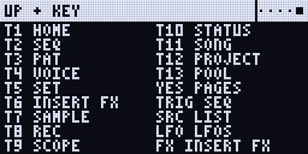
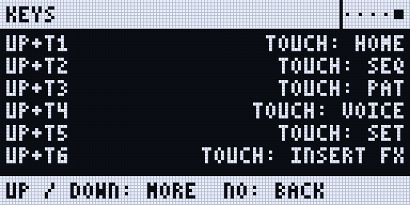
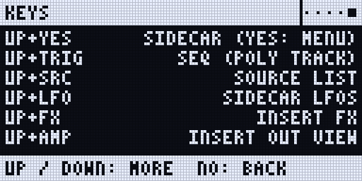
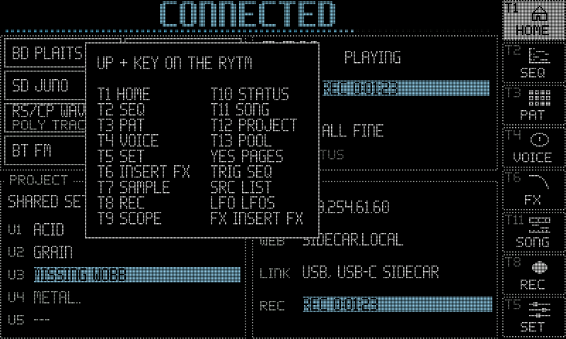

**UP is the Sidecar key.** Hold UP and press a second key. The stock Rytm leaves all of these combinations free, so nothing of the Rytm's own is lost. UP alone still moves the cursor in the Rytm's menus.

- **Hold UP alone** (about half a second) on the Rytm's main screen: the **combo map**. On a page where UP scrolls a list, holding UP scrolls instead ([below](#knobs-and-keys-how-they-feel-050)). The Rytm shows every UP + key on one screen, in two columns, and lights T1..T14 in their pages' colours. Its first row, `T1-6 TOUCH`, stands for the six pages only a touchscreen has; a touchscreen shows the same map with each of them. Let go of UP to close it.
- **No touchscreen needed:** every page opened from T7..T14 and every UP + key combination works on the Rytm's own screen.
- **The SIDECAR MENU** (UP + YES, then YES) lists every Sidecar page with its shortcut.
- **The KEYS page** (the last row of the SIDECAR MENU) lists every combination, then the older **trig held + FUNC** forms (the TRK forms are no longer listed).
- While a Sidecar page has the Rytm's keys, **TRK's LED blinks** slowly.

"Hold" means: hold the first key, then press the second. "T1".."T16" are the trig keys.

<small>Renders of the Rytm-screen pages: the Sidecar's own page code on the host, with made-up data. No firmware data.</small>

## UP + a trig key: the pages

| Keys | Opens |
|---|---|
| **UP + T1** | HOME (touchscreen) |
| **UP + T2** | SEQ (touchscreen) |
| **UP + T3** | PAT (touchscreen) |
| **UP + T4** | VOICE (touchscreen) |
| **UP + T5** | SET (touchscreen) |
| **UP + T6** | INSERT FX (touchscreen) |
| **UP + T7** | SAMPLE on the Rytm's screen; again: AUTO |
| **UP + T8** | REC |
| **UP + T9** | SCOPE |
| **UP + T10** | the Sidecar's STATUS (on the Rytm: the SIDECAR page, with the web page's pairing code on its PAIR line) |
| **UP + T11** | SONG |
| **UP + T12** | PROJECT |
| **UP + T13** | POOL |
| **UP + T14** | the Rytm's own key. It becomes the [MORPH](/sidecar-expander/using/morph/) page in 0.5.1 |

- T1..T6 are the touchscreen's pages alone. T8..T14 open on the touchscreen when one is connected and has the page, else on the Rytm's screen.
- No trig is placed: while UP is held the trig keys only pick pages.
- A page that has nothing to show yet (PROJECT before the project list is read, POOL without pools) pops `PROJECT: NOT HERE NOW` on the Rytm instead of opening another page.
- When the touchscreen takes a page, the Rytm pops a short note saying so.

## UP + another key

| Keys | Where | Does |
|---|---|---|
| **UP + YES** | anywhere | the Sidecar's remote pages (SIDECAR first); again: leave. YES on SIDECAR: the SIDECAR MENU |
| **UP + TRIG** | any track | the SEQ page of a poly track; on another track, the make prompt (or why it cannot be one) |
| **UP + SRC** | a track on GRANULAR, WAVETABLE, MULTISAMPLE or DSP SAMPLE | the source list in one press: the machine's POOL bank list (DSP SAMPLE: its SMP list, knob D of the SMPL page) |
| **UP + LFO** | anywhere | the Sidecar's [LFO page](/sidecar-expander/using/lfo/); again: leave |
| **UP + RIGHT** | anywhere (0.5.0) | [FILL](/sidecar-expander/using/fill/) on the selected track; again or NO: leave. **UP + LEFT** is taken for a later release |
| **UP + FLTR** | anywhere | the selected track's [ARP page](/sidecar-expander/using/arpeggiator/) (0.4.0); again: leave |
| **UP + FX** | anywhere | the [INSERT page](/sidecar-expander/using/insert-fx/); again: leave |
| **UP + AMP** | anywhere | the INSERT page on its **OUT view** for the selected track: the [OUT route](/sidecar-expander/using/stereo-out/) (OUT TRK / PRE / POST, LEV, PAN, WID, DEC); again while open: aims the OUT view at the track now selected |
| **FUNC + CHRO**, then **POLY CONFIG** | a track | the Rytm's own track menu; its last item opens the track's [POLY CONFIG](/sidecar-expander/using/sequencer/#poly-config) (VOICES, ALLOCATION, UNISON, DETUNE, SPREAD, GROUP) |
| **trig held + UP + RECORD** | poly track | copy the held steps |
| **trig held + UP + STOP** | poly track | paste onto the held steps |
| **trig held + UP + PLAY** | poly track | clear the held steps |

- **UP + YES** needs UP held for a moment first (about 0.15 s): in a Rytm menu, UP then YES pressed quickly stays the Rytm's own.
- **Step copy is one-handed:** hold the trigs first, then UP, then RECORD, STOP or PLAY. UP first and then a trig is a page request (UP + Tn).
- **On a normal track** UP + RECORD / STOP / PLAY stays the Rytm's own transport, and a held trig with UP or DOWN stays the Rytm's own trig popup.
- On any other track UP + SRC is SRC alone.
- **POLY CONFIG is no UP combination:** it sits where a Rytm user looks for a track's settings, as the last item of the track menu (FUNC + CHRO; FUNC + DOWN moves five rows). The KEYS page and the SIDECAR MENU name it.

:::note[Older forms still work]
The older form **trig held + FUNC + RECORD / STOP / PLAY** of the 0.3 test builds still works. The first version's track shortcuts (**TRK + YES**, **TRK + TRIG**, **TRK + LFO**, **TRK + FX**) are gone in 0.5.0: use **UP** with the same key. TRK is the Rytm's own key again ([TRK and the remote pages](/sidecar-expander/using/rytm-side/#keys-and-knobs-on-a-page)).
:::

## On the remote pages

| Keys | Where | Does |
|---|---|---|
| **YES** | the SIDECAR page | the **SIDECAR MENU**: every page with its shortcut |
| **UP / DOWN**, **YES** | the SIDECAR MENU | pick a page / open it |
| **YES** on WEB UI | the SIDECAR MENU | the web page's pairing code and settings: WEB UI ON / OFF, CODE, PAIRED DEVICES, NEW CODE, FORGET DEVICES ([Pairing a browser](/sidecar-expander/using/web-ui/#pairing-a-browser)) |
| **NO** | a remote page | a page opened by its shortcut (UP + key, UP + a trig key): leave at once (0.4.4). A page reached by LEFT / RIGHT or picked in the SIDECAR MENU, and the SIDECAR MENU itself: back to SIDECAR. On SIDECAR: leave. NO acts when you let go of it, so NO held + KIT / PATTERN / TRACK stays the Rytm's reload (below) |
| **LEFT / RIGHT** | a page in the ring (SIDECAR, SYSTEM, REC, SCOPE ...) | the previous / next page |
| **LEFT / RIGHT** | the LFO page | the previous / next LFO (in the design view: the step) |
| **RIGHT**, LEFT or NO | the INSERT page | the EQ view, and back (opened by UP + AMP, the OUT view: NO leaves the page) |
| **UP / DOWN** | the KEYS page | scroll |
| **YES**, YES again | the INSERT page | the BUS view, then the OUT view ([OUT route](/sidecar-expander/using/stereo-out/#where-to-set-it)) |
| **FUNC + G** | the INSERT page | another track |
| **knobs A..D**, **YES** | the POOL page | list, bank, row, action; do it ([POOL page](/sidecar-expander/using/pools/#the-pool-page-on-the-rytm)) |
| **T1..T5**, **knob A / H** | the PROJECT page | export, import, info, delete, eject; the project / the drive ([PROJECT page](/sidecar-expander/using/projects-bundles/#the-rytm-the-project-page)) |
| **T1 / T2 / T3 / T4** | the SONG page | arm / replay / marker / setup checklist ([Song recorder](/sidecar-expander/using/song-recorder/)) |

PLAY, STOP and RECORD always reach the Rytm, also while a Sidecar page is open.

### Knobs and keys: how they feel (0.5.0)

- **A knob stops at its centre.** On pan, EQ, tone and LFO depth (the knobs with a neutral middle), a turn that reaches the middle stops there. Keep turning, about three more clicks, to leave it. A knob that you find at its centre holds too. A turn back gives the clicks back. The detent forgets itself after about 1.5 s without a turn. It is not on every knob: CHOP's fields, DSP SAMPLE's TUN and FIN and some send FX knobs have none.
- **FUNC + turn takes bigger steps.** On the Sidecar's pages it moves a knob in steps of 8 on a 0..127 value, and a list by a whole zone. On a **TUN** knob it moves an octave (12 semitones). The REC page's playback level takes bigger steps too. FUNC + turn leaves a centre at once. Some pages keep their own FUNC meaning: SEQ, CHOP, FILL, SAMPLE EDIT and the SAMPLE page.
- **Holding UP scrolls a list** on the pages whose rows UP and DOWN move (the SIDECAR MENU, KEYS, MIDI, PROJECT, USER SLOTS and the SEQ page): the combo map does not open there. On a voice page, SCOPE, INSERT and the other pages UP does not scroll, so holding it still shows the map. On CHOP and FILL, UP is a modifier and the map still shows.
- **Holding a key repeats it.** UP and DOWN on a scrolling page, and LEFT and RIGHT on a page that uses them, repeat after 0.4 s, then every 80 ms. The repeat stops when you let go, press any other key, change the page or leave it. The SEQ page does not repeat, and neither does the ring of pages.

**Pages that replace the Rytm's page.** The poly SEQ page, UP + FX, UP + AMP and UP + LFO (and POOL, POLY CONFIG, the SIDECAR MENU and KEYS) take the Rytm's screen like the SRC view does: no page dots, and LEFT / RIGHT do not jump to other Sidecar pages (on the LFO page they step the LFO, on the INSERT page RIGHT opens the EQ view). Leave with **NO** (one press, from 0.4.4), or press the same UP + key again. UP and DOWN on these pages are the Rytm's (in CHRO mode the pads' range), except on POOL, CHOP, the SIDECAR MENU, KEYS, WEB UI and USB-C, which use them, and on the SEQ page's track menu.

## Saving and reloading (the Rytm's own keys)

The Rytm's quick saves and reloads work as on a stock Rytm, also while a Sidecar page is open, and the Sidecar's side follows them.

| Keys | Does | The Sidecar follows |
|---|---|---|
| **YES + KIT** (the PLAY MODE key) | save the kit (also SAVE KIT in the KIT menu) | it saves the kit's [LFO](/sidecar-expander/using/lfo/) and [INSERT](/sidecar-expander/using/insert-fx/) settings with it |
| **NO + KIT** | reload the kit (also RELOAD KIT in the KIT menu) | the saved LFO and INSERT settings come back |
| **YES + PATTERN** (the SCENE key), **NO + PATTERN** | save / reload the pattern | the poly tracks' steps ([Poly mode](/sidecar-expander/using/sequencer/#copy-paste-clear-undo)) |
| **YES + TRACK** (the CHRO key), **NO + TRACK** | save / reload the track | the poly track's steps |

- **On a Sidecar page:** hold **NO**, then press KIT, PATTERN or TRACK. The Rytm reloads under the page. NO alone still goes back a level; it acts when you let go of it.
- GRANULAR's source picks are kept per project, not with the kit: a kit reload does not change them.

## Poly tracks

| Keys | Where | Does |
|---|---|---|
| **RECORD** | a poly track selected | GRID REC: the trig keys, PAGE and the knobs under a held trig edit the Sidecar's steps |
| **trig** tapped | GRID REC on a poly track | the step on / off |
| **trig held + pads** (or a keyboard) | GRID REC on a poly track | the step's notes; several at once: a chord |
| **trig held + A..H** | poly track | the step's NOTE, VEL, LEN, MICRO, CHD, INV, STRUM, SEL |
| **TRIG** | poly track | the SEQ page; again: the TRIG view (NOTE VEL LEN MICRO / COND STRUM CHD INV) |
| **trig held + YES** | poly track | step preview: the held steps play |
| **trig held + SRC / SMPL / FX / FX FX** | poly track | step locks: P1..P8 / P9..P16 / send FX / inserts |
| **NO** / knob **pushed** | a lock page | clear every lock of the held steps / that knob's lock |
| **FUNC + RECORD / STOP / PLAY** | outside / in GRID REC | the pattern / track: copy, paste, clear (the Rytm's own; the poly steps follow) |
| **PAGE held + FUNC + RECORD / STOP / PLAY** | GRID REC | the page: copy, paste, clear |
| **PAGE** / PAGE held / **PAGE + trig** | poly track | next page / the page map on the trig LEDs / jump to that page |
| **FUNC + PAGE** | poly track, also over the SEQ page | the Rytm's SCALE menu |
| **UP / DOWN** | the SEQ page | the Rytm's: in CHRO pad mode, the pads' range (each press moves the pads 4 semitones; they reach C2..B5) |
| **FUNC + DOWN** (no trig held) | the SEQ page | the poly track's menu: BACK, TURN OFF, LENGTH, QUANTISE, PLAY MODE, PRINT RND. In the menu UP / DOWN pick a row, YES chooses, NO goes back |
| **YES + PLAY**, **YES + SCENE** | the SEQ page | the Rytm's own quick saves: YES is the Rytm's there |
| **FUNC**, then **YES** | the SEQ page | UNDO |
| **DATA** turned, pushed | the SEQ page of a poly track | [NOTE EDIT](/sidecar-expander/using/sequencer/#note-edit): walk the notes, select |
| **A..E** | NOTE EDIT | POS, NUDG, LEN, PTCH, VEL of the note (or the selected notes) |
| **FUNC + DATA** turned, pushed | NOTE EDIT | by step; select all / none |
| **FUNC + NO** | NOTE EDIT | delete (two or more notes: press twice) |
| **NO** | NOTE EDIT | clear the selection, then leave |
| **RECORD + PLAY** | poly track | live recording on the Sidecar's grid |

See [Poly mode](/sidecar-expander/using/sequencer/).

## Sounds, sends and pools

| Keys | Where | Does |
|---|---|---|
| **AMP**, AMP again | a track | AMPLITUDE 2: the track's sends to SEND FX 1 and 2. 0.2 |
| **SRC** / **SMPL** again | the FX track | SEND FX 1 / SEND FX 2. 0.2 |
| **STOP STOP** | anywhere | the Sidecar's send effects fade out and clear. 0.2 |
| **FUNC + CHRO** | a track | the track menu with the user slots U1..U5 (0.2), and in 0.3 POLY CONFIG as its last item |
| **knob A** turned (or UP + SRC) | SRC page of GRANULAR, WAVETABLE, MULTISAMPLE | the [bank list](/sidecar-expander/using/pools/#choosing-and-loading-on-the-rytm) of the machine's POOL |
| **SMP** (knob D) turned (or UP + SRC) | SMPL page of DSP SAMPLE | the bank list of SAMPLES |
| **FUNC + YES** | SRC page of DSP SAMPLE | the card's sample browser |
| **LEFT / RIGHT**, **YES**, **NO** | the bank list | the bank / choose / cancel. With the Rytm firmware 0.5.0 the bank is **FUNC + LEFT / RIGHT**, and **RIGHT** opens the files ([quick load](/sidecar-expander/using/pools/#quick-load-and-the-file-menu-050)) |
| **FUNC + YES** | the bank list | the card's browser, aimed at the row: load a file into it |
| **FUNC + YES** held | a file in the card's browser (0.5.0) | hear the file while YES is held |
| **FUNC + RIGHT** | a file in the card's browser (0.5.0) | the file menu: LOAD, LOAD TO NEXT EMPTY, PREVIEW, SAMPLE EDIT, INFO |
| **trigs held + YES** | the bank list (GRID REC) | lock the row on those steps |

## The touchscreen's map

With a touchscreen connected, holding UP shows the same map there, over the current page, in both themes.

