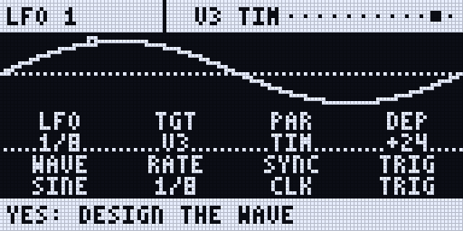
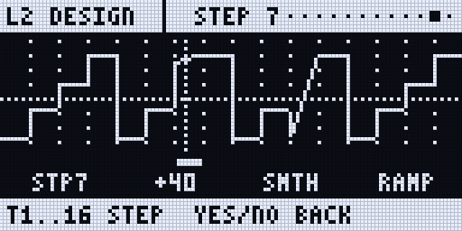
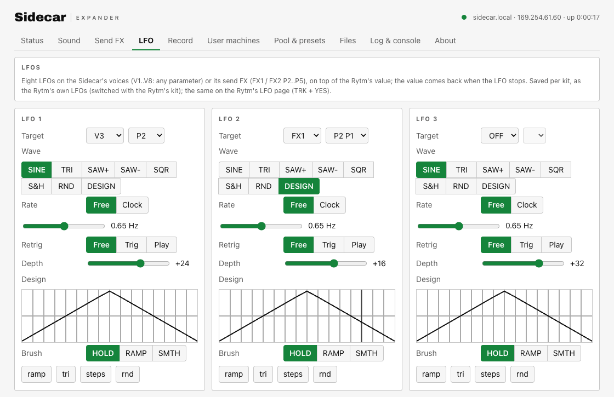
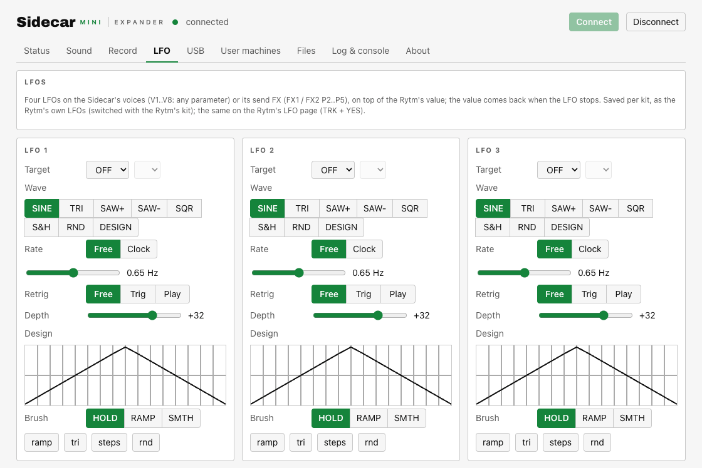

in testing (new in 0.1.0)

The Sidecar has its own LFOs: **8 on the Sidecar (Pi)**, **4 on the Sidecar Mini**. Each one modulates one parameter of a Sidecar voice or a send effect, on top of the value the Rytm sets (its knob or a p-lock). They are global, not tied to a track, and are **saved per kit**, like the Rytm's own LFOs.

## Targets

| Target | What moves |
|---|---|
| **V1..V8** | a Sidecar voice's parameters, by the machine's own names (HRM, CUT, STA, ...), user machines too |
| **FX1, FX2** | the send effect's P2..P5, by the effect's labels (HALO's DCY, CHORUS's DPTH, ...) |

Two LFOs on one parameter add up. Selectors that are read only at a trig (6-OP FM's PAT, DSP SAMPLE's SMP) do not follow an LFO. The LFOs never change the Rytm's own sound parameters, so a kit you save is never altered by a running LFO.

## Waves, rate, retrig, depth

- **Waves:** SINE, TRI, SAW+, SAW-, SQR, S&H, RND (smooth random) and **DESIGN**: 16 steps you draw, each a value and a shape: HOLD (the value until the next step), RAMP (a line to the next step) or SMTH (an S-curve to it). Presets: RAMP, TRI, STEPS, RND.
- **Rate:** free (0.02 to 20 Hz), or synced to the Rytm's clock, from 1/32 to 8 bars, with triplets and dotted values. Synced LFOs follow the song position while the Rytm plays.
- **Retrig:** FREE, TRIG (the target's trig) or PLAY (the Rytm's start).
- **Depth:** -64 to +63 steps around the Rytm's value; negative inverts the wave.

## The LFO page on the Rytm

Hold **TRK** and press **LFO** to open the remote pages straight on the LFO page (or LEFT from SIDECAR).

- **Main view:** the wave over one cycle with a dot at the phase. A **LFO** (which one), B **TGT** (OFF, V1..V8, FX1, FX2), C **PAR** (by name), D **DEP**, E **WAVE**, F **RATE** (FUNC: steps of 8), G **SYNC** (FREE / CLK), H **TRIG** (FREE / TRIG / PLAY).
- **YES** opens the **design view**: the 16 steps with the playhead. The trig keys **T1..T16** pick a step, B sets its value, C its shape, D applies a preset. YES or NO goes back.

<small>Screenshots: the emulator with the Sidecar's host code (mock values).</small>

## On the web page and the console

The Pi's web page and the Sidecar Mini's console have an **LFO** tab with the same settings per LFO: target, parameter, wave, rate, sync, retrig, depth, and the design steps.

<small>Screenshots: the 0.1.0 web UIs with mock data.</small>
