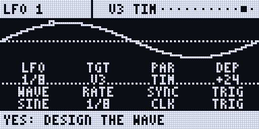
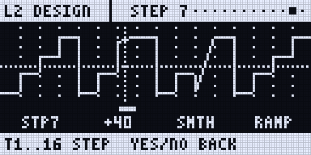
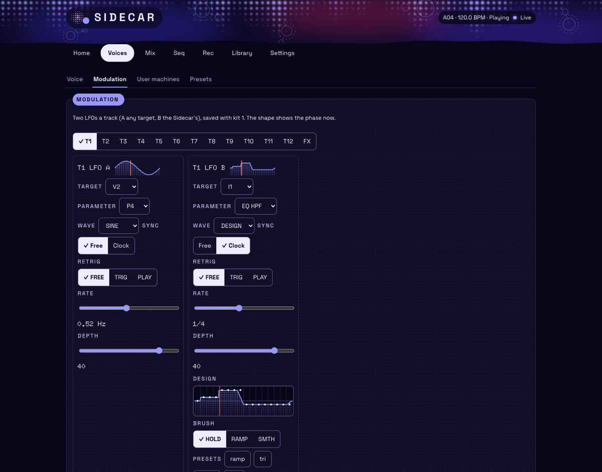

in testing (new in 0.1.0; saved per kit in `/.rytm/lfo/<project>/kNNN.txt` on the Sidecar's card)

The Sidecar has its own LFOs: **26** on the Sidecar (Pi), **4** on the Sidecar Mini. Each one modulates one parameter, on top of the value the Rytm sets (its knob or a p-lock). They are **saved per kit**, like the Rytm's own LFOs.

**Two LFOs a track (0.5.0).** Each of the 12 Rytm tracks and the FX track has an **A** and a **B** LFO: T1A, T1B, T2A ... T12B, FXA, FXB. Which track an LFO belongs to only decides where you find it on the LFO page. It can still aim at any target its kind allows.

- **A** may aim at anything: the Sidecar's own targets (the voices, the send effects, the inserts, the master, the sends and the OUT routes) and the Rytm's own parameters ([below](#lfos-on-the-rytms-parameters-050)).
- **B** aims only at the Sidecar's own targets. It never uses the link to the Rytm.
- The **Sidecar Mini keeps its 4 LFOs**, numbered 1 to 4 as before.

Since 0.3.0 they follow the Rytm's kit **SAVE** and **RELOAD** (YES + KIT / NO + KIT, or the KIT menu), the way poly patterns follow pattern SAVE and RELOAD: change an LFO, reload the kit, and the saved LFO comes back ([Saving and reloading](/sidecar-expander/using/key-combinations/#saving-and-reloading-the-rytms-own-keys)).

## Targets

| Target | What moves |
|---|---|
| **V1..V8** | a Sidecar voice's parameters (the engine's voices: V1 BD, V2 BT, V3 SD, V4 LT, V5 CH/OH, V6 MT/HT, V7 CY/CB, V8 RS/CP), by the machine's own names (HRM, CUT, STA, ...), user machines too |
| **FX1, FX2** | the send effect's P2..P5, by the effect's labels (HALO's DCY, CHORUS's DPTH, ...) |
| **I1..I8** (0.3) | a voice's [insert chain](/sidecar-expander/using/insert-fx/): INSERT A P1..P4 and INSERT B P1..P4, by the effect's labels |
| **B1..B3** (0.3) | an FX bus's insert chain, the same eight parameters |
| **O1..O8** (0.3) | a voice's [OUT route](/sidecar-expander/using/stereo-out/): LEV, PAN, WID |

On an insert or the OUT route an LFO is an offset on top of the knob or the step lock. in testing

## The target list (0.5.0)

On the LFO page, the **TGT** list runs: OFF, then the eight voices **V1..V8** one by one, then FX1, FX2, the inserts, the outs, the master and the sends. On an **A** LFO it goes on with one entry for each Rytm track (**RT1..RT12**) and **RFX**, the FX track, last. A **B** LFO's list ends before RT1.

A voice's **PAR** list shows only the parameters its machine names, by the machine's own names. A machine that names none (it has not reported yet, or a user machine without labels) lists all 16, so a voice is never left without a list. On **SAMPLER** the list starts at TUNE (TUNE FINE SMP PLAY STRT END LOOP LEV), with no empty P1..P8. When you pick a voice, PAR lands on P2 if the machine names it, else on its first named parameter. The web page's PAR list follows the same rule.

A kit or project that stored a parameter the machine does not name still loads it, and the list keeps that row until you move PAR off it.

Two LFOs on one parameter add up. Selectors that are read only at a trig (6-OP FM's PAT, DSP SAMPLE's SMP) do not follow an LFO. On a [poly track](/sidecar-expander/using/sequencer/#p-locks-on-poly-steps), an LFO on a locked parameter moves around the lock. A kit you save is never altered by a running LFO.

## Waves, rate, retrig, depth

- **Waves:** SINE, TRI, SAW+, SAW-, SQR, S&H, RND (smooth random) and **DESIGN**: 16 steps you draw, each a value and a shape: HOLD (the value until the next step), RAMP (a line to the next step) or SMTH (an S-curve to it). Presets: RAMP, TRI, STEPS, RND.
- **Rate:** free (0.02 to 20 Hz), or synced to the Rytm's clock, from 1/32 to 8 bars, with triplets and dotted values. Synced LFOs follow the song position while the Rytm plays.
- **Retrig:** FREE, TRIG (the target's trig) or PLAY (the Rytm's start).
- **Depth:** -64 to +63 steps around the Rytm's value; negative inverts the wave.

## The LFO page on the Rytm

Hold **UP** and press **LFO** to open the remote pages straight on the LFO page, or pick LFO in the SIDECAR MENU (UP + YES, then YES).

- **UP + LFO shows the selected track's two LFOs** (A and B) in 0.5.0. **LEFT / RIGHT** go between A and B (the same as knob A). **FUNC + A** steps to another track and the page stays there until the Rytm selects a track again. The FX track's pair is reached with FUNC + A.
- **The page replaces the Rytm's page** like SRC: no page dots and no siblings. In the design view LEFT / RIGHT step the design step. Leave with **NO** (from the design view, NO goes to the main view first) or **UP + LFO** again; leaving drops the design view.
- **Main view:** the wave over one cycle with a dot at the phase. A **LFO** (which one), B **TGT** (the [target list](#the-target-list-050), with I1..I8, B1..B3 and O1..O8 since 0.3), C **PAR** (by name), D **DEP**, E **WAVE**, F **RATE** (FUNC: steps of 8), G **SYNC** (FREE / CLK), H **TRIG** (FREE / TRIG / PLAY).
- **YES** opens the **design view**: the 16 steps with the playhead. The trig keys **T1..T16** pick a step, B sets its value, C its shape, D applies a preset. YES or NO goes back.

<small>Screenshots: the emulator with the Sidecar's host code (mock values).</small>

## LFOs on the Rytm's parameters (0.5.0)

An **A** LFO can move the Rytm's own sound parameters: pick **RT1..RT12** (a track) or **RFX** (the FX track) as the target, then a parameter. The list is in [The Rytm's own parameters](/sidecar-expander/using/rytm-params/). The LFO adds an **offset**, in steps, on top of the Rytm's value. The kit is never written.

- **No limit on the number of LFOs** on the Rytm, but the link has room for about 16 KB/s. Thirteen A LFOs at 20 Hz use about 12.6 KB/s.
- **When the link is full,** the LFO page's footer says `RYTM LINK FULL: SLOWER`, and the touchscreen and the web page's LFO tab show the same warning. The LFOs then update more slowly, the oldest first, and none starves. A p-lock or a release always keeps its priority.
- **Whole values only:** an LFO cannot move a list word (a wave, a filter type) or another LFO's destination.
- **A saved file** from a build before the two LFOs a track is read as it is.
- The XY pad and MIDI learn reach the Rytm's own parameters too.

## Old kits, rollback and numbers

- **Old kits.** A kit saved with 8 numbered LFOs loads as before: old LFO 1 becomes track 1's A, with the same target, and so on. The next save writes the new names (T1A ... FXB).
- **After a rollback or downgrade** to an older Sidecar build, the LFOs show OFF. The files are kept, so going back to 0.5.0 brings them back. The older build does not read the new names, and it leaves the files alone.
- **Console numbers.** In the console, `lfo=N` counts the 26 LFOs in list order: `lfo=1` is T1A, `lfo=2` is T1B, `lfo=3` is T2A. A numbered line **in an old file** is different: line N there means T<N>A. You can use names instead: `lfo=T3B:dep:-12`. The console's `lfo` prints a summary of all 26.

## On the web page and the console

The web page has an **LFO** tab with the same settings per LFO: target, parameter, wave, rate, sync, retrig, depth, and the design steps. In 0.3.0 its target list has the I, B and O targets too. In 0.5.0 it shows a bar of tracks (T1..T12, FX) with that track's two LFOs, and it follows the track you select on the Rytm. Neither list has Rytm parameters, and a voice's PAR list shows only the parameters its machine names.

<small>Screenshot: the 0.1.0 web page with mock data.</small>

The console's `lfo` prints a summary; `lfo=N:KEY:VALUE` sets one LFO, N being 1..26 or its name (for example `lfo=1:tgt:v3`, `lfo=T3A:dep:20`, `lfo=1:pre:tri`). `lfo=1` is T1A and `lfo=2` is T1B ([Old kits, rollback and numbers](#old-kits-rollback-and-numbers)). A and B both refuse a Rytm target.
