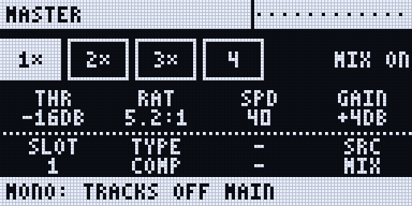
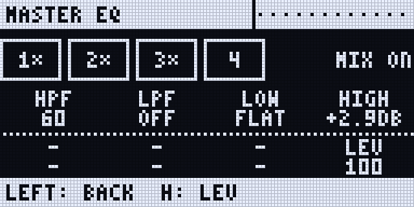
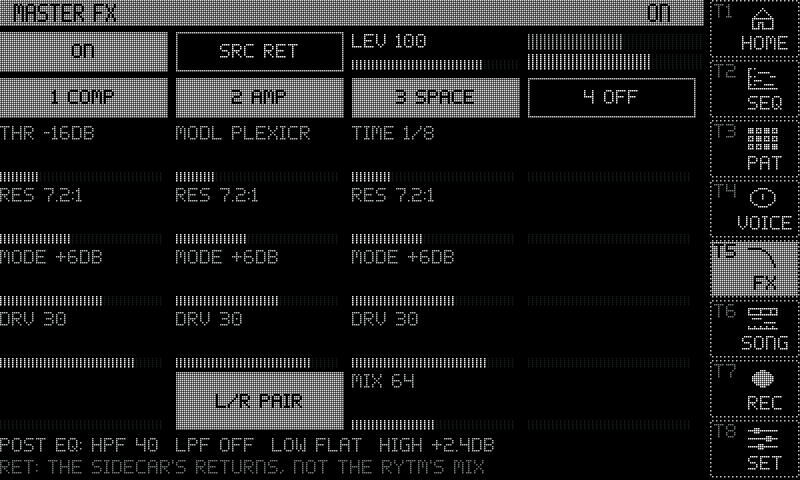
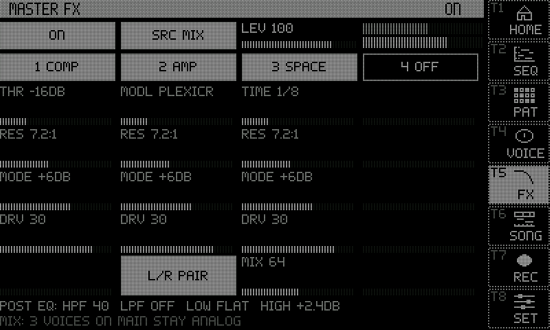

New in 0.4.0. **Master FX** is one stereo chain at the very end: four effect slots in a row, then a POST EQ, then a level, then a limiter. It runs on the Pi and comes back on the Rytm's POST return, after the Rytm's own effects. The Rytm's delay and reverb stay outside it.

## The chain

| Part | What it does |
|---|---|
| **Slots 1..4** | an effect each, in order. Every [insert TYPE](/sidecar-expander/using/insert-fx/#effects) works, [SAT](/sidecar-expander/using/insert-fx/#sat-tape-console-soft) among them (tape on the mix is what it was built for). The send effects CHORUS, COMB, SPACE, RINGS, CLOUD and HALO work as inserts too, two of them at a time, each with a MIX knob (127: only the effect). AMP runs one capture on both sides, or an L/R pair (two captures, one a side); the master has two AMPs of its own, apart from the voices' |
| **POST EQ** | HPF, LPF, LOW and HIGH after the slots |
| **LEV** | the chain's output, 0..127, 100 is unity |
| **The limiter** | last on the output: one gain on both sides, so the stereo image holds, 1 ms ahead of the peaks, 100 ms release. Below its ceiling the sound comes out unchanged, 1 ms later. It runs whenever the chain plays, or in SRC MIX |
| **BYPASS** | crossfades over 10 ms. The chain keeps running, so tails ring on and switching back is instant |

STUTTER is not offered: it would fold the chain to mono. With every slot off, the chain costs nothing.

## SRC: what goes through it

The Sidecar can add to the Rytm's output but cannot take anything out of it, so there are two modes, saved per kit:

| | **SRC RET** (the default) | **SRC MIX** (through mode) |
|---|---|---|
| In the chain | the Sidecar's voices on PRE and POST, the send effect returns, bus 3, the computer's audio | all of that, and every Rytm track you take off **ROUTE TO MAIN** (GLOBAL > AUDIO ROUTING, or the kit's TRACK ROUTING), after its own filter, amp and drive |
| Not in the chain | the Rytm's analog mix; voices on TRK | the Rytm's delay and reverb, and any track left on main, which stays analog |
| The Rytm's distortion and compressor | as ever on the analog mix | hear only the Rytm's effect returns routed PRE: the chain's COMP is now the bus compressor |
| Delay | about 3 ms on what goes through the chain | analog tracks about 6 ms later, plus the chain's |

**In SRC MIX** the Rytm tells the Sidecar each track's **PAN** (p-locks and LFOs included) and its ROUTE TO MAIN, so every track is panned as on the Rytm, and a track still on main is left out of the sum, so nothing doubles. Filter, amp, drive, LEVEL, velocity, accent and MUTE act before the Sidecar takes the track, as they always do. This needs the Rytm firmware 0.4.0; the page's bottom line says what it is doing (`MIX: 3 VOICES ON MAIN STAY ANALOG`).

**STEM TRIM** lowers every Rytm track before the sum, 0 to -24 dB, default -6. A loud kit can ask far more of the main output than it has; the trim sets how hard the chain is driven and how much the limiter has to take. Set it on the web page or the console.

Bypass in SRC MIX keeps the mix: the tracks stay on the main output, with the limiter, and only the chain leaves.

## Saved per kit

The slots, their TYPEs and knobs, the POST EQ, LEV, SRC, BYPASS and the STEM TRIM are saved with the kit, in the Sidecar's insert file for it. A kit without master FX plays and saves exactly as before.

## On the Rytm: the MASTER page

**MASTER** is one of the Sidecar's pages: UP + YES, then LEFT / RIGHT along the ring, or YES on SIDECAR for the SIDECAR MENU. It has no UP + key of its own.

| Key or knob | |
|---|---|
| **A..D** | P1..P4 of the slot shown |
| **E** SLOT | which slot the page shows, 1..4 |
| **F** TYPE | that slot's effect |
| **G** | MIX for a send effect type, MODE for AMP (one capture or an L/R pair) |
| **H** SRC | RET or MIX |
| **YES** | BYPASS on and off |
| **RIGHT** | the EQ view: A..D HPF, LPF, LOW, HIGH, H LEV. LEFT goes back |

## On the touchscreen and the web page

**Touchscreen:** Settings > Send FX > **Master**, at every screen size. Tap a TYPE for the next, ON, SRC and AMP's mode; the knobs are shown and set from the Rytm or the web page.

**Web page:** the **Send FX** tab has a Master section with every control, the **STEM TRIM** and the limiter's reading (how many dB it takes off).

## Console

`mfx` shows the chain. `mfx=byp:0|1`, `mfx=src:ret|mix`, `mfx=lev:V`, `mfx=trim:DB` (0 or -1..-24), `mfx=S:type:T`, `mfx=S:p1..p4:V`, `mfx=S:mix:V`, `mfx=S:pair:0|1`, `mfx=S:off` (S is the slot, 1..4), `mfx=eq:hpf|lpf|low|high:V`, `mfx=eq:off`, `mfx=reset`, and `mfx=stats` for the load and the limiter.

## Limits

- **No p-locks and no LFOs** on the master chain yet.
- **The Rytm's delay and reverb cannot join it.** The Rytm's main return already holds the Sidecar's own output, so sending it through the chain again would feed back.
- Through mode without the Rytm firmware 0.4.0: every track is summed in the centre (mono), and you must take all of them off main yourself or they double.
