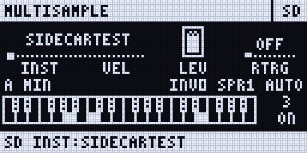
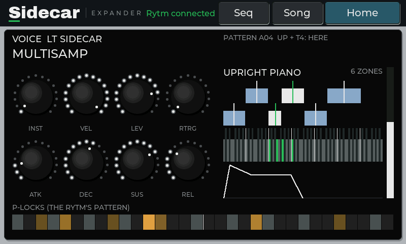
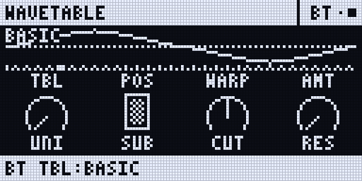
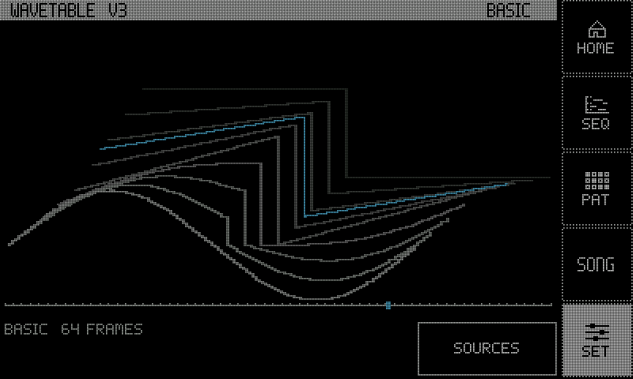
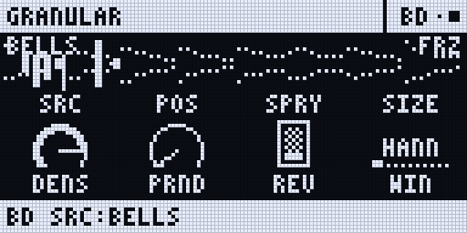
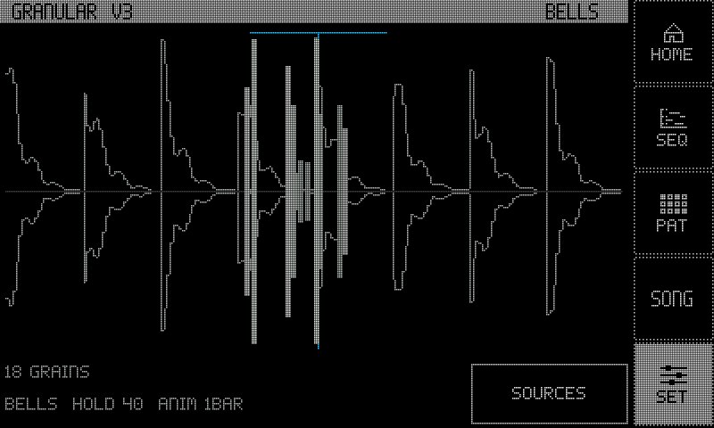
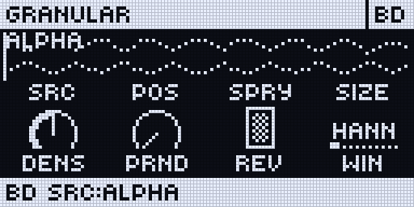
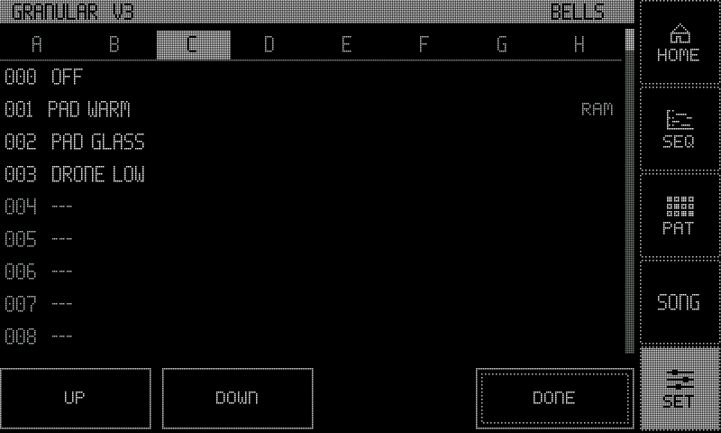
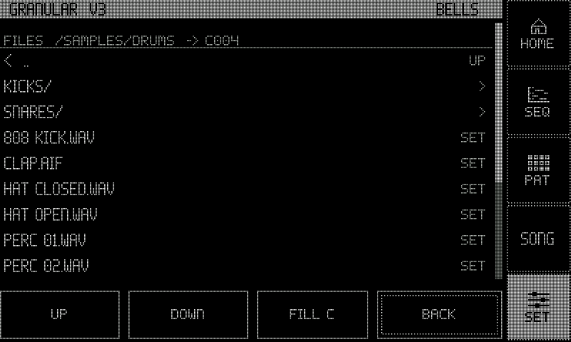

:::caution[0.3 test line]
New in the 0.3 test line (Rytm build `rui1039`, Sidecar on the Pi). Not in the 0.2.0 release. Built and tested in the emulator and on the Mac; not yet confirmed on a real Rytm unless marked. Sidecar (Pi) only.
:::

Three new machines join the machine list on every track, after DSP SAMPLE: **WAVETABLE**, **GRANULAR** and **MULTISAMPLE**. All three are polyphonic, play chords from one trig, and can be [seq tracks](/sidecar-expander/using/sequencer/). Like every Sidecar machine, they play through the track's analog filter and amp. in testing

## Chords on page 2

6-OP FM, MULTISAMPLE, WAVETABLE and GRANULAR share four chord knobs on the SMPL page, E..H:

| Knob | Values |
|---|---|
| CHD | OFF MAJ MIN SUS2 SUS4 7 MAJ7 MIN7 DIM AUG 6 MIN6 9 ADD9 MIN9 5: the chord on the trig's note; OFF plays one note |
| INV | INV0..INV3: the lowest notes moved an octave up |
| SPR | SPR0..SPR2: the voicing opened over 1..3 octaves |
| VOI | AUTO, 1..6: the number of notes (more repeat the chord an octave up) |

Each can be p-locked per step on the Rytm, so a normal Rytm track can play a chord per step. On 6-OP FM, E..H were unused before, so old kits play as they did.

Live chords: with CHRO on, chords played on the pads sound at once; with RECORD + PLAY each chord is written to its step as the NOTE plus CHD / INV / SPR / VOI locks.

| Machine | Notes per voice | Notes in all |
|---|---|---|
| 6-OP FM | 6 | 24 |
| MULTISAMPLE | 16 | 64 |
| WAVETABLE | 8 | 32 |
| GRANULAR | 6 | 24 |

## MULTISAMPLE

A multisampled instrument player. Instruments are **SFZ** files (a subset of the format) with WAV or AIFF samples of any common depth and rate: key and velocity zones, layers, round robin, loops, release samples. Samples **stream from the SD card** while they play: only the first half second of each sample is in memory.

| Knob | SRC page (A..H) | SMPL page (A..H) |
|---|---|---|
| A..D | INST (the instrument), VEL (velocity sensitivity), LEV (100 = unity), RTRG (release samples OFF / ON) | TUNE (semitones), FINE, STRT (start offset), LOOP (AUTO / OFF / ON) |
| E..H | ATK, DEC, SUS, REL (64 = the instrument's own envelope) | CHD, INV, SPR, VOI |

- Put instruments in `/MULTISAMPLE` on the card: `/MULTISAMPLE/<folder>/<name>.sfz` with its samples. The web page's Files tab uploads a whole folder; the list rescans.
- The SRC page on the Rytm shows the instrument's name. The touchscreen's VOICE page shows its zones on a keyboard and the envelope.
- Memory: 8 instruments are kept loaded, up to 64 MB each; the least recently used is replaced. A trig before its instrument has loaded plays when it has (within 250 ms).
- The card's speed limits how many notes can stream at once, more so while the recorder writes. A card test on the Sidecar measures it.

## WAVETABLE

A band-limited wavetable synth: no audible aliasing at any pitch.

| Knob | SRC page (A..H) | SMPL page (A..H) |
|---|---|---|
| A..D | TBL (the table), POS (the frame position), WARP (OFF SYNC PWM FM), AMT (the warp's amount) | ATK, DEC (also the release), SUS, ENV (the mod envelope onto POS) |
| E..H | UNI (unison: up to 7 oscillators, detuned), SUB (a sine an octave down), CUT (low-pass below 64, open at 64, high-pass above), RES (resonance and drive) | CHD, INV, SPR, VOI |

- Tables: six built-ins (BASIC PWM VOCAL ORGAN FM SYNC, 64 frames each), then the card's `/WAVETABLES/*.wav` and `/WAVETABLES/<folder>/*.wav`, in the format Serum, Vital and others write (frames of 2048 samples, or the size in the file's `clm ` chunk, or 1024 / 512 / 256, or one single cycle). Up to 256 frames, 8 MB a file.
- The SRC page on the Rytm draws the frame at POS and the table's frames; the touchscreen draws the table as a stack of frames.

## GRANULAR

A granular machine on card samples or on the Rytm's live audio.

| Knob | SRC page (A..H) | SMPL page (A..H) |
|---|---|---|
| A..D | SRC (the source), POS (where the grains read), SPRY (position and timing jitter), SIZE (5 ms .. 1 s) | ATK, REL, HOLD (0..99, then FRZ), ANIM (OFF, 8BAR .. 1/16) |
| E..H | DENS (1 .. 200 grains a second), PRND (random pitch per grain), REV (reverse probability), WIN (HANN TRI TUKEY PERC) | CHD, INV, SPR, VOI |

- **Sources:** IN (the Rytm's AUDIO IN L + R), MAIN, the voice outputs BD SD RS-CP BT LT MT-HT CH-OH CY-CB (recorded live into a 5.5 s ring), two built-ins PAD and BELLS, then card samples (`/GRANULAR`, the sampler's takes, the DSP SAMPLE pool) and the library browser.
- **HOLD**: on a card sample, the playhead's speed (1x at 0, stopped at 99); on a live source, feedback. **FRZ** (120..127) stops the playhead or the live ring.
- **ANIM** moves the head, the grain size and the density in a cycle locked to the Rytm's clock (8 bars to 1/16).
- Each note is its own grain stream at its pitch (C4 plays the source as it is). Up to 64 grains a voice.
- Careful with MAIN or the track's own stem as a live source: they contain the voice's own output (a feedback loop).

## Source banks A..H

GRANULAR's SRC, WAVETABLE's TBL and MULTISAMPLE's INST pick from **8 banks of 128 sources**.

- **Bank A** is the list as it was: GRANULAR's live and built-in sources, WAVETABLE's built-in tables, then the files and the library. Existing kits play what they played.
- **Banks B..H** are fixed rows: row 000 is OFF (silence), rows 001..127 are slots you fill. An empty row is silent too. Filling never moves a row.
- The bank is part of the knob's value, so it is saved in the kit and in p-locks (also over a power cycle).

**Choosing on the Rytm (the bank list):** on the SRC page of a GRANULAR, WAVETABLE or MULTISAMPLE track, **turn knob A**. A list opens with the tabs `< A B C D E F G H >` and rows `000 OFF`, `001 name`, ...

| Key | In the list |
|---|---|
| LEFT / RIGHT | the bank |
| knob A, UP / DOWN | the row |
| YES | choose |
| NO | cancel, nothing changes |
| YES with trigs held (GRID REC) | lock the choice on those steps |

The SRC page then shows the source's name; a row the Rytm has no name for reads like `B005`.

**Filling banks:**

- **Touchscreen:** a GRANULAR or WAVETABLE track's machine view, **SOURCES**: tabs A..H over the rows. Tap a row with a source to pick it. Tap an empty row of B..H to open **FILES** aimed at that row: a file goes into it. **FILL** fills the bank's empty rows from a folder, in name order.
- **Web page:** Files tab, a folder's **Fill bank** (for GRANULAR, WAVETABLE or MULTISAMPLE, and the bank).
- MULTISAMPLE has no touchscreen list: fill its banks from the web page.

Files load into memory only when a voice selects them (GRANULAR and WAVETABLE keep 4, MULTISAMPLE 8; the least recently used is replaced). On the touchscreen and the Rytm's list, resting on a GRANULAR or WAVETABLE row for a moment previews it.

<small>Screenshots: rendered off-device by the Sidecar's own page code, with made-up data.</small>

## Limitations

- Sidecar (Pi) only.
- The bank list on the Rytm needs the Sidecar connected and drawing the SRC page. Without it, knob A steps one source a detent and keeps the bank.
- Bank A's row 000 is its first entry, not OFF (so old kits keep their sound).
- The Rytm holds one bank's names at a time; another bank's rows read `B005` until the Sidecar sends them.
- **MIDI:** with PARAM OUTPUT set to NRPN, the knob's NRPN carries the bank; in CC mode, CC 16 carries only the index (bank lost).
- Locks from the bank list need GRID REC. A source lock set on a seq step keeps bank A.
- A file loads at its first use, not when the project loads; the first trig may wait for it (up to 250 ms).
- MULTISAMPLE has no list on the touchscreen and no preview.
- FUNC + YES to load a sample into a bank slot from the Rytm is being fixed.
