:::caution[New in 0.3]
New in 0.3 (until 0.3.0 is released: the test line, Rytm build `rui1046` with the Sidecar's 0.3 test build). Built and tested on the Mac and in the emulator; not yet run on a Pi or a real Rytm. Sidecar (Pi) only. The pools replace the per-machine source banks and the DSP SAMPLE pool of the earlier 0.3 test builds; projects made with those open with the template below.
:::

Every project has three **POOL** lists: the sounds its tracks pick from, in fixed rows. The Rytm's knob stores a row, never a file name, so a kit or a p-lock plays the same row whatever you load. in testing

## The three lists

| List | Used by | A row holds |
|---|---|---|
| **SAMPLES** | GRANULAR's SRC, DSP SAMPLE's SMP, the sampler's takes | a WAV or AIFF file, a live input, a built-in |
| **WAVETABLES** | WAVETABLE's TBL | a WAV or AIFF file (any sample can be a table), a built-in |
| **INSTRUMENTS** | MULTISAMPLE's INST, the auto-sampler, the sampler's slice maps | an `.sfz` instrument with its samples |

Each machine sees only its own list.

- **8 banks, A..H, of 128 rows.** Row 000 of every bank is **OFF** (silence); rows 001..127 are yours. Rows never move: loading never renumbers, unloading leaves an empty row, and a lock on an empty row plays silence.
- **One row per file.** Loading a file that is already in the list goes to its existing row (`IN POOL C004` on the Rytm, `IN C001` on the touchscreen); nothing changes.
- **Inputs and built-ins** are rows without a file. SAMPLES: the live inputs `IN MAIN BD SD RS-CP BT LT MT-HT CH-OH CY-CB` (GRANULAR only; silent on DSP SAMPLE) and `PAD BELLS`. WAVETABLES: `BASIC PWM VOCAL ORGAN FM SYNC`. They come from the browser's `@INPUTS/` and `@BUILT-IN/` folders. To put a file in such a row, unload it first.

**A new project starts with:**

| List | Rows |
|---|---|
| SAMPLES | H001..H010 the ten inputs, H011 PAD, H012 BELLS; bank A empty |
| WAVETABLES | A001..A006 BASIC PWM VOCAL ORGAN FM SYNC |
| INSTRUMENTS | empty |

A new GRANULAR track points at A010 (empty, silent until you load something), WAVETABLE at A001 (BASIC), MULTISAMPLE at A000 (OFF).

## Choosing and loading on the Rytm

**The bank list.** On the SRC page of a GRANULAR, WAVETABLE or MULTISAMPLE track, turn **knob A**. On a DSP SAMPLE track, turn **SMP** (knob D of its SMPL page). Or press **UP + SRC** on any of these tracks: the list opens in one press. The list opens: tabs `< A B C D E F G H >`, rows `A000 OFF`, `A001 name`, and the row under the cursor with its state.

| Key | In the list |
|---|---|
| LEFT / RIGHT | the bank |
| the knob, UP / DOWN | the row |
| YES | choose the row |
| NO | cancel, nothing changes |
| YES with trigs held (GRID REC) | lock the row on those steps |
| **FUNC + YES** | open the card's browser, aimed at the row under the cursor |

**FUNC + YES** works in every bank. The browser's root shows the list's virtual folders (`@INPUTS/`, `@BUILT-IN/`) and the card's folders; a folder shows its subfolders and the files the list takes (`.wav .aif .aiff`, or `.sfz` for INSTRUMENTS). YES on a folder opens it, YES on a file puts it in the row (`SET C005`), NO goes up. Resting the cursor on a file already in the list previews it.

Refused, with the reason: row 000 (`000 IS OFF`), an input or built-in row (`BUILT-IN: UNLOAD FIRST`), a locked list (`POOL LOCKED`). A row in use asks first (below).

The bank is part of the knob's value, so it is saved in the kit and in p-locks, also over a power cycle. An old kit's DSP SAMPLE SMP reads as bank A.

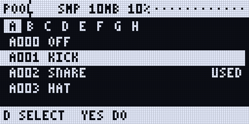

## The POOL page on the Rytm

A remote page for the whole pool: **UP + T13** (with a touchscreen connected, its POOL page opens instead), or POOL in the **SIDECAR MENU** (UP + YES, then YES). Its header shows the list and the pool RAM.

| Control | Does |
|---|---|
| knob A | the list: SAMPLES / TABLES / INSTR |
| knob B | the bank A..H |
| knob C, UP / DOWN | the row (FUNC: 8 at a time) |
| knob D | the action: SELECT, UNUSED, ALL, NONE, UNLOAD, REPLACE, UNDO |
| YES | does the action |

- **SELECT** toggles the row, **ALL** selects the bank's filled rows, **NONE** clears the selection.
- **UNUSED** selects the rows that hold a file and were never seen playing in this project (see the warning below).
- **UNLOAD** empties the selection (or the row). The file stays on the card.
- **REPLACE** opens the list's browser aimed at the row: YES on a file puts it in the row.
- **UNDO** brings back the last replace or unload of that list.

Rows show `RAM`, `LOADING`, `MISSING`, `CHANGED`, `LIVE`, `BUILT-IN` or the size, and `USED` for a row in use.

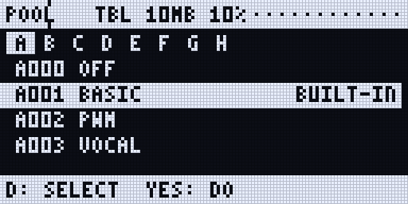
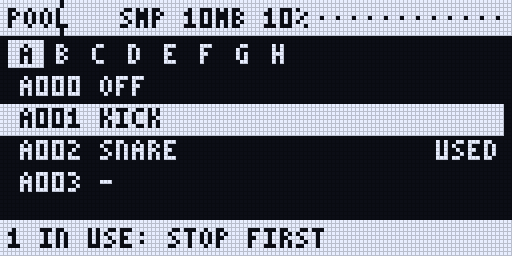
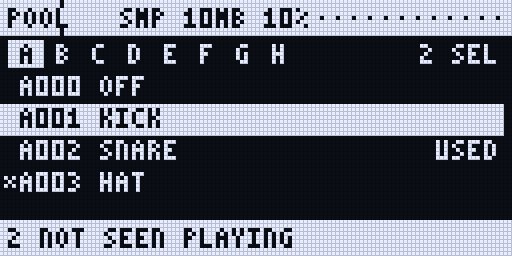
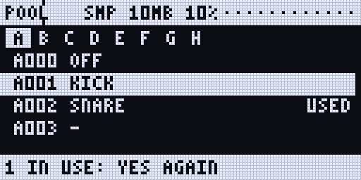
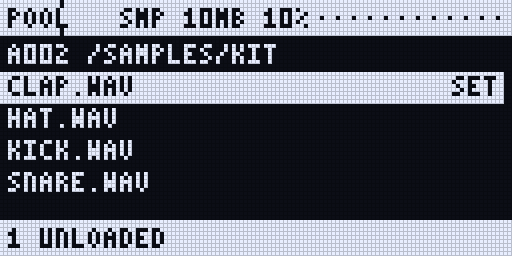
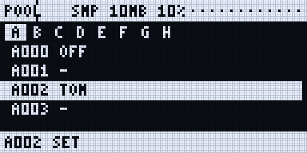

<small>Renders of the Rytm-screen pages: the Sidecar's own page code on the host, with made-up data.</small>

## On the touchscreen

- **The machine view's POOL** (UP + T4 on a GRANULAR, WAVETABLE or MULTISAMPLE track, then **POOL**): the voice's own list, tabs A..H, its rows with their states, and the pool RAM in the title. Tap a filled row: the voice plays it. Tap an empty row: **FILES** aimed at it (a file goes in, then the next empty row is aimed at), or **FILL** the bank's empty rows from a folder, in name order (SAMPLES and WAVETABLES).
- **Long press** a filled row: **REPLACE**, **UNLOAD**, **ACCEPT** (a changed file). **UNDO** shows in the message row after a change.
- **UNUSED**: the rows not seen playing, selected, with the warning; **UNLOAD N** asks first.
- **ALL POOLS** (or Settings > Pool) opens the **POOL page**: the same, with the three lists as tabs and their counts.

A row in use carries a mark: filled when voices play it now (`X3`: three voices), an outline when it was seen playing in this project.

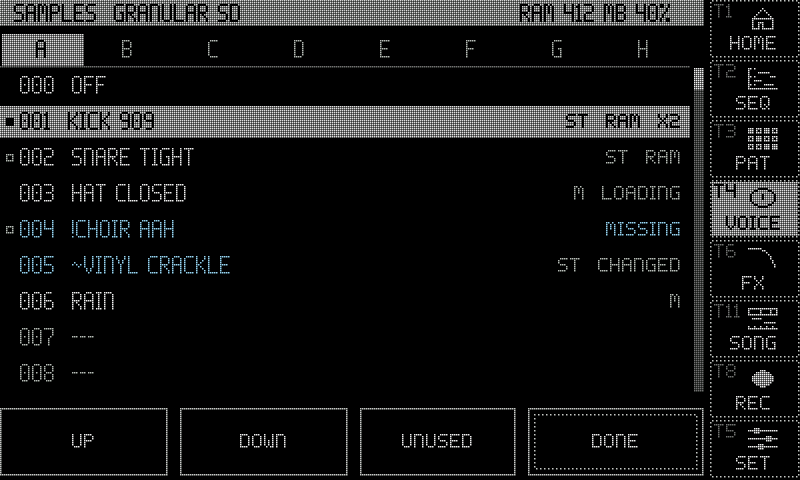
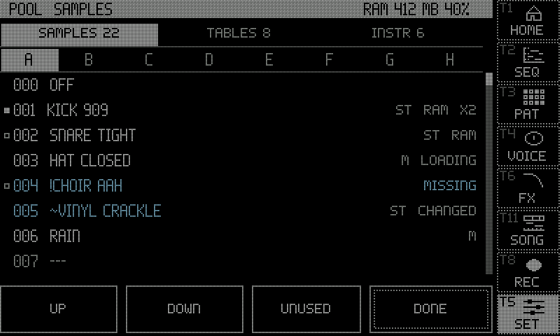
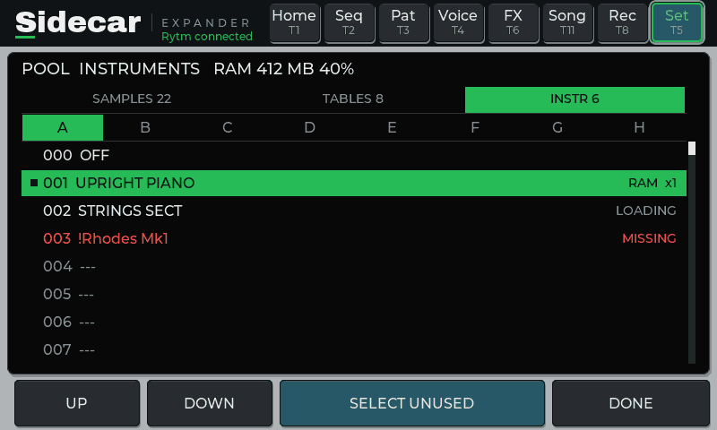

## On the web page

The **Pool** tab at `sidecar.local`: SAMPLES / WAVETABLES / INSTRUMENTS, banks A..H, the project and the pool RAM; per row the name, state, size, how often it played and the voices on it now. **Accept**, **Replace** (from a small file browser), **Unload**, **Select unused**, **Select none**, **Unload selected**, **Undo**.

On the **Files** tab: **+SMP** / **+WT** next to a WAV or AIFF and **+INST** next to an `.sfz` put the file into the first free row of the bank picked above the table. **Fill bank** on a folder fills that bank's empty rows in name order (SAMPLES and WAVETABLES; add instruments one by one with +INST). The tab that was "Pool & presets" is now **Presets**.

## A row in use

A row is **in use** when a voice plays it now, or when it was seen playing in this project. Replacing or unloading such a row:

- **asks first**: the Rytm's bank list `C012 USED 3: YES=SET` (a second YES sets it), the POOL page `2 IN USE: YES AGAIN`, the touchscreen `ROW C012 USED BY 3 SOUNDS.`, the web page a confirmation;
- **is refused while the Rytm plays**: `PLAYING: STOP FIRST`. Stop the Rytm first;
- **can be undone**, one level per list.

An empty row never asks.

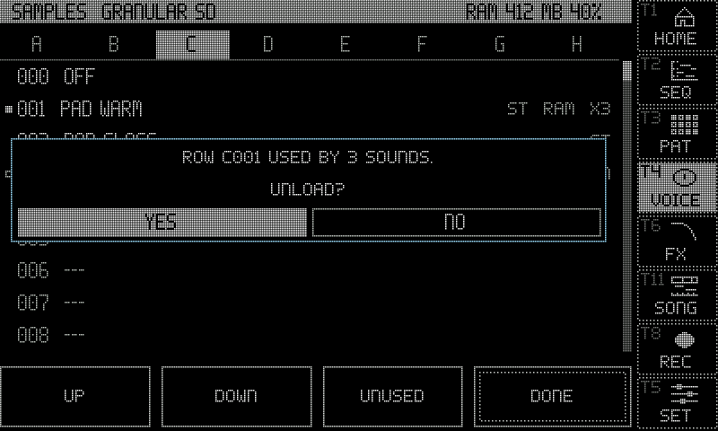

### SELECT UNUSED

The Sidecar cannot read the Rytm's kits or patterns, so it only knows what it has **seen playing** since the project was opened. A row locked on a step that has not played yet looks unused. Every surface says so: `NOT SEEN PLAYING - A RYTM LOCK MAY STILL USE IT`. Play the project through before you unload what UNUSED selects.

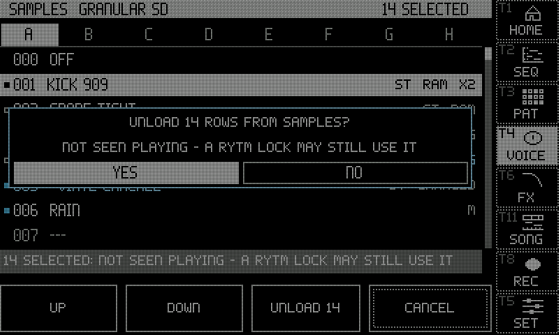

## ST and M: stereo samples

The pool lists tag each sample **ST** (stereo) or **M** (mono). A stereo file is kept in stereo in memory (twice the memory of a mono one). On its track a voice plays the sum of the two channels, as before; routed to [PRE or POST](/sidecar-expander/using/stereo-out/) it plays in stereo. `poolmono=1` in `cmdline.txt` sums stereo files at load instead: half the memory.

## The pool RAM

One shared memory for the samples of GRANULAR, DSP SAMPLE and MULTISAMPLE: a file used by two machines (or by an instrument and the SAMPLES list) is in memory once.

| Board | Default size |
|---|---|
| 2 or 4 GB (Pi 4B or Pi 5) | 1 GB |
| 8 GB | 3 GB |

- Set it with `poolram=MB` in `cmdline.txt`.
- Every POOL view shows it as MB and percent (`RAM 412 MB 40%`). WAVETABLE's table memory is counted in the figure.
- When it is full, the least recently used samples that no voice is playing make room.
- A sample longer than 87 s at 48 kHz is cut (`TOO LONG: FIRST 87 S`); a wavetable file is at most 8 MB (`TOO BIG: 8 MB MAX`).
- When a project opens, the SAMPLES rows it played most are loaded ahead, as far as there is free room. Tables and instruments load when a voice uses them.
- MULTISAMPLE keeps the first half second of each sample in memory and streams the rest; a row can be held whole ("always in RAM", see [Stereo and the OUT route](/sidecar-expander/using/stereo-out/#the-streaming-budget)).

## The sample library

The Sidecar keeps an index of every sample and instrument on its card, each known by a **fingerprint** of its content (a SHA-256 hash), with the path as a hint. A pool row points at a fingerprint, so:

- **a moved or renamed file is found again** and keeps playing (MOVED); the row's path is updated at the next save;
- **a missing file** is flagged: `!name`, MISSING, and the row is silent;
- **a changed file** (other content at the same path) still plays and is flagged: `~name`, CHANGED. **ACCEPT** (touchscreen, POOL page, web Accept) makes the row take the new content;
- [bundles](/sidecar-expander/using/projects-bundles/) never copy a sample twice: an import reuses a file with the same content wherever it is on the card.

After a boot the Sidecar reads its index (`/.rytm/library/`), walks the card's folders and fingerprints what is new or changed, a small piece at a time on its own core: about 2-3 minutes a GB the first time on a big card, afterwards only changes. While the Rytm plays it only reads in small pieces; while the recorder records it stops. Files the Sidecar writes itself (uploads, takes, imports) are fingerprinted as they are written. The Overbridge recorder's takes in `/Recordings` are indexed but fingerprinted only when used.

**Where to see it:** the web page's **Status** tab, *Storage* (`Library 48,213 files (18 GB), 61 % hashed, ... 212 duplicates`), and the touchscreen's **SIDECAR STATUS** page (`LIBRARY 48K FILES 61%`). After copying files onto the card on a computer, `lib=rescan` on the console walks the card again.

## Files

The lists are per project: `/.rytm/projects/<project>/samples.pool.txt`, `wavetables.pool.txt`, `instruments.pool.txt`, and `pool-used.txt` (what was seen playing). They are written a moment after an edit. A list file from a newer Sidecar, or a damaged one, is **locked**: shown, never written over (`POOL LOCKED`). The pool files of the earlier 0.3 test builds stay on the card and are not read.

## Limitations

- Sidecar (Pi) only. Not yet run on hardware.
- UNUSED knows only what played since the project was opened (above).
- No FUNC override while the Rytm plays: stop it to replace or unload a row in use.
- FILL is not offered for INSTRUMENTS; add each `.sfz` on its own.
- Folder instruments (WAVs without an `.sfz`) are not offered.
- DSP SAMPLE plays a file outside `/Samples` from memory only (not streamed), and a take written since the last boot only after the next boot.
- An instrument is known by its `.sfz` file's own fingerprint: two `.sfz` files with the same text are one entry.
- Paths of 160 characters or more are not indexed by the library.
