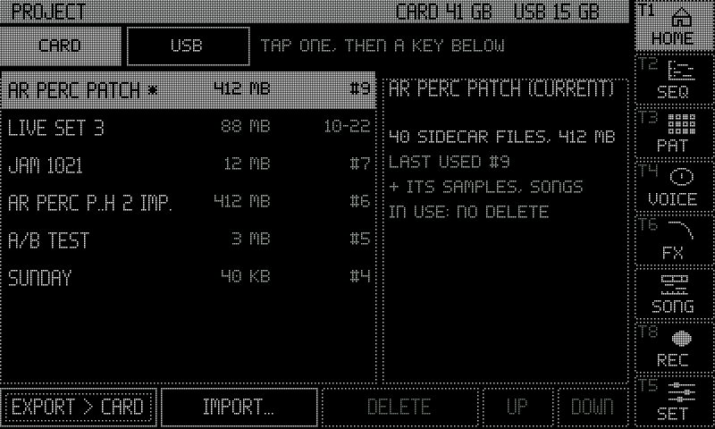
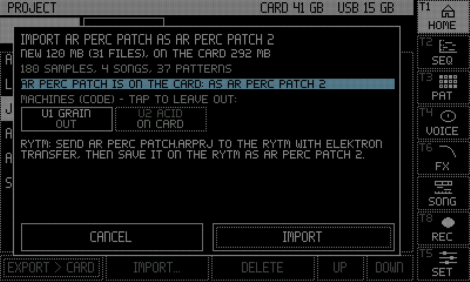
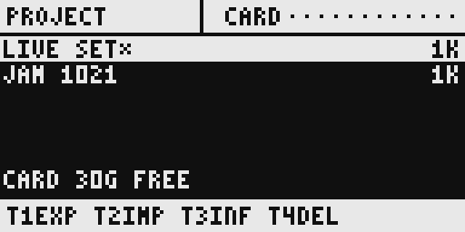
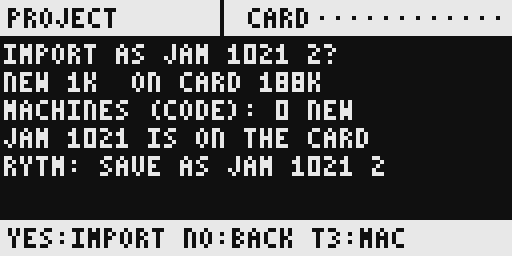
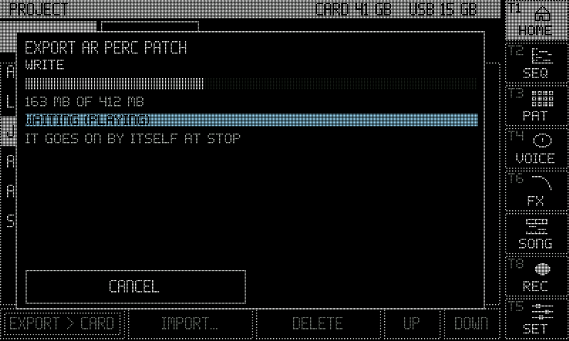
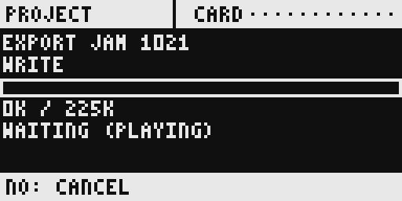
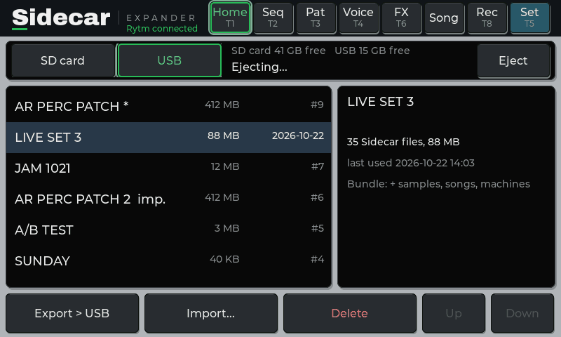

:::caution[New in 0.3]
New in 0.3 (until 0.3.0 is released: the test line, Rytm build `rui1045` with the Sidecar's 0.3 test build). Built and tested on the Mac and in the emulator; not yet run on a Pi. Sidecar (Pi) only.
:::

The Sidecar keeps a project's files on its own card, found by the Rytm's project name. A **bundle** puts one project in one file, `<NAME> <YYYYMMDD-HHMM>.sidecar.zip`: move it to another Sidecar (Pi 4B or Pi 5) or keep it as a backup, and import it there with the same sounds in the same rows, the same poly tracks and songs. <span class="sc-test">in testing</span>

## What a bundle holds

| In the bundle | Not in the bundle |
|---|---|
| the project's Sidecar files: [POOL lists](/sidecar-expander/using/pools/), poly tracks (working and saved state), LFOs, insert and OUT settings, user slot maps, JUNO / FM lists | the Overbridge recorder's takes (`/Recordings`) |
| every sample and instrument its pools use, once each | this Sidecar's own settings (display, keys, Wi-Fi; never a password) |
| its song takes and the sampler's takes | the FX return route (noted, not applied) |
| the user machines it plays, at their exact version | |
| the Rytm project file, if you add it (below) | |

A bundle is a normal zip: it opens on any computer.

## Where

Three places drive the same job; one job runs at a time.

### The touchscreen: PROJECT

Tap the **PROJECT** panel on HOME.

- The list: every project on the card (the Rytm's current one `*`, an imported one the Rytm has not named yet `IMP.`), the size of its Sidecar files, when it was last used. Tap one; its details show on the right.
- The picker at the top: **CARD** or a mounted **USB** stick. Export writes there; import looks there.
- **EXPORT > CARD / USB**: the selected project's bundle into `/Bundles` on the card or `/SIDECAR` on the stick.
- **IMPORT...**: the bundles there. Tap one, **IMPORT IT**: every byte is checked first, nothing is written yet. Then the summary (below): **IMPORT** or **CANCEL**.
- **DELETE** (never the current project): a confirmation whose DELETE key comes on after a second. Only the project's Sidecar files go; samples stay on the card.
- **EJECT** (a stick picked): stops a job on the stick, then unmounts it.




### The Rytm: the PROJECT page

Open the remote pages (TRK + YES), YES for the **SIDECAR MENU**, then **PROJECT** (or LEFT from SIDECAR: it is the last page).

| Control | Does |
|---|---|
| knob A, UP / DOWN | the project |
| knob H | CARD or a USB stick |
| T1 | EXPORT (YES / NO) |
| T2 | IMPORT: the bundles there; YES checks the one under the cursor, then the summary: YES imports, NO cancels, T3 leaves the bundle's machines out or puts them back |
| T3 | INFO |
| T4 | DELETE (YES, then YES again on SURE?) |
| T5 | EJECT the stick |
| NO | cancels a running job |

The trig LEDs show the keys: T1 blue, T2 green, T4 red, T5 amber when a stick is there.




### The web page: Project tab

At `sidecar.local`, the **Project** tab:

- **Projects**: **Download** (the browser saves the bundle; nothing is written to the card), **To card** (`/Bundles/`), **To USB** (the stick's `/SIDECAR`), **Rytm file…** (add the Rytm project file you exported with Elektron Transfer; it goes into that project's next export), **Delete**.
- **Bundles on the card**, **Import a bundle…** (or drop one on the list): it is uploaded to `/Bundles/incoming/`, checked, then summarised.
- **USB stick**: the mounted sticks with their free space, **Eject**, and the stick's bundles with **Import**.

On plain `http://sidecar.local` a browser download is collected in memory first, up to 1 GB. For a bigger bundle use **To card** or **To USB**.

## Importing

The summary shows, before anything is written:

- **the name** it imports as: its own, or `NAME 2` when the card has a project of that name (on the web page you can type another, or replace the existing one: it is exported to `/Bundles/.backup/` first);
- **how much is new** and how much is already on the card: a sample with the same content is never copied twice, wherever it is (the [sample library](/sidecar-expander/using/pools/#the-sample-library));
- **the machines (code)** in the bundle: installed by default, tap one to leave it out. A slot plays the exact version its project names; another version installs beside the one you have;
- **the Rytm step**: "Send `<file>` to the Rytm with Elektron Transfer, then save it on the Rytm as `<NAME>`." The Sidecar never sends anything to the Rytm. Save the Rytm project under exactly that name: the Sidecar finds its files by the name.

After the import: **"Save your Rytm project as NAME 2"**.

## Safety

- **Checked before written.** An import reads the whole bundle and checks every file's fingerprint first. One wrong byte refuses it, and nothing is written.
- **All or nothing.** New files are staged, read back and checked, then put in place in one step. A power cut during an import leaves the card as it was before or as it is after, never in between.
- **Nothing is overwritten by accident.** A name that exists imports as `NAME 2`; a replace backs up the old project first. The current project cannot be replaced or deleted.
- **Never disturbing the audio.** The job runs on the Sidecar's own core in small pieces. While the Rytm plays (or a song take records) it only reads, slowly, and shows **WAITING (PLAYING)**; while the recorder records it stops (**WAITING (RECORDING)**). It goes on by itself.
- **Deleting** a project removes its Sidecar files only; its samples stay on the card.




## USB sticks

- Format the stick **FAT32 with the MBR scheme** (see [Storage](/sidecar-expander/using/storage/#formatting-a-usb-drive)). exFAT and GPT do not mount in this build.
- Plug it into a blue USB 3 port on the Pi 4 (the Rytm stays on a black USB 2 port), any port on the Pi 5.
- Export writes `<project> <date>.sidecar.zip` into the stick's `/SIDECAR` folder (made when missing). Import reads a bundle straight from the stick (its `/SIDECAR` and its root).
- Nothing is read from or written to the stick while the Rytm plays or something records: the job waits for STOP.
- **Eject** before pulling it: the touchscreen's EJECT, the Rytm page's T5, the web page's **Eject**. Pulled during a job, the job stops: an import leaves the card exactly as before; an export leaves a `.part` file on the stick (delete it on a computer).



## Renamed on the Rytm

The Sidecar finds a project's files by the Rytm's project name. When the Rytm names a project that has no Sidecar files right after one that had some (a SAVE PROJECT AS, a rename), the Sidecar asks first, on the Rytm's PROJECT page (it opens by itself):

```
RENAMED ON THE RYTM?  FROM <OLD>  TO <NEW>
n SIDECAR FILES THERE: YES MOVES THEM ACROSS
YES: MOVE  NO: NEW PROJ
```

- **YES** moves every per-project file (poly tracks, pool lists, songs, LFOs, inserts, slot maps) from the old name to the new one. Only names change on the card; nothing is copied or deleted. If a move fails half way, the files already moved go back.
- **NO** (or no answer within two minutes) switches as before: the new name starts empty, the old project keeps its files.
- It is a **move**: after a SAVE PROJECT AS copy, YES leaves the original without its Sidecar files. Answer NO to keep them with the original (the copy starts empty), or export the original as a bundle first.
- A NEW PROJECT made on the Rytm right after one with files is asked about too: answer NO.

## Limitations

- Sidecar (Pi) only. Not yet run on a Pi: the hardware runs are next.
- The project list's size counts the project's Sidecar files only, not the samples it uses.
- The Rytm project file is taken from the card's `/Bundles/Rytm` only.
- An interrupted export is not resumed: its `.part` stays and is listed as incomplete; export again.
- The current project cannot be replaced by an import: switch the Rytm to another project first.
- A bundle holds at most 4 GiB.
- The touchscreen's summary shows up to four of a bundle's machines (the web page shows all).
