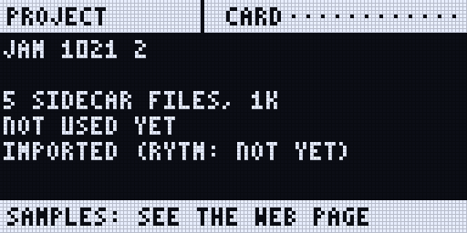
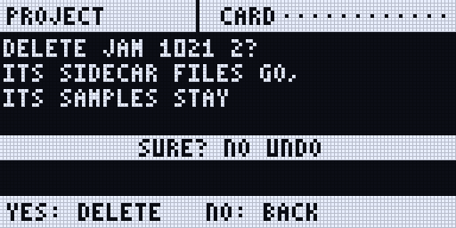

:::caution[New in 0.3.0]
Sidecar (Pi) only. Projects by slot and the trash need the Rytm firmware 0.3.0. First run on a real Rytm and a Pi 4 on 2026-10-29 (the move of existing projects to their slots, with no failures); the rest is tested on the Mac and in the emulator. <span class="sc-test">in testing</span>
:::

The Sidecar keeps each project's own files on its card: the poly tracks, the POOL lists, the LFO and INSERT settings, the songs, the user slot maps, the JUNO / FM lists. They belong to the Rytm's **project slot**. A **bundle** puts one project in one file, `<NAME> <YYYYMMDD-HHMM>.sidecar.zip`: move it to another Sidecar (Pi 4B or Pi 5) or keep it as a backup.

## Projects belong to the Rytm's slot

The Rytm has 128 project slots. The Sidecar files each project under its slot number, not its name.

| On the Rytm | What happens to the Sidecar's files |
|---|---|
| **RENAME** a project | nothing: the files stay with the slot |
| **SAVE PROJECT AS** / **SAVE TO** another slot | the project's Sidecar files are copied to that slot |
| **COPY** a project, **PASTE** it onto another slot | the same: the copy gets the Sidecar files too |
| **CLEAR**, **DELETE** (or a new project made over a slot) | the slot's Sidecar files go to the [project trash](#the-project-trash), never deleted at once. For the project that is loaded they stay until its next save or load |
| two projects with the same name (two called PRESETS, say) | two projects: each slot has its own files |

- A SAVE AS or SAVE TO **onto a slot that already had Sidecar files** moves those old files to the trash first.

You do not have to do anything for this. The copies run in the background without a glitch in the audio.

**The first time with the 0.3.0 firmware**, the Sidecar moves your existing projects (which were kept by name) to their slots by itself. A name that is in two slots cannot be placed by itself: when you open one of them, the PROJECT page asks once:

```
FILES FROM BEFORE SLOTS
NAME PRESETS
FOR SLOT 002?
5 SIDECAR FILES THERE
NO: ANOTHER SLOT MAY
```

**YES** takes the files for this slot. **NO** starts this slot empty and never asks again for it; the other slot with that name may still take them. No answer within two minutes counts as NO.

If a slot's name changes without the Rytm saying why, the PROJECT page asks `SLOT 005: A NEW NAME ... KEEP ITS SIDECAR FILES?`: **YES** keeps them, **NO** moves them to the trash.

## The project trash

A cleared or deleted project's Sidecar files go to the **trash**. It keeps the newest **64** entries; when a 65th comes, the oldest is removed for good. Samples are never in the trash: they stay on the card.

- **The web page:** the **Project** tab's **Trash** list: each entry with its name, why it is there and when. **Restore** puts it back where it was, or into a slot you type (1..128). If that slot has Sidecar files, the page asks whether to move them to the trash first. **Remove…** deletes one entry for good; **Empty…** deletes all of them (both ask first).
- **The touchscreen:** the PROJECT page's **TRASH (n)** key lists the entries. Tap one, then **RESTORE**: it goes back under its slot. **BACK** returns to the projects.
- The project that is loaded on the Rytm cannot be restored over: load another project first.

## Bundles

### What a bundle holds

| In the bundle | Not in the bundle |
|---|---|
| the project's Sidecar files: [POOL lists](/sidecar-expander/using/pools/), poly tracks (working and saved state), LFOs, insert and OUT settings, user slot maps, JUNO / FM lists | the Overbridge recorder's takes (`/Recordings`) |
| every sample and instrument its pools use, once each | this Sidecar's own settings (display, keys, Wi-Fi; never a password) |
| its song takes and the sampler's takes | the FX return route (noted, not applied) |
| the user machines it plays, at their exact version | |
| the Rytm project file, if you add it (below) | |

A bundle is a normal zip: it opens on any computer.

**A bundle holds only the Sidecar's side.** The Rytm's own project (its kits, patterns, sounds) is not in it, unless you add the Rytm project file you exported with Elektron Transfer. Put the Rytm project into the slot yourself (below).

### Where

Three places drive the same job; one job runs at a time.

#### The touchscreen: PROJECT

Tap the **PROJECT** panel on HOME, or press **UP + T12** on the Rytm.

- The list: every project on the card (the Rytm's current one `*`, an imported one the Rytm has not named yet `IMP.`), the size of its Sidecar files, when it was last used. Tap one; its details show on the right.
- The picker at the top: **CARD** or a mounted **USB** stick. Import looks there.
- **EXPORT > CARD**: the selected project's bundle into `/Bundles` on the card. Export to a USB stick is off in 0.3.0 ([below](#usb-sticks)).
- **IMPORT...**: the bundles there. Tap one, **IMPORT IT**: every byte is checked first, nothing is written yet. Then the summary (below): **IMPORT** or **CANCEL**. The bundle goes to its default slot ([Importing](#importing)).
- **DELETE** (never the current project): a confirmation whose DELETE key comes on after a second. The project's Sidecar files go to the [trash](#the-project-trash); samples stay on the card.
- **TRASH (n)**: the trash, with **RESTORE**.
- **EJECT** (a stick picked): stops a job on the stick, then unmounts it.


#### The Rytm: the PROJECT page

Press **UP + T12** (with a touchscreen connected, its PROJECT page opens instead), or pick PROJECT in the **SIDECAR MENU** (UP + YES, then YES). LEFT from SIDECAR also reaches it: it is the last page of the ring.

| Control | Does |
|---|---|
| knob A, UP / DOWN | the project |
| knob H | CARD or a USB stick |
| T1 | EXPORT to the card (YES / NO). With a stick picked it says that export to a stick is off |
| T2 | IMPORT: the bundles there; YES checks the one under the cursor, then the summary (`IMPORT TO SLOT 005?`): YES imports, NO cancels, T3 leaves the bundle's machines out or puts them back |
| T3 | INFO |
| T4 | DELETE (YES, then YES again on SURE?): the Sidecar files go to the trash; restore them on the web page |
| T5 | EJECT the stick |
| NO | cancels a running job |

The trig LEDs show the keys: T1 blue, T2 green, T4 red, T5 amber when a stick is there.





<small>Renders of the Rytm-screen pages: the Sidecar's own page code on the host, with made-up data.</small>

#### The web page: Project tab

At `sidecar.local`, the **Project** tab:

- **Projects**: **Download** (the browser saves the bundle; nothing is written to the card), **To card** (`/Bundles/`), **Rytm file…** (add the Rytm project file you exported with Elektron Transfer; it goes into that project's next export), **Delete** (to the trash).
- **Bundles on the card**, **Import a bundle…** (or drop one on the list): it is uploaded to `/Bundles/incoming/`, checked, then summarised. **Delete** removes a bundle, or an unfinished `.part`, from the card.
- **USB stick**: the mounted sticks with their free space, **Eject**, and the stick's bundles with **Import** and **Delete**. There is no To USB button in 0.3.0.
- **Trash**: the [project trash](#the-project-trash), with Restore, Remove and Empty.

On plain `http://sidecar.local` a browser download is collected in memory first, up to 1 GB. For a bigger bundle use **To card**.

### Importing

The summary shows, before anything is written:

- **the slot** it imports into (**to slot** on the web page). The default is the bundle's own slot when the Rytm's project there has the bundle's name, else the slot with the bundle's name, else the first empty slot. On the web page you can pick any slot (the list shows each slot's name and whether it has Sidecar files; the loaded one is greyed out). The touchscreen and the Rytm's page import to the default slot; when that slot already has Sidecar files, or no slot is empty, they send you to the web page;
- **replace**: a slot that already has Sidecar files is only used when you tick **replace** on the web page. Its old files then go to the [trash](#the-project-trash), so you can restore them;
- **how much is new** and how much is already on the card: a sample with the same content is never copied twice, wherever it is (the [sample library](/sidecar-expander/using/pools/#the-sample-library));
- **the machines (code)** in the bundle: installed by default, tap one to leave it out. A slot plays the exact version its project names; another version installs beside the one you have;
- **the Rytm step**: the Sidecar never sends anything to the Rytm, so the Rytm project must be in that slot. With a Rytm project file in the bundle: send it into that slot with Elektron Transfer, then load it. Without one: put the Rytm project into the slot yourself (Transfer, or SAVE TO that slot on the Rytm) **before** you import, then load it. A SAVE TO onto the slot after the import moves the imported files to the trash.

After the import the page says where it went: `IMPORTED TO SLOT 005`.

### Safety

- **Checked before written.** An import reads the whole bundle and checks every file's fingerprint first. One wrong byte refuses it, and nothing is written.
- **All or nothing.** New files are staged, read back and checked, then put in place in one step. A power cut during an import leaves the card as it was before or as it is after, never in between.
- **Nothing is overwritten by accident.** A slot with Sidecar files is only replaced when you ask for it, and its old files go to the trash. The project loaded on the Rytm cannot be replaced or deleted.
- **Never disturbing the audio.** The job runs on the Sidecar's own core in small pieces. While the Rytm plays (or a song take records) it only reads, slowly, and shows **WAITING (PLAYING)**; while the recorder records it stops (**WAITING (RECORDING)**). It goes on by itself.
- **Deleting** a project moves its Sidecar files to the trash; its samples stay on the card.


### USB sticks

- Format the stick **FAT32 with the MBR scheme** (see [Storage](/sidecar-expander/using/storage/#formatting-a-usb-drive)). exFAT and GPT do not mount in this build.
- Plug it into a blue USB 3 port on the Pi 4 (the Rytm stays on a black USB 2 port), any port on the Pi 5.
- **Import** reads a bundle straight from the stick (its `/SIDECAR` folder and its root).
- **Export to a stick is off in 0.3.0.** Export to the card (`/Bundles`), then copy the bundle to the stick on a computer (take the card out, or download it from the Files tab). The end of a stick export hung the Pi in a test; it comes back once that is fixed.
- Nothing is read from the stick while the Rytm plays or something records: the job waits for STOP.
- **Delete** on the web page removes a bundle, or an unfinished `.part` file left by an earlier build, from the stick.
- **Eject** before pulling it: the touchscreen's EJECT, the Rytm page's T5, the web page's **Eject**. Pulled during an import, the job stops and the card stays exactly as before.
- Samples stay on the SD card for now: a stick holds bundles and [recordings](/sidecar-expander/using/recorder/#recording-to-a-usb-drive).


## Limitations

- Sidecar (Pi) only.
- Export to a USB stick is off in 0.3.0.
- The project list's size counts the project's Sidecar files only, not the samples it uses.
- The Rytm project file is taken from the card's `/Bundles/Rytm` only.
- An interrupted export is not resumed: its `.part` stays and is listed as incomplete; export again.
- The project loaded on the Rytm cannot be replaced by an import: load another project first.
- A bundle holds at most 4 GiB.
- The touchscreen's summary shows up to four of a bundle's machines (the web page shows all).
