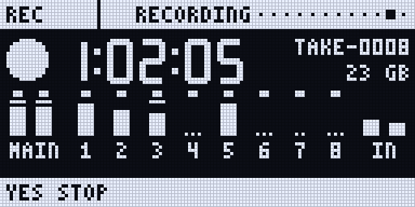
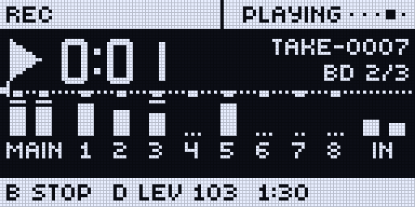
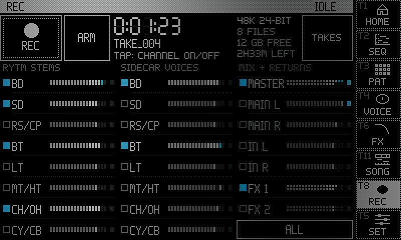
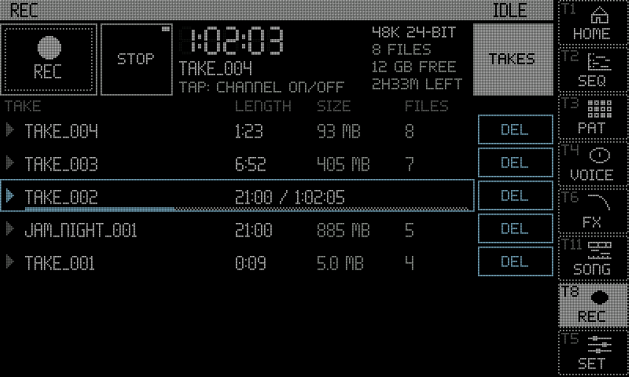
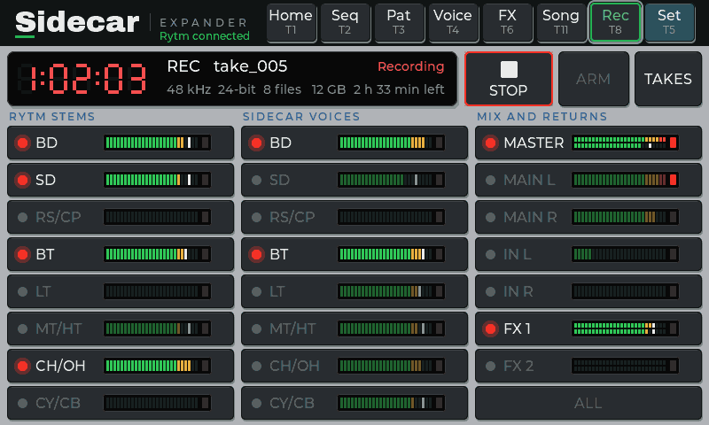

hardware: a 5-minute take of 13 sources with no dropped audio.

The Pi records the Rytm's Overbridge channels, its own voices and the effect returns to its SD card, **one WAV file per source, all sample-aligned**.

## Sources

| Sources | |
|---|---|
| `00_MASTER` | the Rytm's main mix, stereo |
| `01_MAIN_L`, `02_MAIN_R` | the same as two mono files |
| `03_BD` .. `10_CY-CB` | the Rytm's 8 voice outputs |
| `11_IN_L`, `12_IN_R` | the Rytm's audio inputs, or `11_FX_L`, `12_FX_R` while the IN L/R source is the Rytm's FX return (below) |
| `13_VOICE1` .. `20_VOICE8` | the Sidecar's voices as rendered: mono, or stereo for a voice on PRE / POST (0.3) |
| `21_FX1`, `22_FX2` | each send effect's own return, stereo |
| `23_PRE`, `24_POST` (0.3) | the voices routed PRE and POST, as the Sidecar sends them to the Rytm's main mix, stereo |

:::caution[New in 0.3]
With the [OUT route](/sidecar-expander/using/stereo-out/) (Sidecar 0.3 test build), a voice on PRE or POST when a take starts records its own `VOICEn` file in stereo, L and R as rendered, and two more sources hold the PRE and POST pairs. The route is read when the take is armed or started; a route change during a take does not change its files. in testing (Mac)
:::

## Recording from the web page

Open `sidecar.local`, tab **Record**.

1. Tick the sources (groups, Select all / None).
2. Choose **manual** or **armed**. Armed starts a take when the Rytm's sequencer starts (MIDI PLAY) and stops on STOP, then arms again. The Rytm must send its transport over USB (MIDI CONFIG, TRANSPORT SEND).
3. Press **Record** (or **Arm**). The page shows the elapsed time, a peak meter per source, free space and the time left, the card's speed and a red warning if blocks were dropped.
4. **Stop**. The takes are listed below, each file downloadable, with a play button per channel.

## The REC page on the Rytm

hardware. **UP + T8** opens it (with a touchscreen connected, the touchscreen's REC page opens instead), or REC in the SIDECAR MENU (UP + YES, then YES). **YES** records and stops; encoder **A** arms (right) or disarms (left). The page shows the take's time in large digits, its name, the card's free space and the hours left, and the meters with the recorded channels marked.

- **Channels** (in testing): the trig keys choose what the next take records: T1..T8 the tracks, T9 MAIN, T10 / T11 the inputs (or FX L / R with the FX return). Their lights show it: blue recorded, orange not. Not while a take records.
- **Playback:** **B** turned picks a channel, **B** pushed plays and stops it, **C** picks the take, **D** sets the level (below).

<small>Screenshots: the emulator with the 0.2 host code (mock values).</small>

## The REC page on the touchscreen

in testing (Pi, 0.3 test line). **UP + T8** on the Rytm, the REC key in the navigation column, or a tap on the home page's REC status.

- **The transport row:** REC / STOP, ARM / DISARM, the take's time in segment digits with the take's name, 48 kHz and the bit depth, the number of files, the card's free space and the time it holds at this selection, and **TAKES**.
- **The channels**, in three columns: RYTM STEMS (BD .. CY/CB), SIDECAR VOICES (each named for its tracks, in the Rytm's track order, so a voice sits beside its track's stem) and MIX + RETURNS (MASTER, MAIN L / R, IN L / R or FX L / R, FX 1 / FX 2, then ALL / NONE). Each row has a meter (stereo sources: L over R) and a clip lamp. Tap a channel to record it or not, while idle.
- While recording the title bar turns to the alert look; armed, the REC key shows a ring.

**TAKES** lists the newest takes, with DEL (after a confirmation).

- **Tap a take's row** to play it into the Rytm's MAIN: its MASTER mix if the take has one, else its first file. Tap again to pause, once more to go on; tap another take to switch to it from its start.
- **STOP** goes back to the start.
- The playing row shows a play triangle, `elapsed / length` and a progress bar.
- Playback continues when you leave the page and shows again when you come back. It ends at the take's end, when a recording starts or arms, and when its take is deleted.

<small>Screenshots: rendered off-device by the Sidecar's own UI code, with made-up data.</small>

## Playback

hardware (Pi). One take plays into the Rytm's MAIN, on top of everything else: from the Rytm's REC page (one channel), the touchscreen's TAKES (the take's mix), or the web page's Record tab (a play button per channel, and Stop). A take that starts recording stops playback; playback never runs while a take records.

Known: picking another take with C on the Rytm's page while one plays can glitch once.

## Files and limits

- **Files:** `/Recordings/<name>_<NNN>/<NN>_<SOURCE>.wav`, 48 kHz, 24-bit (or 16-bit), mono or stereo. Every file of a take starts on the same frame and has the same length.
- **Power loss:** one file is synced every 2 seconds, in turn (so each file every 2 s times the number of files). After a power cut the next boot repairs the headers, and the take opens up to its last sync.
- **Limits:** a take stops before any file reaches 4 GB (FAT32): about 4 hours for a stereo 24-bit file. A full card stops the take and closes the files.
- **Card speed:** all 23 sources of 0.2 at 24-bit need about 3.6 MB/s; stereo voice files and PRE / POST add to it. Use a fast card; the page shows whether it keeps up.
- **Latency:** the round trip to the Rytm (about 6 ms) is not compensated between the Rytm's channels and the Sidecar's voices.
- The display shows the recording in its title bar and on HOME.

## The FX return on IN L/R

hardware (2026-10-18: echoes seen on SCOPE's FX source). The Rytm can put its own delay + reverb return on the Overbridge IN L/R instead of its audio inputs: **Sound** tab, **IN L/R source: FX return**. The recorder then names those files `11_FX_L` / `12_FX_R`, and the SCOPE page calls the source FX. **Never send these two channels back into the Rytm through the computer's audio** (a loop on your mixer): the effect would feed itself. The page warns while the switch is on.

## Sampling

To record straight into the project's sample pool instead (a source, bars, slices, the auto-sampler), see [Sampler and auto-sampler](/sidecar-expander/using/sampling/).
