Everything Sidecar does is played from the Rytm. The mods add machines, pages and menu items; everything else on the Rytm works as stock.

## EXT machines

Each Sidecar machine appears in the Rytm's machine list on **every track**, next to the analog machines. Open the track's SRC page, press SRC again for the machine list, pick the machine and press YES.

A Sidecar voice keeps the silent "disabled" analog source and plays the Sidecar's audio in its place, through the track's **own analog filter, overdrive and amp**. So the track's FILTER and AMP pages, its envelopes and its outputs all work on it.

The SRC page shows the machine's eight knobs. They behave like any Rytm knob: turn, p-lock, slide, modulate with the LFO. The values reach the Sidecar with every trig, so a p-lock lands on its step. Page 2 (the SMPL key) is either the stock sample layer or eight more Sidecar knobs, depending on the machine.

| Machine | SRC knobs (A..H) | Page 2 |
|---|---|---|
| PLAITS | ENG HRM TIM MOR DEC LPG TUN LEV | FM FIN AUX TMD MMD VEL GLD VOL |
| DAISYSP | ENG STR BRI DMP INP EXC TUN LEV | EXCITER: XTN XDC FB OUT XP4 XLV XP5 WID |
| DSP SAMPLE | ENG STR BRI DMP MIX FB TUN LEV | SD SAMPLE: TUN FIN SMP MOD STA END LOP LEV |
| DIGIDRUM | ENG and the engine's seven controls (named per engine) | the stock sample layer |
| JUNO | PAT CUT RES ENV ATK DEC REL LEN | the stock page, muted |
| 6-OP FM | PAT TIM MOR DEC LPG TUN LEV LEN | the stock page, muted |
| U1..U5 | the user machine's own knobs and names | sample layer or eight more knobs |

What each knob does is on [Voices and machines](/sidecar-expander/using/machines/).

Names from the Sidecar's card show on the Rytm: DSP SAMPLE's SMP shows the pool sample's name, JUNO's and 6-OP FM's PAT show the patch name.

## The SIDECAR folder

The Rytm's sample browser (GLOBAL > SAMPLES, or FUNC + SMPL, DOWN, FUNC + YES) shows a folder **SIDECAR** at the +Drive root (called TEENSY before the 1021 builds). Inside it is the Sidecar's card, on the Pi as well as the Teensy: folders and WAV files with their sizes, and the JUNO and DX7 banks.

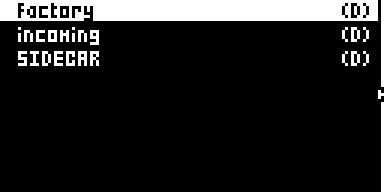
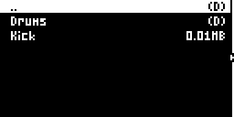

<small>Screenshots: `sfx1021` in the emulator, with a stand-in Sidecar listing two entries. in testing (the TEENSY name was checked on hardware; SIDECAR is new in 1021)</small>

- **LOAD TO PROJ** on a Sidecar file adds it to the project's **Sidecar pool** (stored on the Sidecar, one pool per project). Nothing is copied into the Rytm.
- DSP SAMPLE's **SMP** knob then picks from that pool: 0 is OFF, N is pool slot N.
- LOAD TO PROJ on a JUNO patch or a DX7 voice adds it to the project's JUNO or FM list, which the PAT knob then steps through.

## User slots U1..U5

Five machine slots, **U1..U5**, play user machines: loadable machine plugins on the Sidecar's card. Pick them from the machine list like any machine. See [User machines](/sidecar-expander/using/user-machines/) for installing them.

To choose which machine a slot plays from the Rytm:

1. Open the track menu: **FUNC + CHRO**. Five items `U1 <name>` .. `U5 <name>` follow SAVE TRACK.
2. Move to a slot and press **YES**. Each YES steps that slot to the next installed machine; after the last it clears the slot.
3. A popup shows the answer: READY, LOADING, NOT INSTALLED, NO ROOM, STOP TO INSTALL, NOT ON CARD, BAD, or NO SIDECAR (no Sidecar answered, after about 2 seconds; NO TEENSY before 1021).

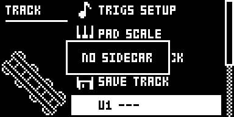

<small>Screenshot: `sfx1021` in the emulator, no Sidecar attached. in testing</small>

The slot menu can hold the screen for up to 2 seconds while it waits for the Sidecar.

What the machine list shows per slot:

| Sidecar says | Machine list |
|---|---|
| nothing yet (no Sidecar) | `USER n` |
| empty | `USER n ---` |
| ready | the machine's name |
| missing, bad, no room, crashed, timed out | `!` + the reason + the name: `!MISS`, `!BAD`, `!ROOM`, `!CRSH`, `!TIME` (see [!NAME on the Rytm](/sidecar-expander/using/user-machines/#name-on-the-rytm)) |
| loading | the name + `...` |
| ready, but this sound was made for another machine | `!` + the name, and the track stays silent |

Sounds remember which machine they were made for (a fingerprint). A sound saved with machine A stays silent if its slot now holds machine B, rather than playing B with A's settings.

## The SEND FX pages

The Sidecar runs two send effects, **SEND FX 1** and **SEND FX 2**. Every track has a send to each, and the FX track has a page per effect.

**Sends**, on every track: press **AMP** twice for **AMPLITUDE 2**.

| Knob | |
|---|---|
| A **SFX1** | the track's send to SEND FX 1 |
| B **SFX2** | the track's send to SEND FX 2 |

**Effects**, on the FX track: press **SRC** (DELAY) again for **SEND FX 1**, and **SMPL** (REVERB) again for **SEND FX 2**. A further press goes back to the stock page.

| Knob | |
|---|---|
| A **TYPE** | the effect: OFF, CHORUS, COMB, CRUSH, RINGMOD, and on the Pi RINGS, CLOUDSEED, STUTTER |
| B **P1 ROUTE** | **PRE**: the return enters before the Rytm's analog distortion and compressor (the default). **POST**: it is added after them, clean |
| C..F **P2..P5** | the effect's own knobs, with its own labels (RATE, DCY, MODL...) |

- The TYPE list comes from the Sidecar, so it shows the effects your Sidecar plays. An effect it cannot play shows as `!NAME` and stays silent.
- TYPE and ROUTE are stored in the kit and cannot be p-locked. P2..P5 can be p-locked on the FX track.
- A TYPE change never clicks: the old effect fades out in 10 ms and the new one fades in from a clean state.
- Some knobs show a zone name and a number, for example RINGS P3 `MODAL 12`.
- With a Sidecar older than the mods, P2..P5 show numbers instead of names. Update the Sidecar.

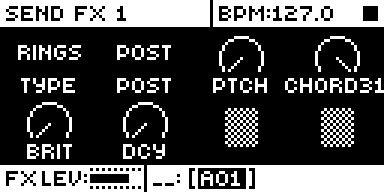
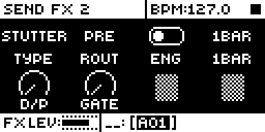
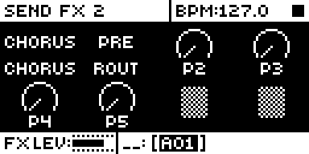

<small>Screenshots: `sfx1021` in the emulator, with the Sidecar's labels sent by a stand-in host. The SEND FX pages and labels are hardware (with the Pi); the stepped TYPE, ROUTE and STUTTER knobs are in testing.</small>

Each effect's knobs are on [Send effects](/sidecar-expander/using/send-effects/).

## Stepped knobs

in testing (in `sfx1021`)

Knobs that pick from a list step **one item per detent**, like the Rytm's own FILTER TYPE knob, and show the item's name where the dial was:

- the ENG knobs of PLAITS, DIGIDRUM, DAISYSP and DSP SAMPLE, DAISYSP's INP and OUT, DSP SAMPLE's MOD, the PAT knobs of JUNO and 6-OP FM, and a user machine's list, preset and pool knobs;
- the SEND FX pages' TYPE (over the Sidecar's list), ROUTE (PRE or POST), and effect knobs that are pure selectors, such as STUTTER's ENG and LEN.

Knobs with a number inside a zone (RINGS' model with its structure, say) stay continuous.

## The double stop

Press **STOP** twice and the Rytm cuts its delay and reverb tails. With the mods it also tells the Sidecar (an "all sound off"): both send effects fade out in about 5 ms and clear, and STUTTER drops back to the dry mix.

## The remote UI

hardware (part of the release in `rui1022`; the pages were tested 2026-10-18 with the Pi and the Teensy, and `rui1022`'s key handling with the Pi)

The remote UI lets the Sidecar draw its own pages on the Rytm's screen. The Rytm side only shows what it is sent and passes the keys and knobs on.

- **TRK + YES** (hold TRK, press YES) opens it. The first pages are the status pages SIDECAR and SYSTEM; then one page per voice whose machine has a page (PLAITS first).
- **LEFT / UP**: the previous page. **RIGHT / DOWN / PAGE**: the next. **NO**: back to SIDECAR.
- A page catches **only the keys and knobs it uses**. PLAY, STOP and RECORD always reach the Rytm (FUNC + PLAY / STOP too); the pads, MUTE / CHRO / SCNE / PERF, FILL, the trig keys, BANK and tap tempo work as on the stock screen. Keys that open stock screens (TRIG, SRC, SMPL, FLTR, AMP, LFO, FX, GLOBAL, YES, TRK and so on) stay with the Sidecar.
- On the SIDECAR and SYSTEM pages no knob is caught: a turn edits the stock parameter of the stock page underneath (you see it after leaving). LEVEL always sets the track level.
- With a Sidecar firmware older than the key masks, the page catches every key and knob except PLAY, STOP and RECORD.
- The **encoders** A..H change the shown voice's parameters. Such an edit holds until the Rytm's own value moves (its knob, a p-lock, another sound). It is not saved in the kit.
- The pads keep playing.
- **Leave** with TRK + YES again. The page also closes by itself 1 second after the Sidecar stops answering.

Since 1021 every letter on these pages is drawn by the Rytm itself, in its own font, at the stock screens' sizes and places: the title bar, the labels and the bottom bar look like the Rytm's own pages. The Sidecar sends the graphics and the text items; no font data of the Rytm is in Sidecar. A turn shows at once: the Rytm echoes the new value in the bottom bar itself, and the Sidecar's redrawn frame follows about 25 ms later (it was 75 ms).

**The status pages.** **SIDECAR** shows the 8 voices with their machines, and FX1 and FX2 with their TYPE and PRE / POST. **SYSTEM** shows the user slots U1..U5 (`---` empty), the recorder (REC IDLE or the take's time), the Rytm's audio stream (OB OK / STOP, UND = underruns), the load of the render cores, and in the bottom bar the network (ETH UP or WIFI UP with the address; never a network name or key). The Teensy has no recorder and no network, so its SYSTEM page leaves those out.

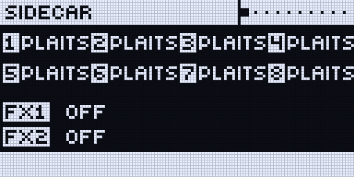
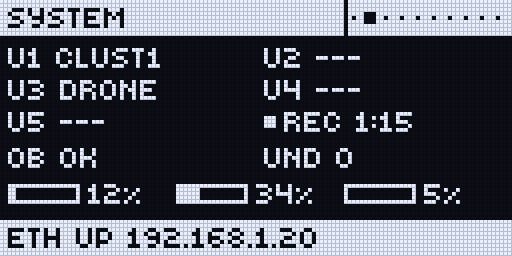

**A voice page** (RIGHT from the status pages) is laid out like a stock knob page: the dials in the same places, the labels on the same rows. ENG shows the model's name where the dial would be.

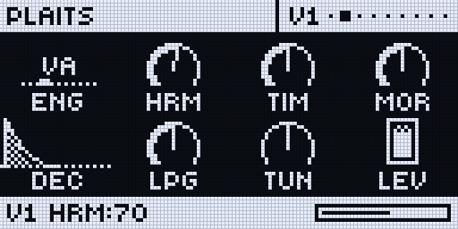

<small>Screenshots: `rui1021` in the emulator with the 1021 host code (mock values). The remote UI itself is hardware-tested: on a real Rytm the text is the Rytm's own and it responds at once.</small>

- It needs the 1021 Sidecar: the Pi with the 1021 kernel, or the Teensy with the 1021 firmware. An older Pi kernel opens the pages without text.

### Examples: what the remote UI can show

in testing: built and tested in the emulator, not yet on a real Rytm; not part of the tester release yet.

All of these are drawn by the Sidecar. The Rytm only shows what it is sent, so new pages, layouts and graphics come with a Sidecar update (the Pi's SD card or a Teensy upload) and **do not need a new Rytm flash**. Only a new kind of building block on the Rytm side, like the connect screen below, needs one.

**Connect screen** (needs the `rui1023` Rytm build). When the Sidecar connects to a Rytm that is already on, or the cable is plugged back in, a USB screen shows for 3 seconds: the Sidecar's name, CONNECTED, the voices and effects, and the Pi's address (or USB AUDIO+MIDI). PLAY, STOP, RECORD and the pads keep working under it; an arrow, YES or NO only closes it, any other key or knob closes it and does its normal job.

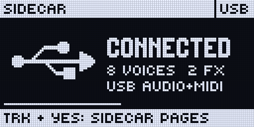
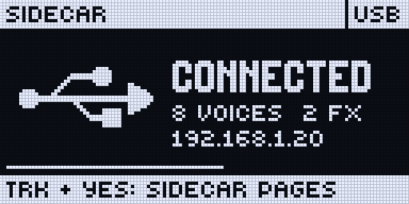

**SCOPE and meters.** The Rytm's output (or one Sidecar voice, or the inputs) as a scope, with a level meter per track and a 1-second peak hold. Knob A: the source, B: the timebase (21 ms to 1.4 s), C: the gain.

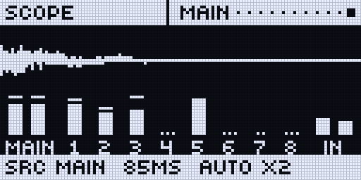

**Sample waveform** on the DSP SAMPLE and GRAIN pages: the sample with its start and end, loop brackets, reverse and slice lines, following the knobs as you turn them. On GRAIN: the grain window and its spread.

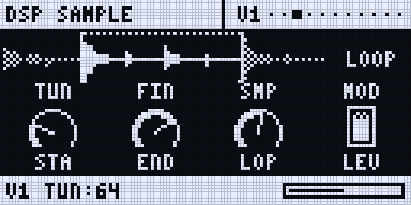
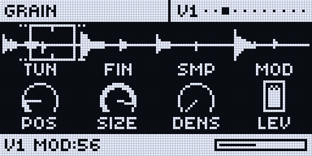

**Recorder** (Pi): YES records and stops, knob A arms. The take's time in large digits, the take name, the card's free space and hours left, and the meters.

**Machine graphics.** 6-OP FM shows the algorithm of the patch PAT picks (operators, carriers on the output line, feedback); JUNO shows its envelope and filter curve.

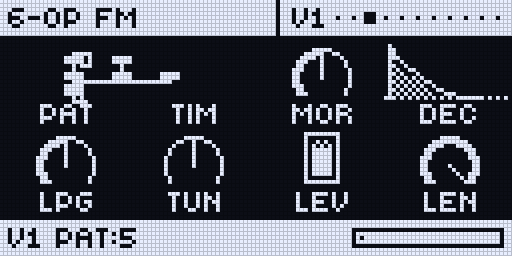
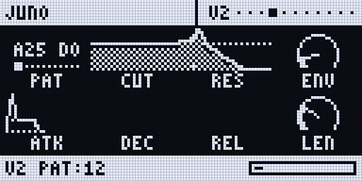

<small>Screenshots: the emulator with the Sidecar's host code (mock values); the text is drawn by the emulated Rytm in its own font.</small>

