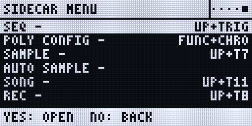
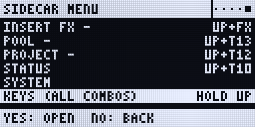

Everything Sidecar does is played from the Rytm. The mods add machines, pages and menu items; everything else on the Rytm works as stock.

## EXT machines

Each Sidecar machine appears in the Rytm's machine list on **every track**, next to the analog machines. Open the track's SRC page, press SRC again for the machine list, pick the machine and press YES.

A Sidecar voice keeps the silent "disabled" analog source and plays the Sidecar's audio in its place, through the track's **own analog filter, overdrive and amp**. So the track's FILTER and AMP pages, its envelopes and its outputs all work on it.

The SRC page shows the machine's eight knobs. They behave like any Rytm knob: turn, p-lock, slide, modulate with the LFO. The values reach the Sidecar with every trig, so a p-lock lands on its step. Page 2 (the SMPL key) is either the stock sample layer or eight more Sidecar knobs, depending on the machine.

| Machine | SRC knobs (A..H) | Page 2 |
|---|---|---|
| PLAITS | ENG HRM TIM MOR DEC LPG TUN LEV | TMD MMD FM AUX / FIN VEL GLD VOL |
| DAISYSP | ENG STR BRI DMP INP EXC TUN LEV | EXCITER: OUT FB XLV XTN / XDC XP4 XP5 WID |
| DSP SAMPLE | ENG STR BRI DMP MIX FB TUN LEV | SD SAMPLE: TUN FIN SMP MOD STA END LOP LEV |
| DIGIDRUM (plays MD in 0.3.0) | ENG (the drum type) and the drum's seven controls (named per type) | the stock sample layer |
| JUNO | PAT CUT RES ENV ATK DEC REL LEN | the stock page, muted |
| 6-OP FM | PAT TIM MOR DEC LPG TUN LEV LEN | the stock page, muted |
| MULTISAMPLE, WAVETABLE, GRANULAR (0.3) | see [Poly machines](/sidecar-expander/using/poly-machines/) | eight more knobs, CHD INV SPR VOI last |
| U1..U5 | the user machine's own knobs and names | sample layer or eight more knobs |

What each knob does is on [Voices and machines](/sidecar-expander/using/machines/).

Names from the Sidecar's card show on the Rytm: DSP SAMPLE's SMP shows the pool sample's name, JUNO's and 6-OP FM's PAT show the patch name.

## The SIDECAR folder

The Rytm's sample browser (GLOBAL > SAMPLES, or FUNC + SMPL, DOWN, FUNC + YES) shows a folder **SIDECAR** at the +Drive root (called TEENSY before the 1021 builds). Inside it is the Sidecar's card: folders and WAV files with their sizes, and the JUNO and DX7 banks.

<small>Screenshots: `sfx1021` in the emulator, with a stand-in Sidecar listing two entries. in testing (the TEENSY name was checked on hardware; SIDECAR is new in 1021)</small>

- **LOAD TO PROJ** on a Sidecar file adds it to the project's **Sidecar pool** (stored on the Sidecar, one pool per project). Nothing is copied into the Rytm.
- DSP SAMPLE's **SMP** knob then picks from that pool: 0 is OFF, N is pool slot N.
- In 0.3.0 the pool is the project's SAMPLES [POOL list](/sidecar-expander/using/pools/): LOAD TO PROJ puts the file into the first free row of bank A, and SMP reaches all eight banks. The bank list's **FUNC + YES** opens this browser aimed at a row.
- LOAD TO PROJ on a JUNO patch or a DX7 voice adds it to the project's JUNO or FM list, which the PAT knob then steps through.

## User slots U1..U5

Five machine slots, **U1..U5**, play user machines: loadable machine plugins on the Sidecar's card. Pick them from the machine list like any machine. See [User machines](/sidecar-expander/using/user-machines/) for installing them.

To choose which machine a slot plays from the Rytm:

1. Open the track menu: **FUNC + CHRO**. Five items `U1 <name>` .. `U5 <name>` follow SAVE TRACK.
2. Move to a slot and press **YES**. Each YES steps that slot to the next installed machine; after the last it clears the slot.
3. A popup shows the answer: READY, LOADING, NOT INSTALLED, NO ROOM, STOP TO INSTALL, NOT ON CARD, BAD, or NO SIDECAR (no Sidecar answered, after about 2 seconds; NO TEENSY before 1021).

<small>Screenshot: `sfx1021` in the emulator, no Sidecar attached. in testing</small>

The slot menu can hold the screen for up to 2 seconds while it waits for the Sidecar.

What the machine list shows per slot:

| Sidecar says | Machine list |
|---|---|
| nothing yet (no Sidecar) | `USER n` |
| empty | `USER n ---` |
| ready | the machine's name |
| missing, bad, no room, crashed, timed out | `!` + the reason + the name: `!MISS`, `!BAD`, `!ROOM`, `!CRSH`, `!TIME` (see [!NAME on the Rytm](/sidecar-expander/using/user-machines/#name-on-the-rytm)) |
| loading | the name + `...` |
| ready, but this sound was made for another machine | `!` + the name, and the track stays silent |

Sounds remember which machine they were made for (a fingerprint). A sound saved with machine A stays silent if its slot now holds machine B, rather than playing B with A's settings.

## The SEND FX pages

The Sidecar runs two send effects, **SEND FX 1** and **SEND FX 2**. Every track has a send to each, and the FX track has a page per effect.

**Sends**, on every track: press **AMP** twice for **AMPLITUDE 2**.

| Knob | |
|---|---|
| A **SFX1** | the track's send to SEND FX 1 |
| B **SFX2** | the track's send to SEND FX 2 |

**Effects**, on the FX track: press **SRC** (DELAY) again for **SEND FX 1**, and **SMPL** (REVERB) again for **SEND FX 2**. A further press goes back to the stock page.

| Knob | |
|---|---|
| A **TYPE** | the effect: OFF, CHORUS, COMB, CRUSH, RINGMOD, HALO, and on the Pi RINGS, CLOUDSEED, STUTTER |
| B **P1 ROUTE** | **PRE**: the return enters before the Rytm's analog distortion and compressor (the default). **POST**: it is added after them, clean |
| C..F **P2..P5** | the effect's own knobs, with its own labels (RATE, DCY, MODL...) |

- The TYPE list comes from the Sidecar, so it shows the effects your Sidecar plays. An effect it cannot play shows as `!NAME` and stays silent.
- TYPE and ROUTE are stored in the kit and cannot be p-locked. P2..P5 can be p-locked on the FX track.
- A TYPE change never clicks: the old effect fades out in 10 ms and the new one fades in from a clean state.
- Some knobs show a zone name and a number, for example RINGS P3 `MODAL 12`.
- With a Sidecar older than the mods, P2..P5 show numbers instead of names. Update the Sidecar.

<small>Screenshots: `sfx1021` in the emulator, with the Sidecar's labels sent by a stand-in host. The SEND FX pages and labels are hardware (with the Pi); the stepped TYPE, ROUTE and STUTTER knobs are in testing.</small>

Each effect's knobs are on [Send effects](/sidecar-expander/using/send-effects/).

## Stepped knobs

in testing (in `sfx1021`)

Knobs that pick from a list step **one item per detent**, like the Rytm's own FILTER TYPE knob, and show the item's name where the dial was:

- the ENG knobs of PLAITS, DIGIDRUM, DAISYSP and DSP SAMPLE, DAISYSP's INP and OUT, DSP SAMPLE's MOD, the PAT knobs of JUNO and 6-OP FM, and a user machine's list, preset and pool knobs;
- the SEND FX pages' TYPE (over the Sidecar's list), ROUTE (PRE or POST), and effect knobs that are pure selectors, such as STUTTER's ENG and LEN.

Knobs with a number inside a zone (RINGS' model with its structure, say) stay continuous.

## The double stop

Press **STOP** twice and the Rytm cuts its delay and reverb tails. With the mods it also tells the Sidecar (an "all sound off"): both send effects fade out in about 5 ms and clear, and STUTTER drops back to the dry mix.

## The remote UI

The remote UI lets the Sidecar draw its own pages on the Rytm's screen. The Rytm side only shows what it is sent and passes the keys and knobs on. Every letter is drawn by the Rytm itself, in its own font, at the stock screens' sizes and places; no font data of the Rytm is in Sidecar. New pages, layouts and graphics come with a Sidecar update (the Pi's SD card) and **do not need a new Rytm flash**; only a new kind of building block on the Rytm side does.

:::caution[New in 0.3]
Sidecar 0.3.0 makes **UP the Sidecar key** and adds the SIDECAR MENU, the KEYS page and the combo map, the SAMPLE, AUTO, SEQ, POLY CONFIG, INSERT (with UP + AMP for its OUT view), SONG, POOL and PROJECT pages, and TRK's LED blinking while a page has the keys. Built and tested in the emulator; not yet confirmed on a real Rytm. With the 0.2.0 release's `rui1027d` the key is TRK (TRK + YES) and the page list is SIDECAR, SYSTEM, LFO, REC and SCOPE.
:::

### Opening, moving, leaving

- **UP + YES** (hold UP, press YES) opens the remote pages on **SIDECAR**; UP + YES again leaves. TRK + YES still works.
- **YES on SIDECAR** opens the **SIDECAR MENU**: every page with its shortcut. UP / DOWN pick a page, YES opens it. A page with nothing to show now is marked with `-` and answers `NOT HERE NOW`.
- **UP + a trig key** opens a page directly (UP + T7 SAMPLE, T8 REC, T9 SCOPE, T10 SIDECAR, T11 SONG, T12 PROJECT, T13 POOL), **UP + TRIG / LFO / FX** open SEQ, LFO and INSERT, and **UP + AMP** the INSERT page's OUT view. **POLY CONFIG** is the last item of the Rytm's own track menu (FUNC + CHRO). See [Key combinations](/sidecar-expander/using/key-combinations/).
- **LEFT / RIGHT**: the previous / next page in the ring. **NO**: back a level (a page > SIDECAR > leave).
- **Pages that replace the Rytm's page.** SEQ, INSERT (UP + FX, UP + AMP), LFO, POOL, POLY CONFIG, the SIDECAR MENU and KEYS take the Rytm's screen like the SRC view does: they have no page dots and no LEFT / RIGHT siblings. Leave with NO, or press the same UP + key again (UP + AMP again re-aims its OUT view at the selected track). On the LFO page LEFT / RIGHT step the LFO; on the INSERT page RIGHT opens the EQ view.
- **Hold UP alone** on the main screen: the combo map, until you let go.
- The page also closes by itself 1 second after the Sidecar stops answering.

<small>Renders of the Rytm-screen pages: the Sidecar's own page code on the host, with made-up data. No firmware data. On the Rytm the text is the Rytm's own.</small>

### The pages

| Page | Shortcut | What |
|---|---|---|
| **SIDECAR** | UP + T10 | the eight voices by track with their machines, FX1 and FX2 with TYPE and PRE / POST |
| **SYSTEM** | | the user slots U1..U5, the recorder, the Overbridge stream and underruns, the render cores' load, the network |
| **LFO** | UP + LFO | the Sidecar's [LFOs](/sidecar-expander/using/lfo/) and the DESIGN view |
| **REC** | UP + T8 | the [recorder](/sidecar-expander/using/recorder/#the-rec-page-on-the-rytm): record, arm, play a take back |
| **SCOPE** | UP + T9 | a scope of the output, a track or the inputs, with a meter per track |
| **SAMPLE**, **AUTO** | UP + T7, again | the [sampler and the auto-sampler](/sidecar-expander/using/sampling/) |
| **POOL** | UP + T13 | the project's [POOL lists](/sidecar-expander/using/pools/#the-pool-page-on-the-rytm) |
| **SEQ** | UP + TRIG | a [poly track's](/sidecar-expander/using/sequencer/) steps |
| **INSERT** | UP + FX | the [insert FX](/sidecar-expander/using/insert-fx/) and the [OUT route](/sidecar-expander/using/stereo-out/) |
| **SONG** | UP + T11 | the [song recorder](/sidecar-expander/using/song-recorder/) |
| **PROJECT** | UP + T12 | the card's projects and [bundles](/sidecar-expander/using/projects-bundles/#the-rytm-the-project-page) |
| **MENU**, **KEYS** | YES on SIDECAR; HOLD UP | the page list; every combination |

The ring (LEFT / RIGHT) runs SIDECAR, SYSTEM, REC, SCOPE, SAMPLE, AUTO, SONG, PROJECT, leaving out the pages that have nothing to show (SONG without a take, and so on). LFO, POOL, SEQ and INSERT, MENU and KEYS are not in the ring: you open them with their own keys (above) and leave them with NO.

**SIDECAR and SYSTEM.** SIDECAR shows the voices by their tracks (a poly track marked) with their machines, and FX1 and FX2 with their TYPE and PRE / POST. SYSTEM shows the user slots U1..U5 (`---` empty), the recorder (REC IDLE or the take's time), the Rytm's audio stream (OB OK / STOP, UND = underruns), the load of the render cores, and in the bottom bar the network (ETH UP or WIFI UP with the address; never a network name or key). Both catch every knob, so nothing changes underneath while you look.

<small>Screenshots: `rui1027d` in the emulator with the 0.2 host code (mock values).</small>

### Keys and knobs on a page

- A page catches **only the keys and knobs it uses**. PLAY, STOP and RECORD always reach the Rytm (FUNC + PLAY / STOP too); the pads, MUTE / CHRO / SCNE / PERF, FILL, BANK, tap tempo and the trig keys (where the page does not use them) work as on the stock screen. Keys that would open stock screens (TRIG, SRC, SMPL, FLTR, AMP, LFO, FX, YES, TRK and so on) stay with the Sidecar while it is open.
- **TRK's LED blinks** slowly (white / off) while a Sidecar page has the keys, and shows the Rytm's own colour again when it closes. in testing (emulator; the LED is still to be checked on a real Rytm)
- **Stock screens step the page aside.** A Rytm menu, window, file browser or prompt (GLOBAL, the PATTERN or TRACK menu, SAVE, the sample browser, a TRK LEVEL readout) shows over the page; when it closes, the page is back.
- **Footers** say what YES and NO do, in one form: `YES: MENU  NO: LEAVE` on SIDECAR, `YES: OPEN  NO: BACK` in the menu, `UP / DOWN: MORE  NO: BACK` on KEYS.
- The **encoders** A..H on a voice page change the shown voice's parameters until the Rytm's own value moves (its knob, a p-lock, another sound). Such an edit is not saved in the kit.
- A turn shows at once: the Rytm echoes the new value in the bottom bar itself, and the Sidecar's redrawn frame follows about 25 ms later.

### Tracks and voices

Twelve tracks can choose a Sidecar machine; eight Sidecar voices sound at once. Like the Rytm's own paired tracks, **RS/CP, MT/HT, CH/OH and CY/CB share one voice** each, so a pair plays one at a time. The pages name voices by their tracks; the meters on SCOPE and REC, and SCOPE's sources, follow the Rytm's track order. hardware (Pi: meters by track)

### The SRC view

hardware (the `rui1027d` Rytm build, 2026-10-19, also after a USB replug)

On a track that plays a Sidecar machine with a page, the Rytm's **own SRC page** shows the Sidecar's machine page with its graphics: JUNO's envelope and filter, the FM algorithm, DSP SAMPLE's waveform, GRAIN's cloud, and in 0.3.0 GRANULAR's grains, WAVETABLE's frames and MULTISAMPLE's zones. It is drawn from the Rytm's own values, so every key and knob stays the Rytm's: edits, p-locks, kits and saving work as on a stock SRC page. The bottom bar names the last knob you turned (for example `BD CUT:73`).

- Other machines, and analog tracks, show the stock SRC page.
- The stock machine list, popups and holding TRK or BANK show the stock screen while they are up.
- Leaving SRC shows the stock page again; UP + YES opens the remote pages as usual and takes precedence.
- When the Sidecar goes away, the stock SRC page is back within about a second.
- On the SRC page and SMPL page 2, user-machine knobs the machine does not use show as hatched boxes, like the Rytm's own unused knobs.
- Limits: a turn shows on the view after about 50-100 ms; edits made while holding a trig on a normal track (p-locks) are not shown on the view, which shows the sound's own value.

New in 0.3 (in testing, emulator):

- **The source list.** On GRANULAR, WAVETABLE and MULTISAMPLE, turning **knob A** opens the bank list of the machine's [POOL](/sidecar-expander/using/pools/#choosing-and-loading-on-the-rytm); on DSP SAMPLE, knob **D** (SMP) on the SMPL page. **UP + SRC** opens it in one press.
- The view works in every pad mode (MUTE, CHRO, SCNE, PERF too).
- On a poly track the title says so (`BD POLY`).

### More pages

**Connect screen** hardware (the `rui1027d` Rytm build). When the Sidecar connects to a Rytm that is already on, or the cable is plugged back in, a USB screen shows for 3 seconds: the Sidecar's name, CONNECTED, the voices and effects, and the Pi's address (or USB AUDIO+MIDI). Its footer names the key that opens the pages (`UP+YES: SIDECAR PAGES` in 0.3.0, `TRK + YES` with `rui1027d`, as in the pictures). PLAY, STOP, RECORD and the pads keep working under it; an arrow, YES or NO only closes it, any other key or knob closes it and does its normal job.

**SCOPE and meters** hardware. The Rytm's output, a track or the inputs (sources in track order: MAIN, BD, SD, RS/CP, BT, LT, MT/HT, CH/OH, CY/CB, IN L, IN R) as a scope, with a level meter per track and a 1-second peak hold. Knob A: the source, B: the timebase (21 ms to 1.4 s), C: the gain.

**Recorder and playback** hardware: YES records and stops, knob A arms; B picks a channel and plays it into the MAIN, C the take, D the level. The trig keys pick the recorded channels. See [The recorder](/sidecar-expander/using/recorder/#the-rec-page-on-the-rytm).

**Sample waveform** in testing on the DSP SAMPLE and GRAIN pages: the sample with its start and end, loop brackets, reverse and slice lines, following the knobs as you turn them. On GRAIN: the grain window and its spread.

**Machine graphics** in testing. 6-OP FM shows the algorithm of the patch PAT picks (operators, carriers on the output line, feedback); JUNO shows its envelope and filter curve.

**The INSERT page's OUT view** (0.3, in testing): the TRACK view's strip ends in an OUT box; YES twice opens the OUT view with the route, level, pan and width. See [Stereo and the OUT route](/sidecar-expander/using/stereo-out/#where-to-set-it).

<small>Screenshots: the emulator with the Sidecar's host code (mock values), and host renders of the 0.3 pages.</small>
