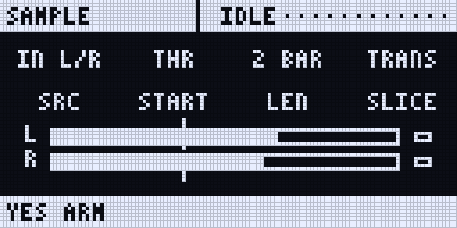
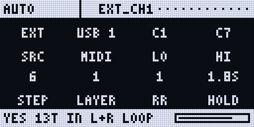

:::caution[New in 0.3]
New in 0.3 (until 0.3.0 is released: the test line, Rytm build `rui1048` with the Sidecar's 0.3 test build), Sidecar (Pi) only. Built and tested on the Mac; first fixes after hardware reports are in; not yet confirmed on a real Rytm.
:::

## The sampler

One take to the card, from: in testing

| Source | |
|---|---|
| IN L/R | the Rytm's AUDIO IN, stereo |
| MAIN | the Rytm's main mix (resampling everything, the Sidecar's voices and send FX included) |
| A Rytm voice | BD SD RS/CP BT LT MT/HT CH/OH CY/CB, mono |
| A Sidecar voice | as rendered, mono |

- **Start:** now, a threshold (dBFS), the Rytm's PLAY, or its next bar. A pre-roll of up to 1 s is kept from before the start.
- **Length:** free (until stop; at most 120 s), or N bars cut exactly at the Rytm's clock.
- **Processing:** free takes are trimmed and normalised to -1 dBFS; 24-bit 48 kHz WAV.
- **Slices:** by transients or a grid of N, written as an `.sfz` slice map next to the WAV.
- **Files:** `/Samples/<project>/<name>.wav` (and the slices).
- **Into the pool:** the take goes into the project's **SAMPLES** [POOL](/sidecar-expander/using/pools/), the first free row of the bank last shown (bank A by default, else the next bank with room); the page says `TAKE -> A012`. GRANULAR can play it at once, DSP SAMPLE after the next boot. Its slice map goes into **INSTRUMENTS** the same way, for MULTISAMPLE.

**On the Rytm:** the remote page **SAMPLE**, next to SCOPE (UP + T7 opens it). A source, B start, C bars, D slices; **YES** arms, records and stops; A pushed cancels. The page shows the level, the take's time, the last take and the tempo.

**On the web page:** Record tab, **Sample**.

## The auto-sampler

Plays notes, records them, trims, finds loops and writes a MULTISAMPLE instrument (`/MULTISAMPLE/<name>/<name>.sfz` and its WAVs). It goes into the project's **INSTRUMENTS** pool by itself, ready for INST. in testing

| SRC | Plays | Records |
|---|---|---|
| **6-OP FM** | a DX7 voice (PATCH) | rendered offline, faster than real time: you hear nothing (the page says OFFLINE) |
| **JUNO** | a JUNO patch | offline, as above |
| **VOICE** | a copy of what Sidecar voice 1..8 plays now | offline, as above |
| **TRK** | one of the Rytm's 12 tracks, by a note on its MIDI channel | the track's Overbridge stem, in real time |
| **EXT** | an external synth: MIDI notes on **USB** (the computer on the Sidecar's USB-C), **DEV** (a USB MIDI device on the Pi's USB-A) or **RYTM** (the Rytm's USB MIDI), channel 1..16 | the Rytm's AUDIO IN L, R or L+R, in real time |

- **Plan:** notes LO..HI every STEP semitones, velocity layers (1..8), round robins (1..4), the hold time, the release tail, the gap.
- One gain for the whole instrument (velocity layers keep their relation), zones split between the sampled notes, loops found on sustained sounds, silent takes left out.
- **On the Rytm:** the remote page **AUTO** (UP + T7 twice): A SRC, B the entry (PATCH, VOICE, TRACK or the MIDI output and channel; push B for EXT's input L+R / L / R), C LO, D HI, E STEP, F LAYER, G RR, H HOLD. **YES** starts; A pushed cancels after the current note. The bottom bar shows the progress (`C4 v100 3/24`).
- **On the web page:** Record tab, **Auto-sampler**.

<small>Screenshots: rendered off-device by the Sidecar's own page code.</small>

## Limitations

- Sidecar (Pi) only.
- EXT on **USB** needs the Sidecar's USB-C MIDI to the computer, which only the Pi 4 has; your DAW routes the notes to the synth. On a Pi 5 use DEV.
- EXT on **RYTM** reaches a synth only if the Rytm passes USB MIDI on to its MIDI OUT; not confirmed.
- TRK: RS/CP, MT/HT, CH/OH and CY/CB share one stem each.
- DSP SAMPLE sees a new take only after the next boot.
- No touch slicing page yet.
