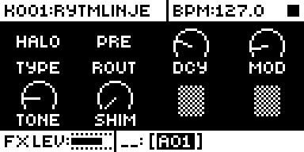

The Sidecar's two send effects take the Rytm's voices, each at its track's send level (AMPLITUDE 2, SFX1 and SFX2), and return the effect in stereo, wet only. How to reach the pages: [The SEND FX pages](/sidecar-expander/using/rytm-side/#the-send-fx-pages).

## Common to every effect

- **P1 is ROUTE** on every effect. **PRE** (0..63, the default) returns into the Rytm's MAIN FX input, which enters **before** the analog distortion and compressor: the return gets the Rytm's master character. **POST** (64..127) returns on MAIN, added **after** them: clean. A change crossfades in 8 ms. (Measured on a real Rytm: the POST return stayed clean with DIST at maximum; the PRE return got gritty and louder.)
- **P2..P5** are the effect's own knobs. All can be p-locked on the FX track.
- **Every knob's 0 is a usable default**, so a fresh kit sounds sensible. There is no level or mix knob: the sends set the level.
- Changes are smoothed over 10 ms. A TYPE change, or a change of a zone that swaps the algorithm (RINGS' model, CLOUDSEED's character), fades out, clears and fades in: a short gap, no click.
- The paired tracks that share a voice (RS/CP, MT/HT, CH/OH, CY/CB) send at the louder of their two send levels.
- The return is soft-limited (-6 dBFS PRE, -12 dBFS POST). A runaway or invalid value clears the effect instead of blasting.

## Which effects where

| TYPE | Sidecar Mini | Sidecar (Pi) | Status |
|---|---|---|---|
| CHORUS | yes | yes | hardware |
| COMB | yes | yes | hardware |
| CRUSH | yes | yes | hardware |
| RINGMOD | yes | yes | hardware |
| HALO | yes | yes | hardware (heard; measured on the Mini) |
| RINGS | - | yes | hardware |
| CLOUDSEED | - | yes | hardware |
| STUTTER | - | yes | hardware |

The large effects need more memory than a Teensy has (CLOUDSEED alone uses 1.25 MB a slot), so a Teensy reports them as `!NAME` and keeps them silent. On the Pi both slots can run any effect, even two CLOUDSEEDs.

## CHORUS

A stereo chorus.

| Knob | Label | Range |
|---|---|---|
| P2 | RATE | 0.2 to 5 Hz |
| P3 | DPTH | 25 to 100 % of 6 ms |
| P4 | DLY | base delay 8 to 25 ms |
| P5 | FDBK | feedback 0 to 0.8 |

## COMB

A tuned comb resonator: tracks ring at a pitch.

| Knob | Label | Range |
|---|---|---|
| P2 | TUNE | 55 Hz, rising an octave every 24 steps |
| P3 | DCY | POS (0..63): ring time 0.2 to 8 s. NEG (64..127): the same with negative feedback, an octave lower with odd harmonics |
| P4 | DAMP | damping 0 to 0.95 |
| P5 | SPRD | stereo spread: the right side up to 3 % lower |

The ring time stays the same at any tuning.

## CRUSH

A sample-rate reducer and bitcrusher. All knobs at 0 is clean.

| Knob | Label | Range |
|---|---|---|
| P2 | RATE | sample hold 1 to 64 samples (48 kHz down to 750 Hz); the right side is offset for width |
| P3 | BITS | 16 down to 1 bit, continuous |
| P4 | DRV | drive 0 to +24 dB before the quantizer, level compensated |
| P5 | TONE | low-pass after, 18 kHz down to 400 Hz |

## RINGMOD

A ring modulator: the input times a carrier on each side.

| Knob | Label | Range |
|---|---|---|
| P2 | FREQ | 10 Hz to 5.1 kHz |
| P3 | SPRD | the right carrier up to a fifth higher |
| P4 | SHPE | carrier from sine to near square |
| P5 | LFO | 0 off; else the carrier swept ±6 semitones at 0.1 to 10 Hz |

## HALO

A small, lush, modulated plate reverb written for the Sidecar: very long smooth tails, FREEZE and SHIMMER, wide stereo, the kind of space the Rytm's own reverb cannot make. It runs on Sidecar Mini and Sidecar alike, in 8 KB of RAM per slot.

| Knob | Label | Range |
|---|---|---|
| P2 | DCY | decay, 0.3 to 30 s; at 127 **FRZ**: FREEZE holds the tail forever (no new input) |
| P3 | MOD | modulation, 0 still to 127 deep |
| P4 | TONE | the tail's low-pass (1.2 to 10 kHz) and the input's high-pass (250 down to 30 Hz) |
| P5 | SHIM | octave-up shimmer, 0 off to 127 |

On the Mini (measured with `:sendfxbench`): HALO alone about 5.7 % CPU per slot, two HALOs about 16 %, HALO with CHORUS about 11 %.

<small>Screenshot: the SEND FX 1 page in the emulator with HALO's labels from the Sidecar.</small>

## RINGS (Pi)

A port of the Mutable Instruments Rings modal resonator and sympathetic strings, played by the send. An onset in the send is a strum: the next voice takes the note, and the last one rings on, so a p-locked P2 plays overlapping notes.

| Knob | Label | Range |
|---|---|---|
| P2 | PTCH | from C2, a semitone every 2 steps |
| P3 | MODL | four zones: MODAL (2 voices), MONO (modal, odd partials left, even right), STRNG (sympathetic strings), CHORD. Within a zone: the structure (CHORD: the chord) |
| P4 | BRIT | brightness |
| P5 | DCY | decay |

## CLOUDSEED (Pi)

A port of the Cloud Seed algorithmic reverb, with four characters.

| Knob | Label | Range |
|---|---|---|
| P2 | CHAR | four zones: ROOM, HALL, PLATE (a dark plate), AMBNC (ambience). Within a zone: size ×1 to ×2.5 |
| P3 | DCY | the character's decay time, up to ×10 |
| P4 | DAMP | darker as it rises |
| P5 | MOD | modulation depth and rate |

## STUTTER (Pi)

A beat repeat. STUTTER is not a send: it works as an **insert on the whole mix**. It takes the sum of all voice stems (send levels are ignored) and returns it: at unity when disengaged, repeating a tempo-synced slice when engaged.

| Knob | Label | Range |
|---|---|---|
| P2 | ENG | OFF (0..63) / ON (64..127). A lock on a step fires a repeat of the slice that ended at the latest grid point, in time. Lock consecutive steps for a roll |
| P3 | LEN | 1/64, 1/32, 1/16, 1/8, 1/4, 1/2, 1BAR |
| P4 | D/P | NONE at 0; DCY 1..63: each repeat quieter (up to 12 dB a repeat); PTCH: each repeat lower (up to 12 semitones a repeat, a tape stop in steps) |
| P5 | GATE | 0: the whole repeat; up: each repeat sounds for 100 % down to 10 % of its length |

Only one STUTTER at a time: FX 1 wins, a second one shows `!STUTTER`.

### Set up STUTTER: ROUTE TO MAIN

Because STUTTER carries the whole mix, the Rytm's tracks must reach the main mix only through the Sidecar:

1. Keep the Sidecar running first. With the tracks off main and no Sidecar, the Rytm is silent.
2. In the Rytm's AUDIO ROUTING, set **ROUTE TO MAIN off for all 12 tracks**. They still go to their Overbridge outputs, so the Sidecar gets every stem.
3. Set SEND FX 1 TYPE to **STUTTER** (FX 2 if FX 1 is busy).
4. Set **P2 to 0** first. A kit never edited with the send FX pages can hold 127 in P2..P5, which would mean "engaged" all the time.
5. **P-lock P2 to 127** on the steps where it should fire. Lock P3 per step for different lengths.
6. In MIDI CONFIG, turn on **CLOCK SEND** and **TRANSPORT SEND** to the USB port. Without the clock STUTTER runs free at 120 BPM from the engage.

While the Sidecar carries the mix, the **whole mix is about 4 to 5 ms late** (the USB round trip), dry or repeating. With ROUTE PRE (the default) the mix keeps the Rytm's analog distortion and compressor; with POST it returns after them.
