:::caution[New in 0.3]
New in 0.3.0 (the Rytm firmware 0.3.0 with the Sidecar 0.3.0 card). First used on a real Rytm with a Pi 4 (build `rui1039`); the fixes and additions since (the TRIG view, trig conditions, step copy, pattern reload and save, jumps, UP as the Sidecar key, poly tracks on every Sidecar machine, POLY CONFIG, the seeded random) are tested in the emulator and on the Mac. Poly tracks per pattern and NOTE EDIT have been used on a real Rytm; their newest versions (the SEQ page's keys, the new NOTE EDIT screen) are being checked with the 0.3.0 release. Sidecar (Pi) only.
:::

A Rytm track plays one note per step. In **poly mode** the Sidecar sequences the track itself: chords and several notes per step, each note with its own velocity, length and micro timing, up to 8 pages of 16 steps, trig conditions, and p-locks on the Sidecar's parameters. You still edit on the Rytm: GRID REC, the trig keys, the pads and the knobs. The Rytm stays the master: PLAY, STOP, tempo, pattern changes and mutes are the Rytm's, and the Sidecar follows them. The Rytm's screens call such a track a **POLY TRACK**.

in testing

## How it works

1. **A poly track** is a Rytm track on a Sidecar poly machine that you handed to the Sidecar sequencer. Poly is a property of the **pattern** ([below](#poly-tracks-belong-to-the-pattern)). Its steps live on the Sidecar's card, one file per project and pattern (`/.rytm/seq/<project>/pNNN.sqp`), saved a second after each edit and at STOP (a power cut can lose the very last edits, never damages the file). The Rytm's own track stays empty.
2. **The clock.** While playing, the Rytm reports each step of each poly track to the Sidecar, stamped to its audio block. The Sidecar plans the notes ahead and starts them early by the measured round trip, so they land with the Rytm's own trigs. The round trip is measured automatically, once, after the Rytm connects (5 short clicks while stopped).
3. **The analog chain is held open.** On a poly track the Rytm's analog amp stays open and the filter envelope is off, so the Sidecar's notes, each with its own envelope, pass through the track's filter, overdrive and amp. FRQ, RES, the filter type, OVR, level, pan and the sends stay yours. A poly track that has nothing sounding is closed again after 400 ms.
4. **Pattern changes.** The Sidecar loads the next pattern's steps as soon as the change is queued and switches on the Rytm's switch, with the next pattern's first steps already planned. DIRECT JUMP and TEMP JUMP (FUNC + BANK C / D) play the new pattern from the old position at once.

### Which machines

**Every Sidecar machine** can be a poly track: PLAITS, JUNO, DAISYSP, MD, DSP SAMPLE, 6-OP FM, MULTISAMPLE, WAVETABLE, GRANULAR and user machines. Only the analog machines cannot: the Rytm's analog voice is mono. How many notes a track plays at once is its [POLY CONFIG](#poly-config); AUTO gives each machine its default:

| Machine | VOICES on AUTO | Where the notes play |
|---|---|---|
| 6-OP FM | 6 | the machine's own pool |
| MULTISAMPLE | 16 (its pool, as before; VOICES 1..8 caps it) | the machine's own pool |
| WAVETABLE | 8 | the machine's own pool |
| GRANULAR | 6 | the machine's own pool |
| JUNO | 6 | the instance pool |
| PLAITS, DAISYSP | 4 | the instance pool |
| MD | 1 (mono: a new note cuts the old) | the voice |
| DSP SAMPLE | 1 (mono only: one card stream a voice) | the voice |
| user machines | 1 for a drum, else up to 4 (the package declares its maximum) | the instance pool, when the package allows it |

- **The instance pool** holds 32 instances shared by the poly tracks, each with its own engine state, so a PLAITS track with VOICES 4 plays four PLAITS at once. They are rendered into the track's own channel, before its inserts, so the voice's CPU budget covers them: every built-in machine fits 8. A heavy user machine is cut to what fits (`CUT` on the pages).
- **The note's pitch:** on PLAITS, JUNO, DAISYSP, DSP SAMPLE and the note machines the note is the pitch (plus TUN / FIN); MD does not use it (tune with its own pitch knob); a user machine for a fixed-pitch drum ignores it.
- A user machine package declares its voices (`max_voices`) and whether pitch matters; older packages stay mono.
- A poly track's own Rytm trigs make no note; its pad in the normal pad mode still plays its voice.

The Rytm's make prompt names the machine and its notes, and where POLY CONFIG is.

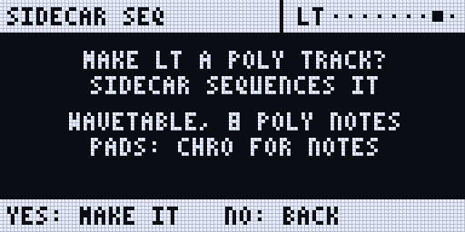
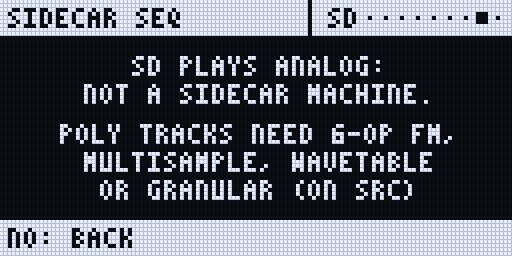

## Getting started

1. Pick a **Sidecar machine** on a track's SRC page: PLAITS, JUNO, 6-OP FM, MULTISAMPLE and the rest (see [Machines](/sidecar-expander/using/machines/) and [Poly machines](/sidecar-expander/using/poly-machines/)).
2. Select the track (TRK + pad), hold **UP** and press **TRIG**. The Rytm asks **MAKE BD A POLY TRACK?**
3. Press **YES** (UP may still be held). The track is a poly track, saved per project. The Rytm shows the Sidecar's SEQ page for it, and the touchscreen switches to its piano roll.
4. Press **RECORD** (GRID REC) to edit steps on the trig keys. This is **seq mode**: the trig keys, PAGE and the knobs under a held trig are the Sidecar's.
5. Press **PLAY**.

To leave the SEQ page: UP + TRIG again, or NO. Selecting a track that is no poly track closes it too, and the trig keys are the Rytm's again.

The SEQ page **replaces the Rytm's page** like the SRC page does: LEFT and RIGHT do not jump to other Sidecar pages from it, and it has no page dots.

**The poly track's menu:** on the SEQ page with no trig held, hold **FUNC** and press **DOWN**: **BACK TO THE SEQ**, **TURN OFF (STEPS KEPT)**, **LENGTH (KNOB C)**, **QUANTISE (KNOB D)**, **PLAY MODE**, **PRINT RND**. UP / DOWN pick, YES confirms, NO goes back. TURN OFF asks once more and then **closes the poly page at once**: the Rytm's own trigs and LEDs are back, no NO needed. The steps stay on the card. To make the track poly again, press UP + TRIG and YES; if it still holds notes, the Rytm asks **RESTORE n NOTES?**: **YES** brings them back, **NO** starts empty (FUNC + YES undoes the NO). A pattern switch while the question shows drops it.

**The Rytm's keys on the SEQ page.** The page leaves the Rytm the keys it does not need:

- **YES is the Rytm's**, so its own YES combinations work under the page: hold **YES + PLAY** or **YES + SCENE** for the quick saves. **FUNC, then YES** is **UNDO** (press FUNC first). YES with a trig held is still the step preview (below).
- **UP and DOWN are the Rytm's.** In CHRO pad mode they move the pads' range, so you can play and record higher or lower notes ([The pads' range](#the-pads-range)). FUNC + DOWN is the poly track's menu (above).
- **NO + KIT, NO + PATTERN, NO + TRACK** reload as on a stock Rytm, and YES + KIT saves the kit ([Saving and reloading](/sidecar-expander/using/key-combinations/#saving-and-reloading-the-rytms-own-keys)). NO alone still goes back; it acts when you let go of it.
- A fast FUNC then YES, or FUNC then DOWN, always reaches the Sidecar: it never slips through to the Rytm.

### The pads' range

In CHRO mode the Rytm's 12 pads play 12 semitones. **UP / DOWN** move them **4 semitones a press** (not an octave): 3 presses up, 6 down from where they start. The Rytm keeps the setting when you leave CHRO and come back.

| Pads | Notes |
|---|---|
| lowest (DOWN 6 times) | C2 .. B2 |
| the default | C4 .. B4 |
| highest (UP 3 times) | C5 .. B5 |

So the pads reach **C2 .. B5**. For notes outside that range, use the NOTE knob under a held trig, NOTE EDIT, a MIDI keyboard or the touchscreen's piano roll. A per-track octave shift for the pads (PAD OCT) is planned for 0.3.1.

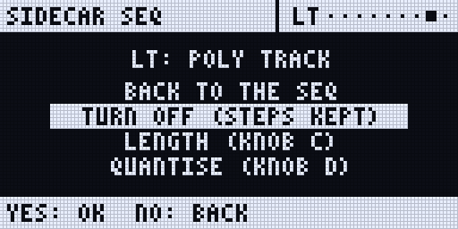
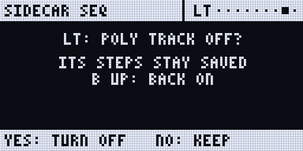

## POLY CONFIG

Each poly track has a **POLY CONFIG**, named and modelled after the Analog Four MKII's. On the Rytm it is the last item of the Rytm's own **track menu**: **FUNC + CHRO**, then **POLY CONFIG** (after TRIGS SETUP, PAD SCALE, RELOAD TRACK, SAVE TRACK and the user slots U1..U5; FUNC + DOWN moves five rows) and **YES**. The Sidecar draws the page on the Rytm's screen; the SIDECAR MENU lists it too.

| Knob | Setting | Values |
|---|---|---|
| **A** VOIC | **VOICES**: the most notes at once | AUTO (the machine's default), 1..8 |
| **B** ALLC | **ALLOCATION**: which voice a new note takes | REASSIGN (the default: the same note held retriggers its voice), ROTATE, RESET |
| **C** UNIS | **UNISON**: instances stacked per note | OFF, 2..8 |
| **D** DTUN | **DETUNE** of the stack | 0..127 (127: ±50 cents at the stack's edges; FUNC: by 8) |
| **E** SPRD | **SPREAD**: the stack across the stereo field | 0..127 (needs the voice on OUT [PRE / POST](/sidecar-expander/using/stereo-out/); FUNC: by 8) |
| **F** GRP | **GROUP** | OFF, 1..4: stored, not played yet |

- The line under the title says what the config resolves to now: `4 NOTES 4 INST 2.92%` (notes, instances, their share of a core), with `CUT` when the budget or the machine's maximum cut it.
- 6-OP FM, MULTISAMPLE, WAVETABLE and GRANULAR allocate from their own pools: they take **VOICES** only, B..E read `-`.
- On a Sidecar track that is no poly track yet, the page says so and **YES** makes it one. On an analog track it explains that the Rytm's voice is mono.
- **NO** goes back to the Rytm's own screen.
- **Where it is stored:** in the pattern, and as the track's default in the project. A track plays its pattern's config, else its default (the last one set on it), so a track keeps its voicing across patterns, and a pattern may still differ.
- The same config is on the touchscreen's SEQ page (the **POLY** tool), the web page (**Sound > Poly tracks**) and the console (`seq=poly:T:voices=4,alloc=rotate,unison=2,detune=30,spread=64`).

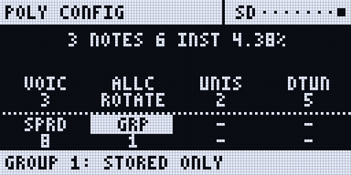
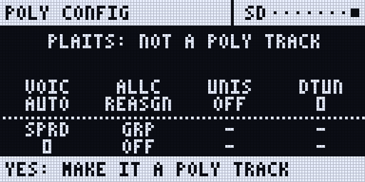
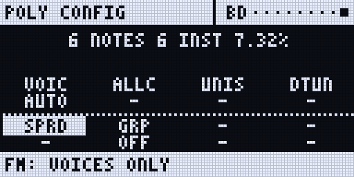
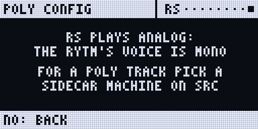
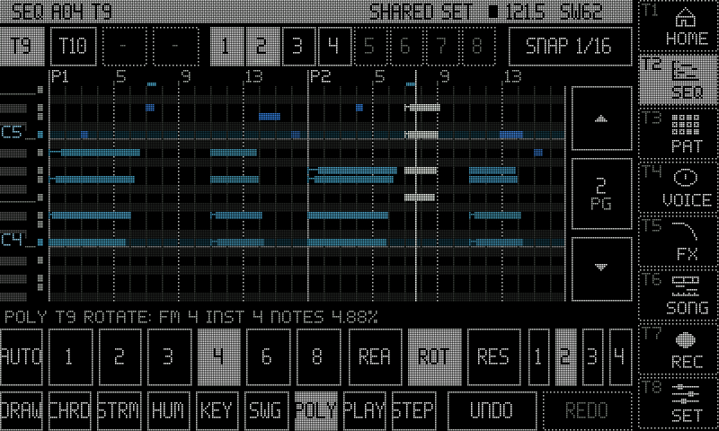

in testing (emulator)

## Seeded randomness

Every random choice the sequencer makes (today: a step's probability) comes from one **seed**, so it can repeat exactly.

- **Per pattern:** **FREE** (the default: a new seed at each PLAY, kept through pauses and pattern changes) or a **fixed seed** 0..9999, saved with the pattern. With a fixed seed a 50 % step makes the same choices on every PLAY, after an edit and after a reload.
- **Per track:** a track may have a seed of its own, and may make the same choices on every loop.
- Set it on the RANDOM page of the SEQ page ([below](#more-sequencer-pages-direction-speed-scale-random-ratchets-slides-fx-column)) or on the console: `seq=seed:free`, `seq=seed:41`, `seq=tseed:T:N|follow`.

in testing (Mac)

## Poly tracks belong to the pattern

Which tracks are poly is set **per pattern**, so BD can be a poly track in A01 and a plain Rytm track in A02.

- A new or cleared pattern has **no poly tracks**: every track is a normal Rytm track, and regular trigs can be added on every track. Up to 4 tracks per pattern can be poly.
- Switch between a pattern with a poly track and one without while playing: the plain pattern's first step plays the Rytm's own trig once (no double, none missing); the poly pattern's first step is on time when you switch back.
- The Rytm's own **CLEAR PATTERN** turns the pattern's poly tracks off, as it empties the pattern. The Rytm's UNDO brings them back with their steps.
- Pattern and track paste carry the poly flag with the steps.
- A kit change that gives a poly track a **Rytm machine** releases it: the Rytm's own sound and trigs play. Back on a Sidecar machine it is captured again, with its steps.
- **Your existing projects:** poly tracks with steps stay poly. A track that only had an empty poly slot is a plain Rytm track now.
- The touchscreen's step editor lists the pattern's poly tracks only; a track that is off answers "not a seq track".

## Entering notes

In seq mode (a poly track selected, GRID REC on):

- **Tap a trig key**: the step on or off, with the last chord or note you played.
- **Hold a trig + play pads** (or keys on a MIDI keyboard on the Sidecar): those notes become the step's notes; several at once make a chord. The pads play notes in the Rytm's **CHRO** mode; in the normal pad mode they play the tracks as on the stock Rytm.
- **Hold a trig + turn A..H**: NOTE, VEL, LEN, MICRO, CHD, INV, STRUM, SEL. Turning on an empty step starts it at C3 (the track's default note).
- **Chords**: CHD picks a chord on the step's note (OFF MAJ MIN SUS2 SUS4 7 MAJ7 MIN7 DIM AUG 6 MIN6 9 ADD9 MIN9 5), INV an inversion (0..3), STRUM spreads the notes in time.
- **Live recording**: RECORD + PLAY and play the pads or a keyboard. The Sidecar records the notes on its own grid, at the nearest step with the micro offset kept (QNT OFF) or snapped to 1/16 (QNT 1/16), with the length from the note-off. Overdub adds notes. The Rytm writes nothing on a poly track.
- **The touchscreen** has a piano roll for the same steps: draw, move and resize notes, stamp chords, strum, humanise and swing. See [The touchscreen](/sidecar-expander/using/touchscreen/#seq-the-piano-roll).

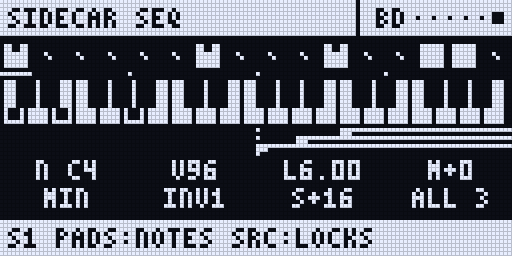

### Step preview

Hold one or more trigs and press **YES**: the held steps play on the track's voice, the whole chord with each note's velocity, length and micro timing, and the first held step's p-locks. Works stopped or playing; nothing is recorded or toggled.

## NOTE EDIT

NOTE EDIT edits single notes the way a Push 3 does: turn **DATA**, and a box walks through the notes while the knobs edit the one it is on. It works on a poly track's SEQ page, in GRID REC or after UP + TRIG. in testing (first round on a real Rytm; the newest screen is still being checked)

**Walk and edit**

1. Turn **DATA**. The box lands on the last note you had (if it is on the page shown), else the page's first note. Then it moves note by note in play order: step by step, upward through a chord. It crosses pages and the page follows. **FUNC + DATA** jumps a whole step.
2. The screen shows the note's step, nudge, length, pitch and velocity. Turn **A..E** to edit it:

| Knob | Edits | FUNC |
|---|---|---|
| **A** POS | the step (it skips a step that is full or already holds that pitch) | 1/96 of a step |
| **B** NUDG | the micro timing | 1/8 of a step |
| **C** LEN | the length | whole steps |
| **D** PTCH | the pitch, by semitone (in the pattern's scale, by scale degree) | octave (in a scale: semitone) |
| **E** VEL | the velocity | by 8 |

F..H (VRNG, PROB, COND) show `-`: not per note yet.

**Reach a note faster**

- **Hold a step:** DATA walks only that step's notes (a chord), and A..E edit that step's note. An empty held step gets a note at the first turn. Let go and DATA walks the whole pattern again.
- **Tap a step:** the box jumps to it. Tapping an empty step adds a note.

**Select several**

- **Press DATA** to add the note to the selection (the footer says `SELECTED n`). The knobs then edit every selected note by the same amount, and the values read as ranges (`C4..F4`). **FUNC + DATA** (push) selects all notes, or none when all are selected.
- Pause for a moment after pressing DATA: the Rytm itself drops a DATA turn in the half second after a push.

**Delete, undo, leave**

- **FUNC + NO** deletes the selection, or the box's note. For two or more notes it asks `F+NO AGAIN`: press it again within 2 seconds. A step left empty is cleared.
- **FUNC + YES** is **UNDO**. It shares one history with the touchscreen's UNDO / REDO.
- **NO** steps back: it clears the selection, then leaves NOTE EDIT. **TRIG** leaves it too.

**What you see.** The screen has no title bar: the note name and the position on the first line, the pitch roll below it, the values and the knob you turned last at the foot. When the notes span more pitches than fit, the roll scrolls as far as it needs to keep the box on screen; small marks on its right edge say there are more pitches above or below. The trig LEDs show the box's step amber and steps with selected notes green. The touchscreen's piano roll follows the same note.

On a poly track's SEQ page DATA no longer sets the track LEVEL (on the Rytm's own pages it still does).

## The TRIG view and trig conditions

On a poly track, **TRIG** opens the SEQ page; with the page open, TRIG switches between the notes and the **TRIG view**, like the Rytm's own TRIG page beside the grid.

- **With trigs held:** NOTE VEL LEN MICRO / **COND** STRUM CHD INV of the first held step. Turning a knob edits every held step (FUNC: coarse).
- **With nothing held:** the track's defaults for new steps (NOTE VEL LEN) and **SWING** (50..80).

**COND** is one knob, as on the Rytm:

| Value | Plays the step |
|---|---|
| `---` | always |
| FILL / !FILL | while FILL is held / not held |
| PRE / !PRE | when this track's last condition was true / false |
| NEI / !NEI | when the track before's last condition was true / false |
| 1ST / !1ST | on the first loop since PLAY or a pattern change / on every loop but the first |
| 1:2, 2:2, 1:3 .. 8:8 | on loop A of every B, counted per track from PLAY or a pattern change |
| 1% .. 99% | with that probability |

Conditions are saved with the step and carried by copy, paste and undo. The touchscreen's piano roll marks them on its ruler.

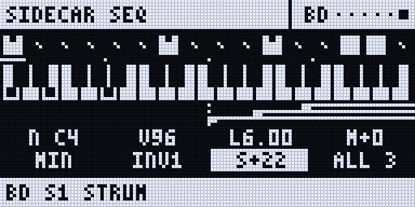
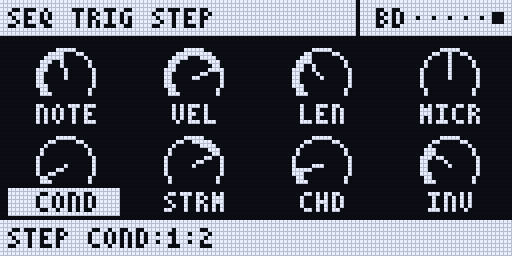

<small>Renders of the Rytm-screen pages: the Sidecar's own page code on the host, with made-up data.</small>

## P-locks on poly steps

Hold one or more trigs and press a page key. The SEQ page becomes a lock page with the machine's knobs:

| Page key | Locks |
|---|---|
| **SRC** | A..H: P1..P8 of the track's Sidecar machine |
| **SMPL** | A..H: P9..P16 (for example CHD INV SPR VOI) |
| **FX** | A..D: SEND FX 1 P2..P5, E..H: SEND FX 2 P2..P5 |
| **FX** again | the **INS** page: A..D INSERT A P1..P4, E..H INSERT B P1..P4 ([Insert FX](/sidecar-expander/using/insert-fx/)) |

- Turn a knob: it is locked on every held step (with FUNC held: 8 steps a detent).
- **NO**: clears every lock of the held steps. **Push** a knob: clears that knob's lock.
- Locking an empty step makes a **lock trig**: locks without notes, which change the sound under a ringing note.
- A locked knob is framed with its label inverted; the bottom bar shows the step and the value (`S5 LEV:34 LOCK`).
- A lock holds until the track's next step with notes or locks; STOP gives every knob its own value back. An LFO on a locked parameter moves around the lock.
- Up to 12 locks per step. Copy, paste, clear and undo carry the locks with the steps.
- Letting go of the trigs goes back to the view you were on.

FLTR, AMP and LFO under a held trig show a page explaining that the analog side and the Sidecar's LFOs are not locked per step.

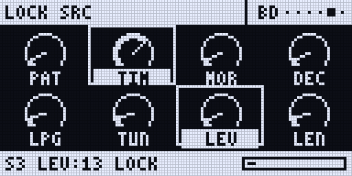
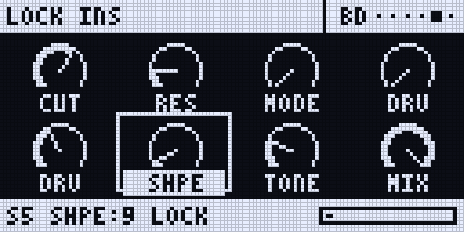

Where locks show: the trig LEDs (a step with locks magenta, a lock trig dim magenta), the SEQ page (a tick over the step per lock, a lock trig as a hollow box) and the touchscreen's lock lane.

## Pages, length and SCALE

- A poly track has up to **8 pages of 16 steps** (128 steps).
- **PAGE**: the next page. **PAGE held**: the trig LEDs show a page map (pages in the pattern dim, the page you edit bright, the playing page white), and the footer names the LED colours; a trig key while PAGE is held jumps to that page. The 4 PAGE LEDs show the position within the group of 4.
- **SCALE**: FUNC + PAGE opens the Rytm's own SCALE menu, also over the SEQ page. A poly track follows a length you set there. NO (or FUNC + PAGE again) brings the SEQ page back.
- On the SEQ page with no trig held: **A** the track, **B** the poly track on, **C** the length, **D** record quantise (QNT), **E** follow, **F** the latency (set by hand; it is measured automatically otherwise).

## Copy, paste, clear, undo

The Rytm's own gestures act on the Sidecar's steps too, with one undo per level as on the Rytm:

| Gesture | Acts on |
|---|---|
| FUNC + RECORD / STOP / PLAY (outside GRID REC) | the pattern: copy / paste / clear |
| GRID REC, FUNC + RECORD / STOP / PLAY | the track: copy / paste / clear |
| GRID REC, PAGE held + FUNC + RECORD / STOP / PLAY | the page: copy / paste / clear |
| GRID REC, trigs held + **UP** + RECORD / STOP / PLAY | the held steps: copy / paste onto them (a shorter clipboard repeats) / clear |
| The same paste or clear again | undo |

Held-step copy is one-handed: hold the trigs first, then UP, then RECORD, STOP or PLAY (UP first and then a trig would be a page request). On a poly track UP is taken at once while a trig is held; on a normal track UP + RECORD / STOP / PLAY stays the Rytm's own.

Paste on another pattern: select it (BANK + trig), then paste, as on the Rytm. Pattern and track copy / paste with poly tracks: hardware.

## Saving and reloading

The Rytm's **SAVE PATTERN** and **RELOAD PATTERN** (the PATTERN menu, FUNC + SCNE) and **SAVE TRACK** / **RELOAD TRACK** (the TRACK menu, FUNC + CHRO) act on the poly tracks too:

- SAVE keeps the working steps as the pattern's saved state (`pNNN.sqs`).
- RELOAD brings the saved state back, keeping the working copy first (`pNNN.prv`). A pattern the Sidecar never saw saved keeps its steps.

**Pattern files from 0.3 on.** A pattern that uses a new feature (a fixed seed, a track's own seed, a poly config) is saved in a newer format (`.sqp` version 4) and needs a 0.3 or later Sidecar; every other pattern is saved as before and still plays on an older Sidecar.

**A pattern file that does not load is locked.** A file from a newer Sidecar, or a damaged one, is never written over: edits stay in memory and the footer says `A05 FROM NEWER SIDECAR: LOCKED` or `A05 FILE DAMAGED: LOCKED`.

## The touchscreen from the Rytm

Hold **UP** and press a trig key to switch the touchscreen's page (no trig is placed); hold UP alone to see the map. See [Key combinations](/sidecar-expander/using/key-combinations/).

| Keys | Page |
|---|---|
| UP + T1 | HOME |
| UP + T2 | SEQ (the piano roll) |
| UP + T3 | PAT (the Rytm's own pattern) |
| UP + T4 | VOICE (the selected track) |
| UP + T5 | SET (settings) |
| UP + T6 | INSERT FX |
| UP + T7 | SAMPLE on the Rytm's screen (again: AUTO) |
| UP + T8 | REC |
| UP + T9 | SCOPE |
| UP + T10 | SIDECAR STATUS |
| UP + T11 | SONG |
| UP + T12 | PROJECT |
| UP + T13 | POOL |

T8..T13 open on the touchscreen when it has the page, else on the Rytm's screen. SEQ, VOICE and the machine view follow the track you select on the Rytm.

## What the screens show

**The Rytm** (the SEQ page): SIDECAR SEQ and the track, the pattern, the page (`PG1/4`), the length and the transport; a step strip with the page's steps; a piano roll of the page. With a trig held: a keyboard with the step's notes, a timing lane, and the eight values. The keyboard names each octave's C (C3, C4, C5) and keeps its window steady while the step's notes fit in it. The playhead on the page moves at most 4 times a second; the trig LEDs show every step.

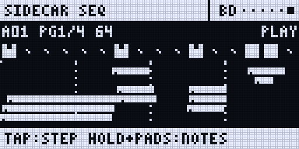
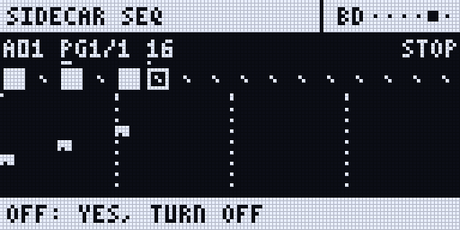

**The trig LEDs** in seq mode: a note blue, a chord cyan, the playing step white, held steps amber, steps with locks magenta, steps past the length dark.

**The touchscreen** (SEQ): the piano roll of the same track, the velocity lane, the lock lane, the page strip and the tools. While the Rytm plays the roll opens in **VIEW**: tap DRAW to edit.

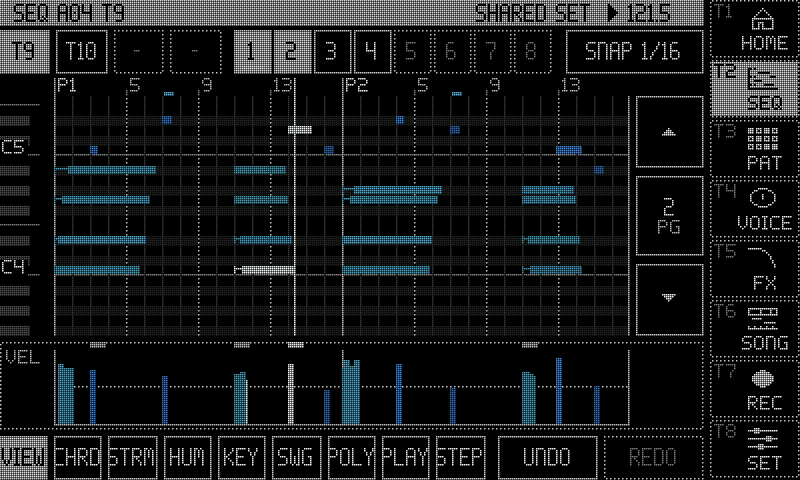

<small>Screenshots: rendered off-device by the Sidecar's own page code, with made-up data.</small>

## The song recorder

The [song recorder](/sidecar-expander/using/song-recorder/) records the Rytm's pattern changes, mutes and knobs. A poly track's notes are not events in the take: they are in the pattern's file on the Sidecar, so when the take (or its replay) changes pattern, the poly track plays that pattern's steps.

## Key combos

| Keys | Where | Does |
|---|---|---|
| UP + TRIG | any track | the SEQ page; on a track that is no poly track the make prompt (or why not) |
| YES / NO | make prompt | make the poly track / back |
| UP + TRIG or NO | SEQ page | leave (the page has no LEFT / RIGHT siblings) |
| FUNC + DOWN (no trig held) | SEQ page | the poly track's menu |
| UP / DOWN | SEQ page, CHRO pads | the Rytm's: the pads' range ([above](#the-pads-range)) |
| YES + PLAY, YES + SCENE | SEQ page | the Rytm's quick saves (YES is the Rytm's) |
| FUNC, then YES | SEQ page | UNDO |
| DATA turned / pushed | SEQ page of a poly track | [NOTE EDIT](#note-edit): walk the notes / select |
| FUNC + DATA / FUNC + NO | NOTE EDIT | step by step or select all / delete |
| RECORD | poly track selected | GRID REC = seq mode |
| TRIG | poly track | the SEQ page / the TRIG view |
| trig tap | seq mode | step on / off |
| trig held + pads / keys | seq mode | the step's notes |
| trig held + A..H | seq mode | NOTE VEL LEN MICRO CHD INV STRUM SEL (TRIG view: COND) |
| trig held + YES | seq mode or SEQ page | step preview |
| trig held + SRC / SMPL / FX / FX FX | seq mode | lock pages: P1..P8 / P9..P16 / send FX / inserts |
| lock page: turn / NO / push | trig held | lock / clear all / clear that knob |
| trig held + UP + RECORD / STOP / PLAY | seq mode | copy / paste / clear the held steps (one hand) |
| PAGE / PAGE held / PAGE + trig | seq mode | next page / page map / jump to page |
| FUNC + PAGE | seq mode, also over the page | SCALE |
| RECORD + PLAY | poly track | live record on the Sidecar's grid |
| FUNC + CHRO, POLY CONFIG, YES | a track | the track's [POLY CONFIG](#poly-config) |
| UP + T1..T13 | anywhere | the pages (above) |

:::note[Older forms]
TRK + TRIG and trig held + FUNC + RECORD / STOP / PLAY, from the 0.3 test builds, still work.
:::

## Features

- Poly tracks on every Sidecar machine, up to 4 poly tracks at once, each with its POLY CONFIG (VOICES, ALLOCATION, UNISON, DETUNE, SPREAD).
- Probability from a seed: FREE, or fixed per pattern and per track.
- Up to 8 notes per step, each with its own velocity, length and micro timing (1/96 of a step).
- Chords by CHD, INV and STRUM, or played on the pads; chord stamp, strum, humanise and swing on the touchscreen.
- Trig conditions (FILL, PRE, NEI, 1ST, A:B) and probability per step.
- Poly per pattern: a track is poly in the patterns where you made it so.
- NOTE EDIT: walk and edit single notes with DATA and A..E, select, delete and undo.
- Up to 8 pages of 16 steps per track, with a page map on the trig LEDs.
- P-locks on the Sidecar machine's 16 parameters, the send FX and the inserts; lock trigs.
- Step preview (trig held + YES), live recording with quantise off or 1/16.
- Follows PLAY, pause, STOP, tempo, pattern changes (queued, chained, jumps), mutes and SCALE lengths.
- Copy, paste, clear and undo of patterns, tracks, pages and held steps through the Rytm's own gestures; SAVE and RELOAD of patterns and tracks.
- Notes rendered ahead by the measured round trip, so they line up with the Rytm's own trigs.
- The SEQ page on the Rytm and a piano roll on the touchscreen, both following the selected track.

## Limitations

- **Sidecar (Pi) only.**
- **Analog tracks are not polyphonic.** A poly track must play a Sidecar machine. FREEZE (below) is planned for analog sounds.
- **Voices** are capped by VOICES (at most 8) and the shared instance pool (32); a note past the cap steals one (the same pitch, then the quietest released tail, then the oldest).
- DSP SAMPLE (and GRAIN) play one note at a time.
- On 6-OP FM, MULTISAMPLE, WAVETABLE and GRANULAR, ALLOCATION and UNISON do not apply (VOICES only).
- **GROUP** is stored, not played: tracks pooled into one instrument come later.
- SPREAD needs the voice on OUT PRE or POST; on TRK the track is mono.
- **Shared voices.** RS/CP, MT/HT, CH/OH and CY/CB share one voice; a poly track is best on BD, SD, BT or LT.
- **No analog p-locks on poly steps**: FLTR, AMP and the Rytm's own FX are not locked per step, and the Sidecar's LFOs are not locked per step.
- **No retrigs.** A FILL latched on the Rytm is not seen (only FILL held).
- A condition is decided when its step is planned (about 32 ms ahead); an edit just then can decide a PRE or A:B step again.
- Poly tracks use the Sidecar's own swing, set per track.
- The first steps after PLAY are late by the round trip (PLAY cannot be predicted); after that, and across pattern changes, notes are rendered ahead.
- Steps live on the Sidecar's card. A stock OS, a SysEx or Transfer backup, or a project shared without the card's files does not carry them: use a [bundle](/sidecar-expander/using/projects-bundles/).
- The files belong to the Rytm's project slot. A rename needs nothing; SAVE AS and copy / paste of a project take them along ([Projects by slot](/sidecar-expander/using/projects-bundles/#projects-belong-to-the-rytms-slot)).
- The SEQ page's playhead moves at most 4 times a second, to keep the Rytm's UI responsive.
- First hardware use on a Pi 4. Nothing is confirmed on a Pi 5 yet.

## More sequencer pages: direction, speed, scale, random, ratchets, slides, FX column

in testing (emulator and Mac; needs the Rytm build `rui1050` or later, and Sidecar 0.3.0). On a poly track's SEQ page, with no trig held, **TRIG** cycles four pages: NOTES, **DEFAULTS**, **SCALE**, **RANDOM**, then NOTES again. With trigs held, TRIG cycles NOTES, **TRIG**, **RTRG**, **FX**.

| Page | Knobs | What |
|---|---|---|
| **DEFAULTS** | A NOTE, B VEL, C LEN, D SWNG, **E DIR**, **F SPD**, **G TLEN** | the new steps' values, the track's play **direction**, its **speed** and its length |
| **SCALE** | A KEY, B SCL, C QNT | the pattern's key, scale and quantise |
| **RANDOM** | A SEED, B RNG, C WGHT, D MODE, E SRNG, F SQNT, G SAFF | seeded random notes and the modulatable seed |
| **TRIG** (trigs held) | A NOTE, B VEL, C LEN, D MICR, E COND, F STRM, G CHD, H INV | the held step (as before) |
| **RTRG** (trigs held) | A RATE, B CNT, C VCRV, D PCRV, E MODE, F OCT, G GATE | ratchets, rolls and a per-step arpeggiator |
| **FX** (trigs held) | A CMD1, B VAL1, C CMD2, D VAL2 | the tracker-style FX column |

- **Direction (DIR):** FWD, REV, PEND (pendulum, the ends once), PING (ping-pong, the ends twice), RND, BROWN (a random walk). RND and BROWN follow the seed, so a fixed seed plays the same order every time. Swing keeps its groove under any direction.
- **Speed (SPD):** a ratio of the Rytm track's own step clock. A plain turn walks Elektron's 1/8, 1/4, 1/2, 3/4, 1, 3/2, 2; **FUNC** also gives 2/3, 5/4 and 7/8. Each track can run its own ratio, for polyrhythms beyond the Rytm's SCALE.
- **Scale and key (SCALE):** KEY C..B; SCL CHR MAJ MIN DOR PENT PHR LYD MIX LOC HMIN MMIN PMAJ BLUES WHOLE; QNT **OFF** (only an aid: the roll's rows and the random notes keep to the scale), **EDIT** (the NOTE knob moves by scale degree, FUNC by semitone, and CHD / INV build chords that belong to the scale) or **PLAY** (also every note is quantised when it plays; the written notes stay).
- **Random notes (RANDOM):** MODE **STEPS** (steps flagged random), **TRACK** (every step with notes gets new pitches; rhythm, velocity and length stay) or OFF. RNG is the range in octaves, WGHT how the notes are weighted (FLAT, ROOT, CHORD, LOW, HIGH, STEP). On a step, turn NOTE below its lowest value to show **RND**: the step's random flag. **SEED** (fully down: FREE) fixes the sequence; **SRNG** lets a machine knob move the seed: the seed follows a parameter of the track's voice **as it plays**, so a scene lock, a PERF macro or an LFO on it changes the notes. That knob is SEED on DAISYSP and DSP SAMPLE; PLAITS and the other machines have no free one (the page says `NO SEED SLOT ON IT`). The poly track's menu has **PRINT RND (THIS LOOP)**, which writes the loop that plays into the steps.
- **Ratchets and arps (RTRG):** CNT repeats (2..16) inside the step, at a RATE or the note's length, with a velocity curve (VCRV) and a pitch curve (PCRV). MODE CHORD repeats the whole chord, WALK walks through it (a strummed ratchet), and UP DOWN UPDN RND PLAYED CONV make a per-step arpeggiator over OCT octaves.
- **Conditions and slides per lock:** on a lock page (trigs held + SRC / SMPL / FX), a **long push** on a knob edits that lock's own condition (label `PAT?`: FILL, 1ST, A:B, a percentage), so one parameter can change on some loops only. **FUNC + push** makes the lock **slide** to that parameter's next lock. A short push still clears the lock, now when you let go.
- **The FX column:** two commands a step. Timing and sound: RTG, DLY, CUT, CHN (a chance for the other command), RND, RNV, OCT, TRS, FIL. Order: JMP, JRN (a random jump), LOP (loop N times), SKP, DIR. They follow the seed too.
- The poly track's menu adds **PLAY MODE** (the direction) and **PRINT RND**.
- **Hold UP alone** (about 0.4 s) with a Sidecar page open: the map of UP combinations over the page, until you let go.

Not built: changing the speed in the middle of a pattern.

## Coming in 0.3.1

planned Not in 0.3.0:

**FREEZE** turns an analog track into a poly track: the auto-sampler samples the track's current sound over a range of notes, **2 round robins per note**, writes a multisample, and the track becomes a MULTISAMPLE poly track with it. The kit's analog sound stays as it was, so the track can go back. A quick way to play an analog sound polyphonically, not a replacement: locks and LFOs on the analog sound's own parameters are baked in.

**PAD OCT:** a per-track octave shift for the pads, so a poly track's pads can reach the notes above B5 and below C2.

See the [roadmap](/sidecar-expander/roadmap/).
