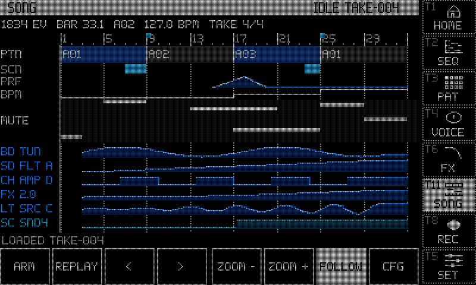
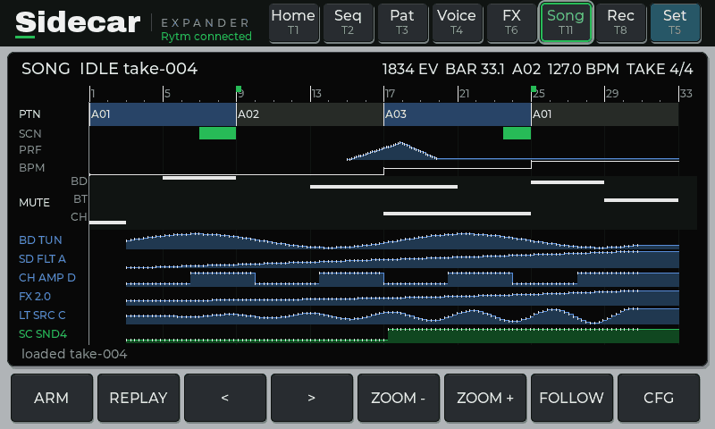
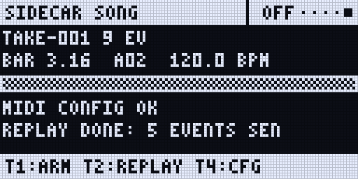

:::caution[New in 0.3]
New in 0.3 (until 0.3.0 is released: the test line, Rytm build `rui1046` with the Sidecar's 0.3 test build), Sidecar (Pi) only. Tested end to end in the emulator; not yet confirmed on a real Rytm.
:::

The Rytm's song mode is a list of patterns. The **song recorder** captures a whole performance instead: arm it, press PLAY on the Rytm and play. Pattern changes, knob moves on every track, mutes, scenes, PERF and the Sidecar's own send FX are recorded against the Rytm's step clock. Replay puts the Rytm back where the take began and plays it again. in testing

## Set the Rytm up once

GLOBAL > MIDI CONFIG (the Sidecar reads these settings, never changes them):

- PORT CONFIG: **ENCODER DEST** = INT+EXT, **OUTPUT CH** = TRK CH, **PARAM OUTPUT** = NRPN.
- SYNC: **PROG CH RECEIVE** and **PROG CH SEND** on, **TRANSPORT SEND** on.

The SONG pages say what is missing (`! ENCODER DEST INT, OUTPUT CH AUTO`); **CFG** on the touchscreen or **T4** on the Rytm's SONG page show the steps.

## Record

1. **Arm:** the touchscreen's **SONG** page, **ARM**; or the Rytm's remote **SONG** page, **T1**. Arming reads the Rytm's start state (working kit, pattern, settings).
2. Press **PLAY** on the Rytm and perform. **T3** drops a marker.
3. **STOP** on the Rytm ends the take: `/.rytm/songs/<project>/take-NNN.json`. A take cut by a power loss is recovered the next time the Rytm names that project.

## Look

The touchscreen's SONG page is the take as a timeline (read only): bars and markers, pattern blocks, scenes, PERF, tempo, the 12 mutes, and the parameter lanes that moved most (Rytm in blue, Sidecar in teal). Drag scrolls; **- / +** zoom; **FOLLOW** keeps the playhead in view; **< >** load the project's other takes.

## Replay

1. Stop the Rytm. **REPLAY** (touchscreen) or **T2** (Rytm).
2. Nothing is written until you **CONFIRM** (touchscreen) or press **YES** (Rytm). The Sidecar first backs up the Rytm's working kit, pattern and settings (`.backup-NNN.json`), then writes the take's start pattern and kit into the Rytm's **working** buffers (never a stored slot, never a save), sets the mutes and its own send FX, and checks what it wrote.
3. Press **PLAY** on the Rytm. Pattern changes, knobs, mutes and scenes come at their recorded steps. STOP ends it. **CANCEL** / **NO** backs out at any point before PLAY.

<small>Screenshots: rendered off-device by the Sidecar's own page code, with made-up data.</small>

**UP + T11** opens SONG: on the touchscreen when one is connected, else the Rytm's SONG page. The Rytm's SONG page is also in the SIDECAR MENU (UP + YES, then YES), listed once a take exists on the card or the touchscreen armed one.

## With poly tracks and the pools

- [Poly tracks](/sidecar-expander/using/sequencer/) keep their notes in the pattern's file on the Sidecar; when a take changes pattern, they play that pattern's steps.
- GRANULAR SRC, WAVETABLE TBL and MULTISAMPLE INST are recorded with their bank, from the Sidecar's own reports (not the Rytm's CC / NRPN), and replayed as a knob turn.

## Limitations

- Not replayed: tempo (the replay follows the Rytm's own tempo), FILL, trig, p-lock and pattern edits, sound loads, machine changes from the menu, LFO phase.
- Scenes and PERF on replay are not tested on hardware.
- Takes are numbered, not dated (the Pi has no clock).
- While a take records, the Rytm's SONG page updates about once a second and the touchscreen's PAT and VOICE pages fetch the Rytm's pattern only after STOP, to keep the Rytm's own UI responsive.
