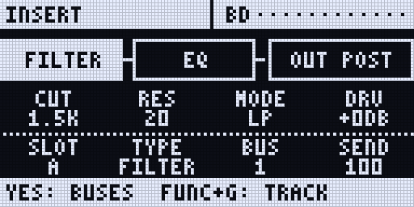
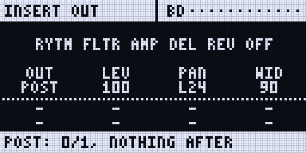
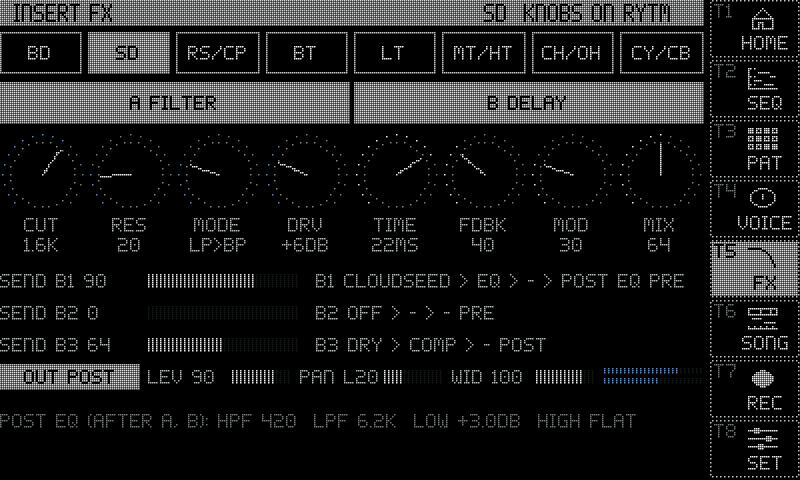

:::caution[New in 0.3]
New in 0.3.0 (the Rytm firmware 0.3.0 with the Sidecar 0.3.0 card). Built and tested on the Mac; **not yet measured on a real Rytm** (see [Measurements](#measurements-pending)). Sidecar (Pi) only.
:::

Every Sidecar voice normally comes back on its own Rytm track, in mono, through the track's analog filter and amp. The **OUT** route can send it past the track instead: straight onto the Rytm's main mix, in stereo. in testing

## TRK, PRE and POST

| OUT | Where the voice goes | The track's FLTR, AMP, OVER, VOL, PAN, DEL, REV | The Rytm's master distortion and compressor | Stereo |
|---|---|---|---|---|
| **TRK** (default) | its own track, as before | yes | yes | no |
| **PRE** | the Rytm's main mix, before the master effects | no | yes | yes |
| **POST** | the Rytm's main mix, after the master effects | no | no | yes |

- On PRE and POST a stereo sample plays in stereo (DSP SAMPLE, MULTISAMPLE, GRANULAR); every other machine plays centred. The voice's [insert effects](/sidecar-expander/using/insert-fx/) run in stereo too.
- Switching OUT crossfades over 8 ms, without a click. A held note keeps sounding; expect a step in level.
- OUT is saved per kit, with the inserts. It cannot be p-locked.

## What changes on PRE and POST

**Left out:** the track's filter, amp envelope, overdrive, volume and pan, and the Rytm's delay and reverb sends (the Sidecar can reach the Rytm's effect returns, not its effect inputs).

**Still works:**

- **The track's FX1 / FX2 send knobs** still feed the Sidecar's [send effects](/sidecar-expander/using/send-effects/): the voice stands in for its silent track.
- **The insert page's bus sends** (bus 1, 2, 3), as before.
- **Mute.** A muted track fades its PRE / POST voice out in 5 ms (and back in when unmuted). On a shared voice (RS/CP, MT/HT, CH/OH, CY/CB) the Rytm's own trigs mute it when both of its tracks are muted.
- **Envelopes.** MULTISAMPLE, GRANULAR and the synth machines have their own. DSP SAMPLE has none (the Rytm's AMP shaped it): on PRE / POST it plays to the sample's end or the note-off, and **DEC** shortens it like the AMP's decay.

## The OUT settings

| Setting | What | Range |
|---|---|---|
| **OUT** | TRK / PRE / POST | |
| **LEV** | the voice's level on PRE / POST | 0..127, 100 = unity |
| **PAN** | a stereo voice's balance, a mono voice's pan | L64 .. C .. R63 |
| **WID** | stereo width | 0 mono, 64 as the sample, 127 the sides twice |
| **DEC** | DSP SAMPLE's decay on PRE / POST | OFF, 20 ms .. 10 s |

LEV, PAN and WID are [LFO](/sidecar-expander/using/lfo/) targets: **O1..O8**.

## Where to set it

- **On the Rytm:** **UP + AMP** opens the remote **INSERT** page straight on the selected track's **OUT view** (again while open: back to that view). Or **UP + FX** for the INSERT page (TRK + FX, the older form, still works). The TRACK view's strip ends in the OUT box (`OUT POST`). Press **YES twice** (TRACK > BUS > OUT) for the **OUT view**: A OUT, B LEV, C PAN, D WID, E DEC (DSP SAMPLE only). The line under the title says what is left out. YES or NO goes back.
- **On the touchscreen:** the **INSERT FX** page (UP + T6): the **OUT** row. Tap the key to step TRK > PRE > POST; LEV, PAN and WID with their values, and the voice's L / R meters while it is on PRE / POST.
- **On the console:** `out=V3:post`, `out=V3:lev:100`, `out=V3:pan:64`, `out=V3:wid:64`, `out=V3:dec:off`, `out=list`.

## Stereo samples

The pool keeps a file's channels: a stereo file is stereo in memory (twice the memory of a mono one); a file with three or more channels keeps its first two. On TRK every machine plays the sum of the two channels, exactly as before. The pool lists tag each sample **ST** or **M** ([Pools](/sidecar-expander/using/pools/#st-and-m-stereo-samples)).

- **MULTISAMPLE** reads the `.sfz` regions' `pan`, `width` and `position` on PRE / POST.
- **GRANULAR** on PRE / POST reads a stereo source's two channels and pans each grain at random within SPRY x WID (WID 0: no spread). Its live inputs stay mono.
- `poolmono=1` in `cmdline.txt` sums stereo files at load: half the memory; PRE / POST voices then play them centred.

## Send and insert FX

- The voice's insert chain runs before the route: in stereo on PRE / POST, in mono on TRK.
- Its bus sends are taken from the voice's mono sum.
- The send effects keep a mono input: a PRE / POST voice feeds them through its track's FX1 / FX2 knobs as if it were the track's own output.

## The streaming budget

MULTISAMPLE streams its samples from the card, with their first half second in memory; stereo streams cost twice the reading of mono ones. Each drive has a **streaming budget**: how many streams it carries with a margin, from what was measured on it (the [storage bench](/sidecar-expander/using/storage/#measuring-a-drive-storbench), and for the SD card also the SD card test), or a cautious default.

- A stereo MULTISAMPLE instrument whose drive cannot carry 8 of its voices is **held in memory** instead, when it fits. Its row says `RAM (BUDGET)`.
- **Always in RAM:** hold a row, or a whole list, in memory whatever the budget says (short loops, hard-hit material): `pool=inst:ram:A003:on`, `pool=smp:ram:all:on` (`:off` takes it back). The web page's Pool tab marks such a row **RAM**.
- `stream` on the console prints every drive's budget (stereo and mono 24-bit 48 kHz streams).
- A change acts at the instrument's next load.

## Recording

A voice on PRE / POST when a take starts records its own file in stereo (`13_VOICE1.wav` .. `20_VOICE8.wav`). Two more [recorder](/sidecar-expander/using/recorder/) sources carry the pairs as sent: **23 PRE** and **24 POST** (the web page's record list, or `rec=ch:+pre,+post`). The sampler's "Sidecar voice" source records stereo for a voice on PRE / POST.

## Measurements (pending)

How the Rytm handles the two returns has not been measured on a real Rytm yet; the defaults follow the design. The Sidecar measures it itself. To help, with a Rytm and a Sidecar running this build:

1. Connect the Rytm (Overbridge, as for playing) and stop it. Set the master effects neutral (distortion 0, compressor off). Note the Rytm's USB audio settings.
2. On the console: `stereo=measure`. It plays test tones and an impulse for about 4 s and reads them back from the Rytm's MAIN L/R. Then `stereo=result`.
3. With a track: put a Sidecar machine on BD (voice 1), FLTR open (LP, cutoff max, RES 0), OVER 0, AMP ATK 0 / HOLD max / DEC max, VOL 100, PAN centre, DEL and REV sends 0. Trigger BD once, then `stereo=measure:trk:1` (about 6 s) and `stereo=result`. It suggests trims that make LEV 100 on PRE / POST as loud as the same voice on TRK.
4. Repeat for each of the Rytm's USB IN routing settings.
5. Keep the trims with `trimpre=` / `trimpost=` in `cmdline.txt` (tenths of a dB), or `stereo=trim:pre|post:N` for the session.
6. Send the `stereo=result` lines and the settings you used with a [tester report](https://github.com/trigcondition/sidecar-expander/issues/new/choose).

If a result says `(NOT IN MAIN IN)`, that return does not reach what the Rytm sends back as MAIN L/R: the recorder's MASTER and the sampler's MAIN would then miss PRE / POST voices. Please report it.

## Limitations

- Sidecar (Pi) only. Not yet measured on a real Rytm (above).
- Not built yet: an amp follower for DSP SAMPLE on PRE / POST (only DEC for now), GRANULAR's live inputs in stereo, stereo-input send effects.
- The touchscreen's REC page has no cells for PRE / POST: use the web page or the console.
- A take's stereo voice files follow the routes set when it is armed, not when PLAY starts it.
- With POST voices the main outputs can reach about -6 dBFS before the send FX returns.
