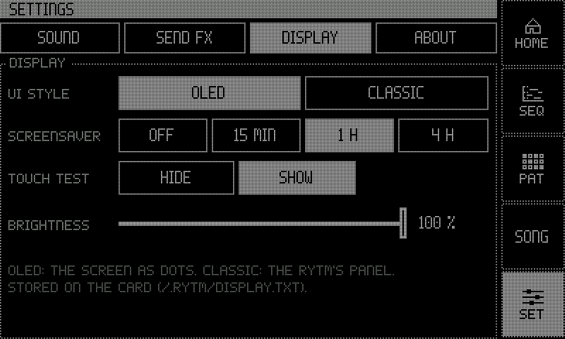
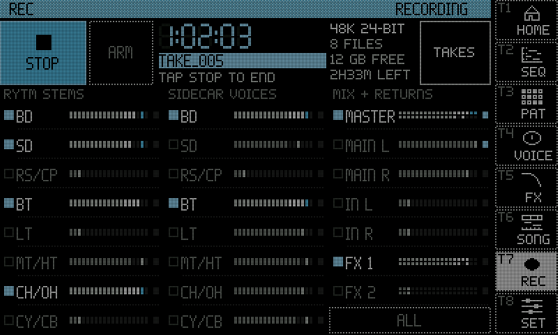

:::caution[New in 0.3]
New in 0.3 (until 0.3.0 is released: the test line, Rytm build `rui1039` with the Sidecar's 0.3 test build), Sidecar (Pi) only. For the 0.2.0 display see [The display](/sidecar-expander/using/display/). The pages are rendered and their touch controls checked off-device; the OLED theme and the SEQ page have been used on a Pi 4 with a 7" DSI panel (OSOYOO).
:::

The touchscreen follows the Rytm: it shows the track you select there, and the Rytm can switch its pages (UP + T1..T10). in testing

## Themes

Two themes, each with every page. Switch with **Settings > Display > UI style** (applied at once, stored on the card); `uistyle=classic` in `cmdline.txt` also gives the boot screen the CLASSIC look.

| Theme | Look |
|---|---|
| **OLED** (default) | The screen drawn as a zoomed-in dot-matrix OLED: 400x240 dots, each 2x2 pixels with a dark grid between, dotted outlines, inverted selection, knobs as dot rings. A navigation column on the right: HOME, SEQ, PAT, SONG, SET. |
| **CLASSIC** | The controls drawn as the Rytm's hardware: rubber keys, trig keys with LEDs, knob caps with LED rings, the teal FUNC key, black display windows. Seq, Song and Home keys in the title bar. |

## Pages

| Page | Open with | Shows |
|---|---|---|
| **HOME** | HOME key, UP + T1 | the voices and their machines, the core loads, Overbridge blocks and underruns, the project's U1..U5, the network and the recorder |
| **SEQ** | SEQ key, UP + T2, TRK + TRIG on the Rytm | the piano roll of a seq track (below) |
| **PAT** | PAT key, UP + T3 | the Rytm's own pattern (read only): 12 tracks x 16 steps (or all 64), trigs by velocity, micro timing, conditions, p-lock lanes and a step card |
| **VOICE** | UP + T4 | the selected track: its machine, P1..P8 as dials with the Rytm's labels, a live scope of the track's output, the machine's panel (the 6-OP FM algorithm, MULTISAMPLE's zones and envelope, DAISYSP's mode) and a p-lock heatmap |
| **Machine view** | UP + T4 on a GRANULAR or WAVETABLE track, or tap a GRAN / WAVE voice on HOME | GRANULAR's grains over the source, or WAVETABLE's frames; **SOURCES** opens the bank list |
| **SOURCES** | SOURCES in the machine view | banks A..H of the machine's sources, FILES and FILL ([source banks](/sidecar-expander/using/poly-machines/#source-banks-ah)) |
| **INSERT FX** | UP + T6, or Settings > Send FX > Inserts | the selected voice's two insert slots, its sends and the three buses ([Insert FX](/sidecar-expander/using/insert-fx/)) |
| **SONG** | SONG key | the song recorder's timeline, ARM, REPLAY ([Song recorder](/sidecar-expander/using/song-recorder/)) |
| **REC** | UP + T8, or tap the REC status on HOME | the Overbridge recorder (below) |
| **SET** | SET key, UP + T5 | Settings: Sound, Send FX, Display, About |

The sampler and the auto-sampler (UP + T7), SCOPE (UP + T9) and SIDECAR (UP + T10) open on the Rytm's own screen; the touchscreen has no pages for them, nor for the LFOs and Wi-Fi (those are on the web page).

### SEQ: the piano roll

The seq track's notes as bars, coloured by velocity, with note names when there is room. Micro timing shows as a stem from the step line (a strummed chord reads as a staircase). The header has the transport, tempo, pages, project, pattern and track; chips switch between the seq tracks; the page strip shows pages 1..8.

| Tool | Does |
|---|---|
| **DRAW** | tap an empty cell: a note; tap a note: select; tap it again: delete; drag: move (time and pitch); drag its right edge: length; the velocity lane under the roll |
| **CHORD** | tap a step: stamp a chord on that row's note (MAJ MIN 7 MAJ7 MIN7 SUS2 SUS4 DIM AUG 9 ...), inversion R/1/2/3, strum 0/6/12/24 |
| **STRUM** | break the chords of a step or the whole view, up or down |
| **HUMAN** | random timing and velocity on a step or the view, reproducible |
| **KEY** | show a key and scale on the rows |
| **SNAP** | 1/16, 1/32, 1/64, FREE |
| **UNDO / REDO** | 24 levels, kept per track and pattern |

Drag on the grid scrolls; pinch zooms (1..8 pages across, row height). While playing, the view follows the playhead's page, 3 s after your last touch.

### VOICE and the machine view

VOICE's scope may stay flat while the Rytm shows one of the Sidecar's remote pages other than SCOPE.

### REC: the Overbridge recorder

The [recorder](/sidecar-expander/using/recorder/) on the touchscreen: REC / STOP, ARM, the take's time in segment digits, the take's name, 48 kHz and the bit depth, the card's free space and the time it holds. Below, the 23 channels in three columns (RYTM STEMS, SIDECAR VOICES in the Rytm's track order, MIX + RETURNS), each with a meter; tap a channel to record it or not (while idle). **TAKES** lists the newest takes, with delete (after a confirmation). The HOME key's LED blinks while recording.

### Connection banner

When the Rytm's link comes up or drops, a short banner slides over the top of the screen: **CONNECTED** (about 1.4 s) or **DISCONNECTED** (about 1.1 s) in the OLED theme, **RYTM CONNECTED** / **RYTM DISCONNECTED** with an LED sweep in CLASSIC. It plays only on a change of the link, never on a page change.

<small>Screenshots: rendered off-device by the Sidecar's own UI code, with made-up data.</small>

## Screen sizes

The UI has two sizes, each with its own layout in both themes: **800x480** and **1024x600** (OLED: 512x300 dots). The size follows the frame buffer the Pi's firmware sets from `config.txt`:

- 800x480 or 1024x600: that layout, 1:1.
- Any other size (Pi 4): the 800x480 layout in the middle, unscaled, with black borders.
- Pi 5 on HDMI: the firmware picks the mode (1920x1080 measured), the UI is scaled to it: the 1024x600 layout when the display prefers 1024x600, else 800x480.
- To force a size: `res=800x480`, `res=1024x600` or `res=auto` in `cmdline.txt` or on its own line in `/.rytm/display.txt`; read at boot.

The larger size gives the roll, the lists, the timeline and the meters more room; text and touch targets keep their size.

## Which displays work

| Display | Pi 4 | Pi 5 |
|---|---|---|
| 5" / 7" HDMI LCD with USB touch, 800x480 (Waveshare) | hardware (the 5") | hardware, scaled (slightly soft) |
| 7" HDMI 1024x600 with USB touch (such as the GeeekPi EP-0194) | expected: needs `hdmi_cvt=1024 600 60 6 0 0 0` under `[pi4]` in `config.txt` | expected |
| 7" DSI compatible with the official display v1 (OSOYOO 7" DSI V4.0) | hardware | in testing (built, not yet run) |
| Official Raspberry Pi 7" Touch Display (v1, DSI) | expected (the same path as the compatibles) | in testing (built, not yet run) |
| Raspberry Pi Touch Display 2 | not supported | not supported (untested; portrait 720x1280) |

HDMI goes to the Pi's micro-HDMI 0, USB touch to a USB-A port. With a DSI display and HDMI both connected, the Sidecar draws on the DSI display. `dsi=0` in `cmdline.txt` keeps it on HDMI. To turn a DSI display by 180 degrees: `lcd_rotate=2` under `[pi4]` in `config.txt` (Pi 4) or `dsi_rotate=180` in `cmdline.txt` (Pi 5); `dsitouch_inv=1`, `2` or `3` mirrors the DSI touch in x, y or both. USB touch calibration: see [The display](/sidecar-expander/using/display/#touch).
