:::caution[New in 0.3]
New in 0.3 (until 0.3.0 is released: the test line, Rytm build `rui1048` with the Sidecar's 0.3 test build), Sidecar (Pi) only. Which displays work, the screen sizes and the display settings: [The display](/sidecar-expander/using/display/). The pages are rendered and their touch controls checked off-device; the OLED theme and the SEQ page have been used on a Pi 4 with a 7" DSI panel (OSOYOO).
:::

The touchscreen follows the Rytm: it shows the track you select there, and the Rytm can switch its pages (UP + T1..T13). The Rytm's keys and knobs come first; the touchscreen shows more and edits what is easier by touch. **It is optional:** without it the Sidecar's pages open on the Rytm's own screen, and the web page covers setup. in testing

## Themes and looks

Two themes, each with every page. Switch with **Settings > Display > UI style** (applied at once, stored on the card); `uistyle=classic` in `cmdline.txt` also gives the boot screen the CLASSIC look.

| Theme | Look |
|---|---|
| **OLED** (default) | The screen drawn as a zoomed-in dot-matrix OLED: 400x240 dots, each 2x2 pixels with a dark grid between, dotted outlines, inverted selection, knobs as dot rings. |
| **CLASSIC** | The controls drawn as the Rytm's hardware: rubber keys, trig keys with LEDs, knob caps with LED rings, the teal FUNC key, black display windows. |

**Settings > Display > LOOK: STUDIO / STAGE** (OLED). STUDIO is the dot look above (the default). **STAGE** draws every dot as a whole 2x2 cell, without the grid lines, and lifts every grey a step: easier to read on a stage and at an angle.

**Colours mean one thing each** (OLED): teal text is always inverted (black on teal) and means "look here", with the reason spelled out; an error blinks for 3 s, then stays. Loading is dim with moving dots. Playing is white.

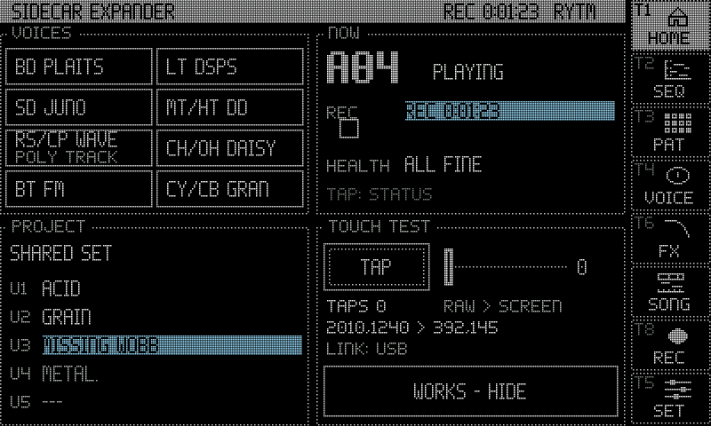
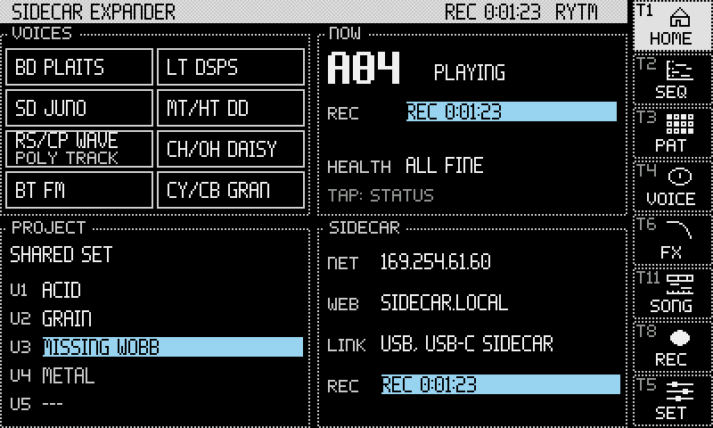
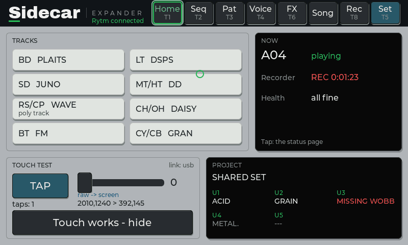

## Navigation

A column of keys on the right (CLASSIC: in the title bar) in both themes: **HOME, SEQ, PAT, VOICE, FX, SONG, REC, SET**. Each key is captioned with the trig key that opens it from the Rytm with **UP** held (T1 HOME, T2 SEQ, T3 PAT, T4 VOICE, T5 SET, T6 FX, T8 REC, T11 SONG). Every page lights its own key or its parent's (SCOPE lights VOICE, STATUS lights HOME), never SET for a page that is not a setting.

**Hold UP** on the Rytm: the touchscreen shows the map of every UP + key until you let go (the Rytm shows the same map). See [Key combinations](/sidecar-expander/using/key-combinations/).

## Pages

| Page | Open with | Shows |
|---|---|---|
| **HOME** | HOME, UP + T1 | the voices by track (a poly track marked POLY TRACK), **NOW** (the pattern, the transport, the recorder, one health line), the project's U1..U5, the network |
| **SEQ** | SEQ, UP + T2, UP + TRIG on the Rytm | the piano roll of a poly track (below) |
| **PAT** | PAT, UP + T3 | the Rytm's own pattern (read only): 12 tracks x 16 steps (or all 64), trigs by velocity, micro timing, conditions, p-lock lanes and a step card |
| **VOICE** | VOICE, UP + T4, a voice on HOME | the selected track: its machine, P1..P8 as dials with the Rytm's labels and their values, the machine's panel (the 6-OP FM algorithm, MULTISAMPLE's zones and envelope, DAISYSP's mode), a p-lock heatmap |
| **Machine view** | UP + T4 on a GRANULAR, WAVETABLE or MULTISAMPLE track | GRANULAR's grains over the source, WAVETABLE's frames, MULTISAMPLE's zones over a keyboard; **POOL** and **ALL POOLS** |
| **POOL** | UP + T13, POOL in the machine view, ALL POOLS, Settings > Pool | the project's [POOL lists](/sidecar-expander/using/pools/#on-the-touchscreen): banks A..H, rows with their states, the pool RAM |
| **INSERT FX** | FX, UP + T6 | the selected voice's two insert slots, its sends, its [OUT route](/sidecar-expander/using/stereo-out/) and the three buses ([Insert FX](/sidecar-expander/using/insert-fx/)) |
| **SONG** | SONG, UP + T11 | the song recorder's timeline, ARM, REPLAY ([Song recorder](/sidecar-expander/using/song-recorder/)) |
| **REC** | REC, UP + T8 | the Overbridge recorder and its takes, with playback (below) |
| **SCOPE** | UP + T9, a tap on VOICE's scope | a scope of one channel over eleven level meters (below) |
| **SIDECAR STATUS** | UP + T10, a tap on HOME's NOW panel | voices, CPU, links, versions and the sample library (below) |
| **PROJECT** | UP + T12, a tap on HOME's PROJECT panel | the card's projects, export and import of [bundles](/sidecar-expander/using/projects-bundles/#the-touchscreen-project) |
| **SET** | SET, UP + T5 | Settings: Sound, Send FX, Display, Pool, About, and a SERVICE tab (test signals, buffer settings) |

The sampler and the auto-sampler (UP + T7) open on the Rytm's screen; the touchscreen has no pages for them, nor for the LFOs and Wi-Fi (those are on the Rytm and the web page). The touch test lives on Settings > Display; it leaves HOME after the first tap.

When the Rytm is away, VOICE, INSERT FX and PAT keep the last data and say `NO RYTM: SHOWING LAST`.

### SEQ: the piano roll

The poly track's notes as bars, coloured by velocity, with note names when there is room. Micro timing shows as a stem from the step line (a strummed chord reads as a staircase). The header has the transport, tempo, pages, project, pattern and track; chips switch between the poly tracks; the page strip shows pages 1..8; trig conditions are marked on the ruler.

| Tool | Does |
|---|---|
| **DRAW** | tap an empty cell: a note; tap a note: select; tap it again: delete; drag: move (time and pitch); drag its right edge: length; the velocity lane under the roll |
| **CHORD** | tap a step: stamp a chord on that row's note (MAJ MIN 7 MAJ7 MIN7 SUS2 SUS4 DIM AUG 9 ...), inversion R/1/2/3, strum 0/6/12/24 |
| **STRUM** | break the chords of a step or the whole view, up or down |
| **HUMAN** | random timing and velocity on a step or the view, reproducible |
| **KEY** | show a key and scale on the rows |
| **SWING** | the track's swing, 50..80 |
| **SNAP** | 1/16, 1/32, 1/64, FREE |
| **POLY** | the track's [POLY CONFIG](/sidecar-expander/using/sequencer/#poly-config): VOICES (AUTO, 1..8), ALLOCATION (REASSIGN / ROTATE / RESET), UNISON; the line above says what it resolves to (`POLY T9: FM 4 INST 4 NOTES 4.88%`) |
| **UNDO / REDO** | 24 levels, kept per track and pattern; the Rytm's [NOTE EDIT](/sidecar-expander/using/sequencer/#note-edit) (FUNC + YES) walks the same history |

Drag on the grid scrolls; pinch zooms (1..8 pages across, row height). **While the Rytm plays** the roll opens in **VIEW**, so a stray touch changes nothing: tap DRAW to edit (it locks again after 10 s without a touch), and a long press adds or deletes a note. Each edit shows a short message. While playing, the view follows the playhead's page, 3 s after your last touch.

When you edit with **NOTE EDIT** on the Rytm, the roll follows the same note: it selects it, shows the page it is on and scrolls its row into view, and the playhead does not move the window meanwhile. The step editor lists only the pattern's poly tracks (a track that is off answers "not a seq track").

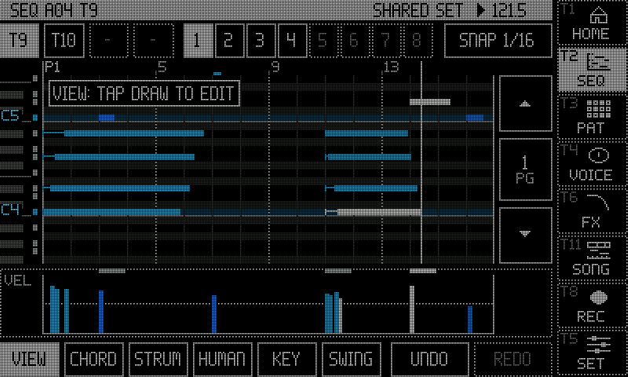
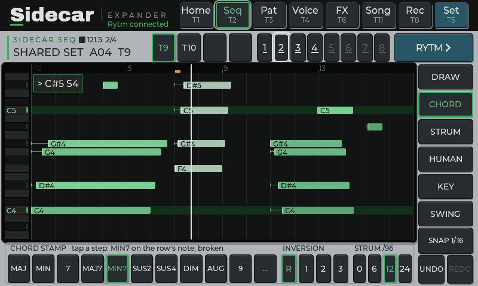

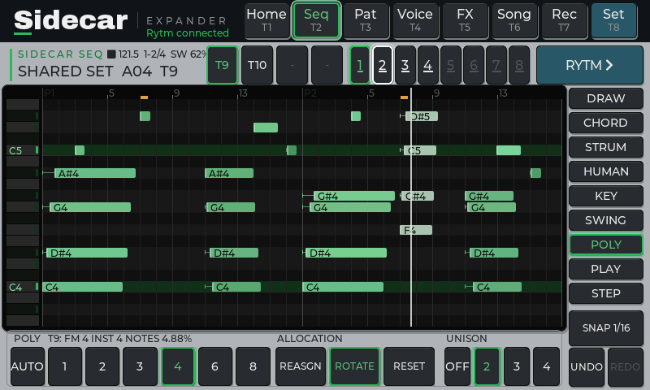

### VOICE and the machine view

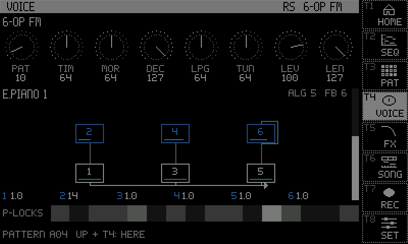
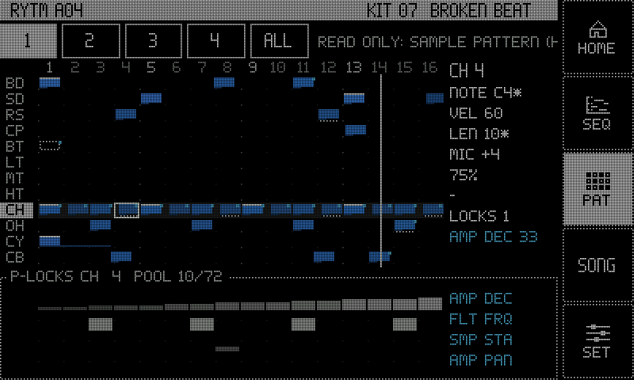

### REC: the Overbridge recorder

The [recorder](/sidecar-expander/using/recorder/) on the touchscreen: REC / STOP, ARM, the take's time in segment digits, the take's name, 48 kHz and the bit depth, the card's free space and the time it holds. Below, the 23 channels in three columns (RYTM STEMS, SIDECAR VOICES in the Rytm's track order, MIX + RETURNS), each with a meter; tap a channel to record it or not (while idle). The title bar turns to the alert look while recording.

**TAKES** lists the newest 64 takes, newest first, with their date; **drag** the list to scroll it. Before REC or ARM the page warns if the selected channels may be more than the drive can write (you can go ahead anyway: [the speed warning](/sidecar-expander/using/recorder/#the-speed-warning)). **Playback:** tap a take's row to play it into the Rytm's MAIN (its MASTER mix if the take has one, else its first file); tap again to pause, once more to go on; tap another take to switch. **STOP** goes back to the start. The playing row shows `elapsed / length` and a progress bar. Playback continues when you leave the page, and ends at the take's end, when a recording starts or arms, or when the take is deleted.

### SCOPE

An oscilloscope of one Overbridge channel: TRACK (the Rytm's selected track, following it), MAIN, a track's stem, or IN L / R (the FX return while it is on). Under it, the eleven channels' level meters (MAIN as L / R); tap a meter to show that channel, TRACK to follow the selection again. The timebase (43 ms .. 2.7 s a screen, triggered up to 85 ms, a sweep from 171 ms), GAIN (AUTO, or x1 .. x64), FREEZE (the trace held, the meters go on).

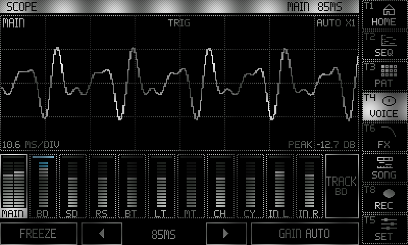

### SIDECAR STATUS

Read only, twice a second:

- **VOICES:** each voice by its track, its machine and its share of a render core; a poly track's machine with its instances (`PLAITS X8`), and on the panel's title the instance pool in use (`INST 12/32`), one instance's cost and its memory.
- **SEND FX:** FX 1 / FX 2 with their TYPE and PRE / POST.
- **CPU:** cores 1..3, the longest block and pass, underruns, the buffer and the temperature.
- **LINKS:** the Rytm, the Overbridge audio, USB-C, the network, the web page, the SD card, a [USB drive](/sidecar-expander/using/storage/) and an NVMe SSD with their free space, the display.
- **VERSIONS + LIBRARY:** the Sidecar build, Circle, LVGL, the Rytm mods seen, and the [sample library](/sidecar-expander/using/pools/#the-sample-library).

Limits and errors (a muted voice, underruns, a busy core, the network down, little free space) show in the alert look.

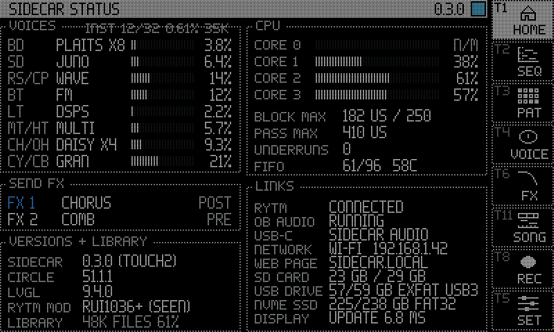

### PROJECT and POOL

The PROJECT page lists the card's projects and exports and imports bundles, to the card or a USB stick: see [Projects and bundles](/sidecar-expander/using/projects-bundles/#the-touchscreen-project). The POOL views show and edit the project's sample, wavetable and instrument lists: see [Pools](/sidecar-expander/using/pools/#on-the-touchscreen).

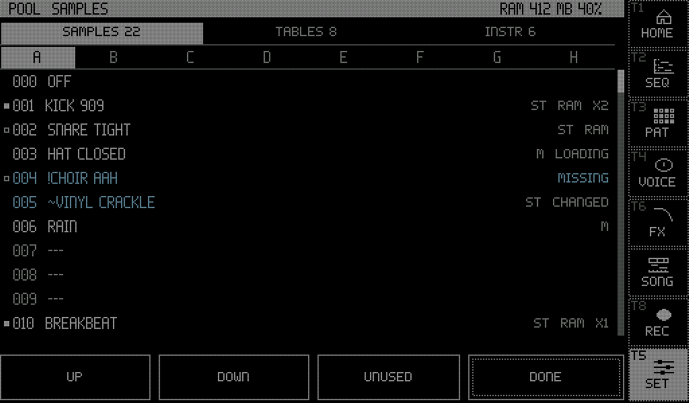

### The connection animation

A banner slides over the top of the screen when the Rytm's link comes up or drops: see [The display](/sidecar-expander/using/display/#the-connection-animation).

<small>Screenshots: rendered off-device by the Sidecar's own UI code, with made-up data.</small>

## Screen sizes and displays

The UI has two sizes, **800x480** and **1024x600**, each with its own layout in both themes. Which displays work, how the size is picked and the `config.txt` lines for a 1024x600 panel are on [The display](/sidecar-expander/using/display/).

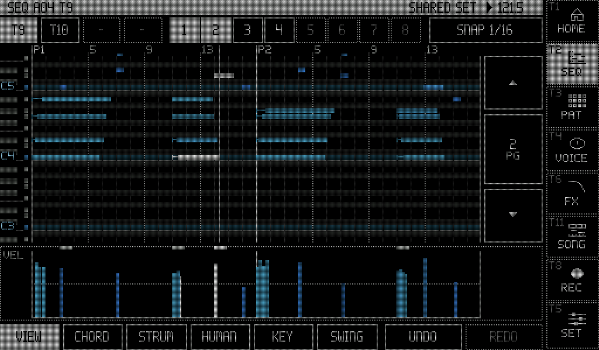
