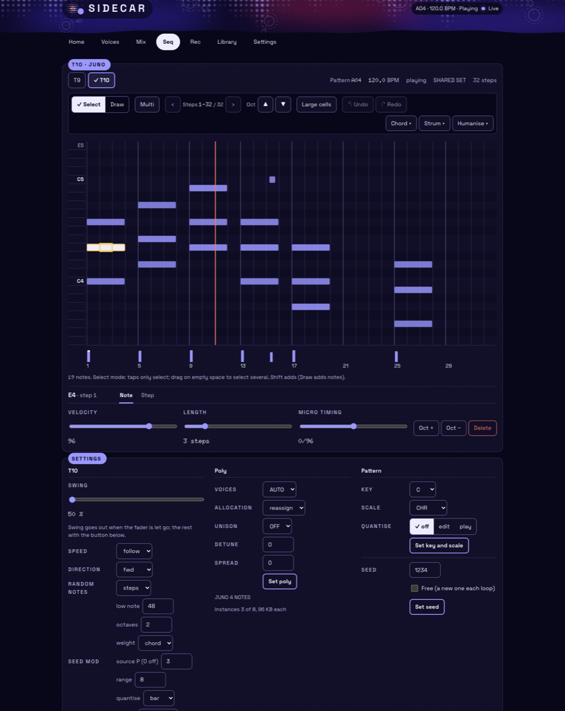
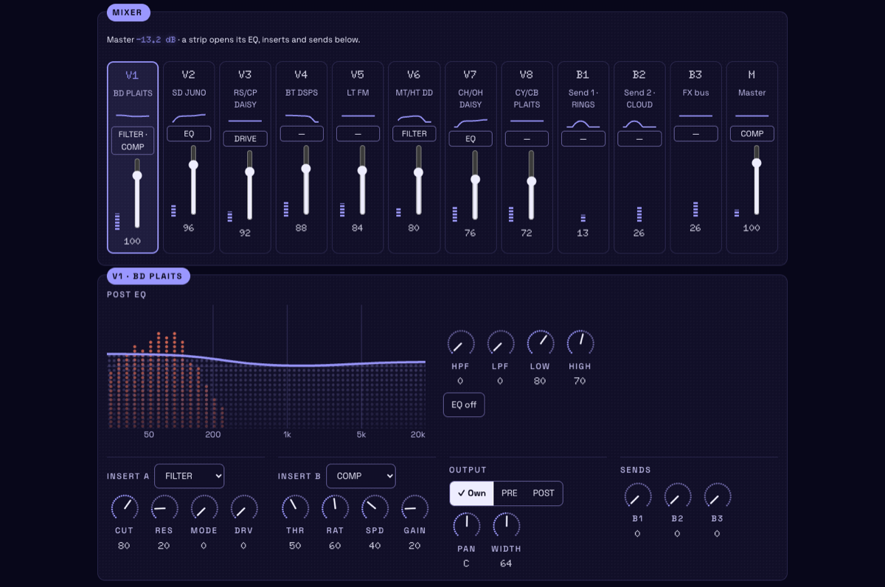
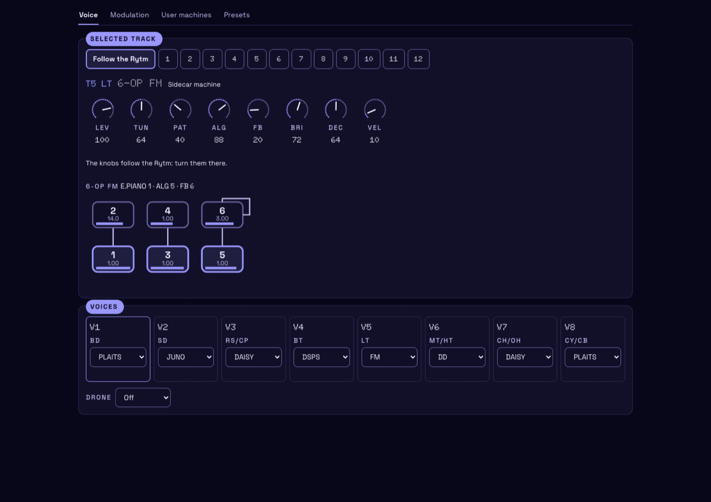
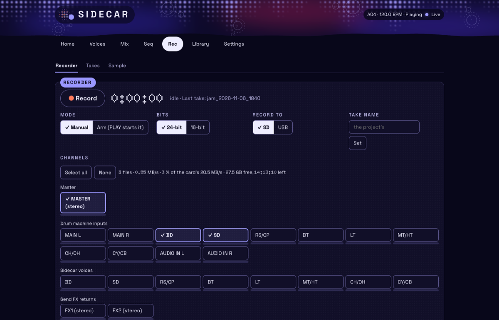
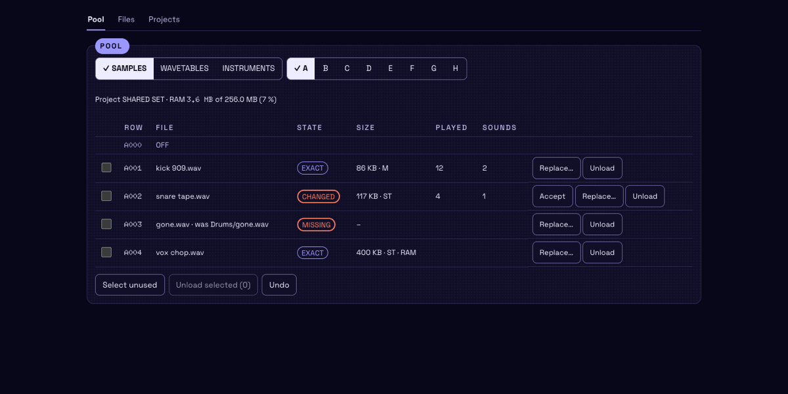
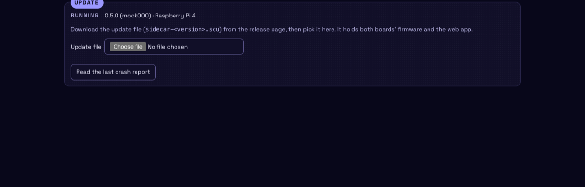

## The Pi's page: sidecar.local

The Pi serves its own page. Open <http://sidecar.local> from any browser on the same cable or network ([how to connect](/sidecar-expander/getting-started/install-pi/#first-boot-over-ethernet-sidecarlocal)). Nothing is sent anywhere else. Since 0.3.0 a browser must be **paired** first, once ([below](#pairing-a-browser)).

## Pairing a browser

in testing New in 0.3.0. The web page is locked with a **pairing code**, so a Sidecar on a shared network is not open to everyone. The code is 8 digits. The Sidecar makes a new one at every start, and shows it only on its own screens: the Rytm's screen and the touchscreen.

**Pair a browser (once per browser):**

1. Open `http://sidecar.local`. The page asks for the code.
2. Read the code on the Rytm or the touchscreen (below). On the page, **Show it on the Rytm** puts it on the Rytm's screen (at most once every 10 seconds; the button says "Shown on the Rytm" or "Wait N s").
3. Type the 8 digits, keep **remember this device** ticked, and press **Pair**.

That browser stays paired, also after the Pi restarts: you do not type the code again. Pairing at `http://sidecar.local` does not carry over to the Pi's IP address (a browser treats them as two sites): pair at the address you use.

**Where the code shows:**

- **On the Rytm**, in a box in the middle of its screen for 30 seconds: when the Pi starts, and when the Rytm connects while no browser is paired yet. A key on the Rytm closes it.
- **SIDECAR MENU > WEB UI** on the Rytm (UP + YES, then YES on SIDECAR, then WEB UI): **CODE**.
- The **SIDECAR** page on the Rytm (**UP + T10**): its PAIR line.
- The **touchscreen's STATUS** page: the LINKS panel's PAIR line.

**SIDECAR MENU > WEB UI** on the Rytm:

| Item | Does |
|---|---|
| **WEB UI** ON / OFF | the web page (and the install port) on the network. OFF: every page answers that the web UI is off on the Rytm. Kept across restarts |
| **CODE** | this start's pairing code |
| **PAIRED DEVICES** | how many browsers and tools are paired |
| **NEW CODE** | a fresh code for this start; paired devices stay paired |
| **FORGET DEVICES** | (YES twice) every paired browser and tool must pair again |

On the web page, the Status tab's **Access** has **Forget this device** and **Forget every device**.

**What stays open without pairing:** the page itself (with the pairing dialog), `/status` (the device's state: no codes, no Wi-Fi key), `/health` (is it running, the build) and the log (`/log`). Everything else (the tabs' settings, files, bundles, Wi-Fi, installs) needs a paired browser.

- **Tools** such as `sdboot.py` (installs over the network) pair once with the code: see [First pairing for tools](/sidecar-expander/developers/building/#pairing-tools-with-the-sidecar).
- A wrong code five times locks that computer out for a minute (longer each time). Paired browsers keep working.
- Pairing is protection against people on the same network, not against someone holding the SD card. The connection is plain HTTP: on a network you do not trust, pair the devices you need beforehand, or use a direct cable.
- **Development cards only:** `paircode=0` in `cmdline.txt` turns the pairing off. The Sidecar then warns at every start, once a minute in the log and on the STATUS page. Never use it on a card you share or take on stage.

## The black box

New in 0.3.1. `GET /blackbox` returns the [black box](/sidecar-expander/using/troubleshooting/#the-black-box), for paired clients only: a browser tab cannot open it, a tool sends its token in the `X-Sidecar-Auth` header. It gives up to 64 KB a request: the last 64 KB, or from byte N with `?off=N`; `?old=1` reads the older file. The first line is `SIZE FROM`: the file's size and where this piece starts. The simplest way for a report: New in 0.5.2 press **Download black box** in **Settings > About**; the card is the fallback ([send the black box](/sidecar-expander/using/troubleshooting/#the-black-box)).

## The tabs

The page has a new look in 0.5.0: the same "UV night" style as the touchscreen's [SIDECAR theme](/sidecar-expander/using/touchscreen/), in two themes (standard and high contrast), with a text size setting. It is built to be faster, works on Safari, and talks to the Sidecar over one live connection (a WebSocket, `/ws`) instead of polling. There are seven tabs, each with sub-tabs.

| Tab | Sub-tabs and what they hold |
|---|---|
| **Home** | **Overview**: CPU of the render cores, buffer levels, underruns, the Overbridge stream, whether the Rytm is attached, temperature and the **Power** tile ("too weak" with a warning when the supply is, for example a Pi 5 not on its 27 W adapter), and the pairing card. **Tracks**: the 12 tracks and their machines. **Log and console**: the live log and a command line for the console commands |
| **Voices** | **Voice**: the selected track (or follow the Rytm), the machine's knobs and its panel, such as the 6-OP FM algorithm, and the eight voices' machines and a test drone. **Modulation**: the [LFOs](/sidecar-expander/using/lfo/) (A and B on every track) and the DESIGN wave. **User machines**: [user machines](/sidecar-expander/using/user-machines/) and [user effects](/sidecar-expander/using/user-effects/), the project's U1..U5 and UFX1..UFX4. **Presets**: the JUNO and 6-OP FM lists and the user machine presets |
| **Mix** | **Mixer**: a strip for each voice (V1..V8), the buses (B1..B3) and the master (M), and, for the selected strip, its POST EQ with a spectrum, INSERT A and INSERT B with their knobs, OUTPUT (own, PRE or POST, pan, width) and the SENDS to B1..B3. **Master FX** ([master chain](/sidecar-expander/using/master-fx/)). **Send FX** ([send effects](/sidecar-expander/using/send-effects/)). **Sidechain** is a placeholder: it comes in 0.5.1 |
| **Seq** | the piano roll of a poly track: Select / Draw, Multi, Chord, Strum and Humanise, the note inspector (VELOCITY, LENGTH, MICRO TIMING, and the step's own tab), and the **SETTINGS** block: swing, speed, direction, random notes, the **Poly** settings (VOICES, ALLOCATION, UNISON, DETUNE, SPREAD) and the pattern's key, scale, quantise and seed ([Poly mode](/sidecar-expander/using/sequencer/)) |
| **Rec** | **Recorder**: record and arm, bit depth, the channels ([recorder](/sidecar-expander/using/recorder/)). **Takes**: the takes with a play button per channel. **Sample**: the sampler's recording |
| **Library** | **Pool**: the project's [POOL lists](/sidecar-expander/using/pools/#on-the-web-page). **Files**: the file browser. **Projects**: [projects and bundles](/sidecar-expander/using/projects-bundles/#the-web-page-project-tab) |
| **Settings** | **Look** (theme and text size, kept in this browser), **Audio**, **USB-C** (the USB-C mode, Class compliant or Overbridge: [Overbridge through the Sidecar](/sidecar-expander/using/usb-audio-midi/#overbridge-through-the-sidecar)), **Display**, **Storage**, **Wi-Fi**, **Access** (pairing), **MIDI bridge**, **Update** ([below](#updating-from-the-web-page-050)) and **About** |

A banner says so when the page is from a newer release than the Sidecar it talks to. The choice buttons are **segmented toggles that show the device's own state**: a click shows the choice as pending until the Sidecar confirms it, and a refused change is put back. hardware

<small>Screenshots: the 0.5.0 web page (`web-next`) running against the development mock server: the tracks, takes, files and levels are made-up data.</small>

### Morph (coming in 0.5.2)

:::caution[Morph is not in 0.5.0]
The Morph tab of the page is **hidden in 0.5.0**: the scene morph and its fader arrive in **0.5.2**, together with a new version of morph. Nothing on the page works as morph yet. A project that uses the Sidecar's morph keeps its settings. See [MORPH](/sidecar-expander/using/morph/).
:::

### Poly tracks

In 0.5.0 the poly settings are in **Seq > SETTINGS > Poly** (VOICES, ALLOCATION, UNISON, DETUNE, SPREAD and **Set poly**); before they were in **Sound > Poly tracks**, a row per poly track: **VOICES**, **ALLOCATION**, **UNISON**, **DETUNE**, **SPREAD** and **Set**, and a line with the instances the config resolves to. It sets the same [POLY CONFIG](/sidecar-expander/using/sequencer/#poly-config) as the Rytm's track menu (FUNC + CHRO) and the touchscreen's POLY tool. in testing

### Pool

**Library > Pool.** SAMPLES / WAVETABLES / INSTRUMENTS, banks A..H, the project and the pool RAM. Per row: the name, the state, the size, how often it played and the voices on it now. **Accept** (a changed file), **Replace** (from a small file browser), **Unload**, **Select unused**, **Select none**, **Unload selected**, **Undo**, **Refresh**. A row in use asks first, and replacing or unloading it is refused while the Rytm plays. The Rytm's bank list and the touchscreen show the same rows. See [Pools](/sidecar-expander/using/pools/).

### Project

**Library > Projects.**

- **Projects**: every project on the card by its Rytm slot (the Rytm's current one marked `*`), with its Sidecar files and their size. **Download** (the browser saves the bundle), **To card** (`/Bundles/`), **Rytm file…** (the Rytm project file you exported with Elektron Transfer, for the project's next export), **Delete** (the project's Sidecar files go to the trash; its samples stay).
- **Bundles on the card** and **Import a bundle…** (or drop a `.sidecar.zip` on the list): checked, then a summary before anything is written, with **to slot** to pick the Rytm slot it goes into. **Delete** removes a bundle or an unfinished `.part`.
- **USB stick**: the mounted sticks with their free space, **Eject**, and the stick's bundles with **Import** and **Delete**. Export to a stick is off in 0.3.0 (no To USB button): export to the card, then copy the bundle.
- **Trash**: the [project trash](/sidecar-expander/using/projects-bundles/#the-project-trash): **Restore**, **Remove…**, **Empty…**.
- While a job runs the tab shows its phase and progress, and **WAITING (PLAYING)** or **WAITING (RECORDING)** while the Rytm plays or the recorder records.

See [Projects and bundles](/sidecar-expander/using/projects-bundles/).

### Storage and the library

In **Settings > Storage**:

- the SD card, the mounted [USB drives](/sidecar-expander/using/storage/#usb-drives) (FAT32 with the MBR scheme) and, on the Pi 5, an NVMe SSD, with their free space; a drive that cannot be mounted says why (GPT, exFAT);
- **Eject** before pulling a drive;
- **Run bench**: the [storage bench](/sidecar-expander/using/storage/#measuring-a-drive-storbench) on a drive, with its result as a table;
- **Library**: one line for the [sample library](/sidecar-expander/using/pools/#the-sample-library): how many files it knows, how much is hashed, duplicates, missing files, and whether it waits (while the Rytm plays).

### Wi-Fi settings

in testing. **Settings > Wi-Fi**: on / off, a network list from a scan (signal, a lock for secured networks, the band), "Other network…", a password field (never pre-filled), **Connect and save**, **Forget network**, and the current connection. Sidecar uses one network at a time, so **Connect and save restarts the Pi** and tries the new network at that boot. If it is not up within 90 seconds (a wrong password, no address, not found), the previous setting comes back and the Pi restarts on it, so a typo cannot lock you out. The password is stored only as the network's key, never shown again. Wi-Fi stays off in the SD card package; turning it on here works over Ethernet. Only a [paired browser](#pairing-a-browser) can change these settings. With no cable at all, use the card-root file instead: see [Wi-Fi without a cable: sidecar-wifi.txt](/sidecar-expander/using/wifi/#wi-fi-without-a-cable-sidecar-wifitxt).

### Lag now

New in 0.5.2. **Lag now** is a button at the top of every page, next to the connection status, and in **Settings > About**. Press it at the moment the Rytm feels slow or laggy while the Sidecar is attached.

- The Sidecar writes a marker with the time into its [black box](/sidecar-expander/using/troubleshooting/#the-black-box), together with its counters of that second. The log can then be read around that moment.
- The page shows "Lag marked". One marker a second at most: a double tap is one marker.
- It changes no setting and costs nothing until you press it.
- The button is greyed out when it cannot work. The label says why: **offline** (the page has no connection to the Sidecar) or **pair first** ([pair the browser](#pairing-a-browser)).

To send the markers, send the black box: press **Download black box** in **Settings > About**, or see [The Rytm feels slow or laggy](/sidecar-expander/using/troubleshooting/#the-rytm-feels-slow-or-laggy).

## Updating from the web page (0.5.0)

Upgrading from 0.4.4, which cannot update itself, is done by card: [Upgrade an existing Sidecar](/sidecar-expander/getting-started/upgrading/).

in testing From 0.5.0 a Sidecar can update itself from its page, on the Pi 4 and the Pi 5: **Settings > Update**. You do not need the SD card in a computer. You download one file from the release page and pick it on the page. The Sidecar does not download anything itself.

1. Download `sidecar-<version>.scu` from the release page. It is one file for the Pi 4 and the Pi 5, with a `.sha256` beside it.
2. Open the page and [pair the browser](#pairing-a-browser) if it is not paired yet. Then open **Settings > Update**.
3. Pick the file. The page checks it at once. A damaged or incomplete download, a file that is not a Sidecar update, or one without this board's firmware is refused before anything is sent. It then says what it will do, for example "Update from 0.5.0 (abc1234) to 0.5.0 (def5678)". The same version again, or an older one, needs the box **Install it anyway**.
4. Press **Install**. The file goes up with a progress bar, the Sidecar checks it again and restarts into the new version **on trial**. Audio stops for about a minute. Keep the Sidecar switched on until the page says it is done.
5. After the restart the page reconnects by itself and follows the trial: "Trying 0.5.1 (def5678): permanent in 20 s", then "Updated to 0.5.1 (def5678)". Reload the page: the update brings its own web app.

<small>The Update card as it opens, from the development mock server. The installing, trial and done states are not shown: they need a real Sidecar.</small>

**The Update card follows the trial.** The card on the page keeps showing where the update is, also while the Sidecar restarts: Trying, then Updated, or Failed. The new version is tried first. If it starts and runs for 30 seconds, it becomes permanent on its own, and the old version stays as the previous one. You do not install it twice.

**You can install again right after.** Once a trial has become permanent, the next update can go in at once. You do not need to restart the Sidecar first.

**On the screens.** While the update is written, the touchscreen shows a full-screen notice (`INSTALLING UPDATE - DO NOT POWER OFF`). During the trial it shows `TRIAL: PERMANENT IN N S`, for a few seconds after `UPDATED TO 0.5.0`, and after a failed trial `UPDATE FAILED - BACK ON 0.5.0`. The Rytm's screen shows the same lines as a status popup. It waits while one of the Sidecar's pages is open on the Rytm. No Rytm firmware change is needed.

**When it goes wrong.** If the new version does not start, hangs, or the power goes during the trial, the Sidecar starts its old version again at the next start, by itself. The page then says the new firmware did not start and the Sidecar went back to the old version. Nothing is lost: try again, or update from a card.

**Back to the previous version.** The card keeps the version before the last update. **Back to 0.5.0** restarts into it, on trial the same way. A previous version from before 0.5.0 cannot make itself permanent: the page warns you, and if you go on, it is put in at once without a trial. To go up again you then use the SD card in a computer.

**The last crash report.** **Settings > Update > Read the last crash report** shows what the last start that did not end by a planned restart left behind (the report and the end of the log). **Save as a file** keeps it for a bug report. It is for paired browsers only, and it holds no pairing code or Wi-Fi key.

**Who can update.** A paired browser, or the USB-C cable, and only from the page itself.

**Turning it off.** Put `webupdate=0` in `cmdline.txt`. The web update is off by itself without a card, and on a Pi 4 card that does not start through sdboot. Update such a card in a computer.

### The file browser

- Browse, download, upload (several files, drag and drop), delete, new folder, rename, free space.
- **Folders:** drop a folder (or "Upload folder") and it is uploaded whole, with progress per file and overall, and one Cancel. macOS junk files are skipped.
- **Safe writes:** an upload is written to a temporary file, each piece is read back and checked, and it replaces the old file only when the whole file's checksum matches. An interrupted upload resumes.
- **Protected:** the boot files cannot be changed from the page, and `/.rytm`, `/Samples` and `/Plugins` cannot be deleted or renamed (their contents can).
- Dot-files are hidden unless "show hidden" is on. A Recordings button jumps to your takes.
- **Into the pool** (0.3): **+SMP** / **+WT** next to a WAV or AIFF and **+INST** next to an `.sfz` put the file into the first free row of the bank picked above the table. **Fill bank** on a folder fills that bank's empty rows in name order (SAMPLES and WAVETABLES).

Uploading during play works, but a large upload can compete with sample streaming from the card. Prefer uploading while the sequencer is stopped.
