## The Pi's page: sidecar.local

The Pi serves its own page. Open <http://sidecar.local> from any browser on the same cable or network ([how to connect](/sidecar-expander/getting-started/install-pi/#first-boot-over-ethernet-sidecarlocal)). Nothing is sent anywhere else.

| Tab | What |
|---|---|
| **Status** | CPU of the render cores, buffer levels, underruns, the Overbridge stream, whether the Rytm is attached, USB-C, temperature; the **Wi-Fi** section (below) |
| **Sound** | MIDI notes, output to tracks or MAIN, the **IN L/R source** (Inputs or the Rytm's FX return), computer audio, a machine per voice and a test drone; **Display**: screensaver and brightness |
| **Send FX** | the two effects' TYPE and the tracks' send levels as the Rytm's kit sets them (read only); Kill tails |
| **LFO** | the eight [LFOs](/sidecar-expander/using/lfo/): target, wave (with the DESIGN grid), rate, retrig, depth |
| **Record** | the [recorder](/sidecar-expander/using/recorder/): record, arm, channels, and the takes with a play button per channel |
| **User machines** | [user machines](/sidecar-expander/using/user-machines/): installed list, upload, delete, rescan, the project's U1..U5, export and import of the slot list, memory bars |
| **Pool & presets** | the project's sample pool, the JUNO and FM lists, and user machine presets; **Save current** adds what a voice plays now to its list hardware |
| **Files** | the file browser (below) |
| **Log & console** | the live log and a command line for the console commands |
| **About** | address, build, versions |

The choice buttons are **segmented toggles that show the device's own state**: a click shows the choice as pending until the Sidecar confirms it, and a refused change is put back. hardware

The page has no password. Use it on a direct cable or a network you trust.

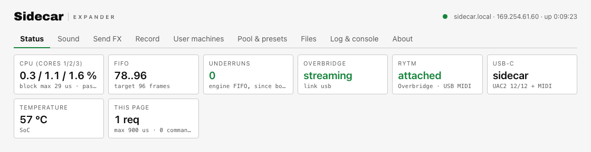
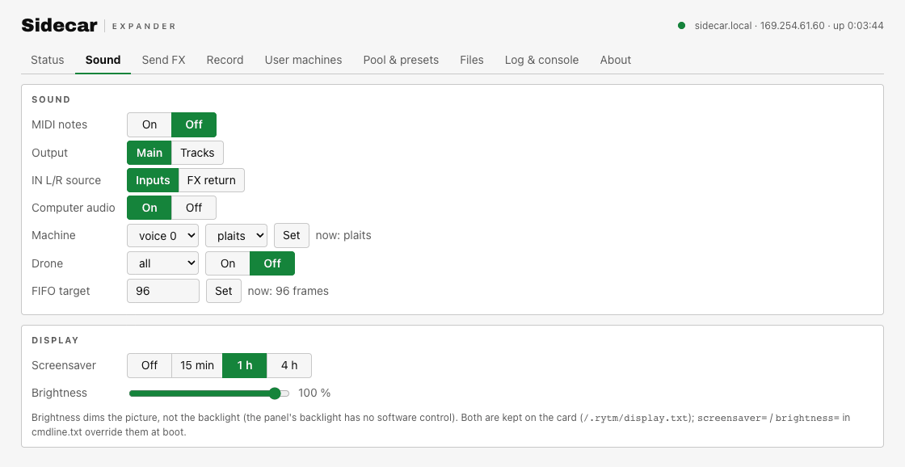
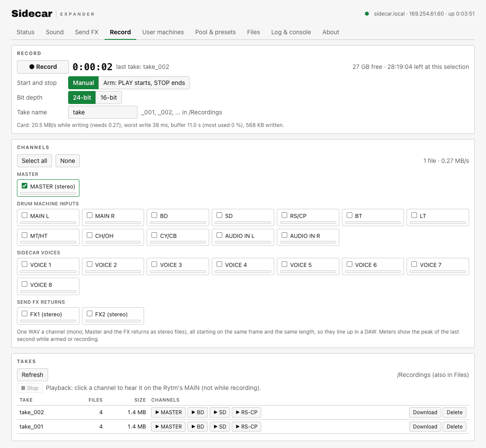
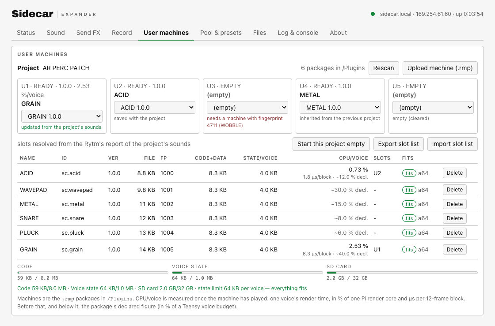
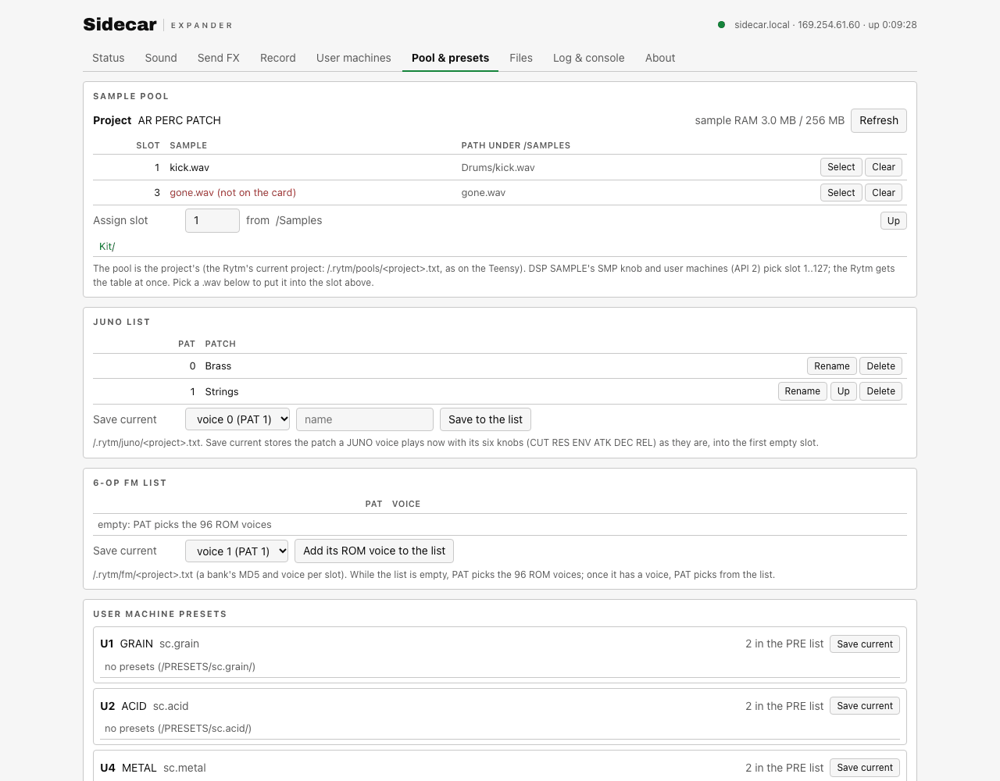
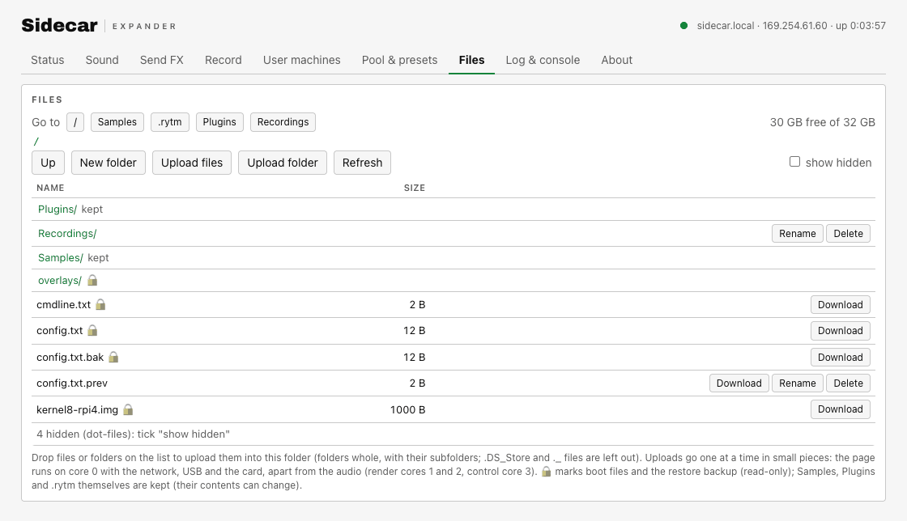
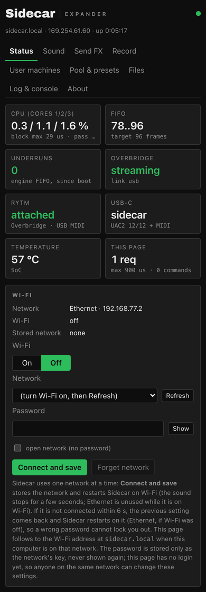
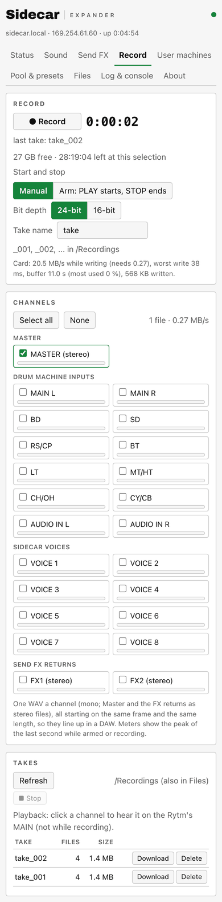

<small>Screenshots: the test line's page with mock data (`mock_web.py`: made-up addresses, takes and machines).</small>

### Wi-Fi settings

in testing. The Status tab's **Wi-Fi** section: on / off, a network list from a scan (signal, a lock for secured networks, the band), "Other network…", a password field (never pre-filled), **Connect and save**, **Forget network**, and the current connection. Sidecar uses one network at a time, so **Connect and save restarts the Pi** and tries the new network at that boot. If it is not up within 90 seconds (a wrong password, no address, not found), the previous setting comes back and the Pi restarts on it, so a typo cannot lock you out. The password is stored only as the network's key, never shown again. Wi-Fi stays off in the SD card package; turning it on here works over Ethernet. The page has no login yet, so anyone on the same network can change these settings. With no cable at all, use the card-root file instead: see [Wi-Fi without a cable: sidecar-wifi.txt](/sidecar-expander/using/wifi/#wi-fi-without-a-cable-sidecar-wifitxt).

### The file browser

- Browse, download, upload (several files, drag and drop), delete, new folder, rename, free space.
- **Folders:** drop a folder (or "Upload folder") and it is uploaded whole, with progress per file and overall, and one Cancel. macOS junk files are skipped.
- **Safe writes:** an upload is written to a temporary file, each piece is read back and checked, and it replaces the old file only when the whole file's checksum matches. An interrupted upload resumes.
- **Protected:** the boot files cannot be changed from the page, and `/.rytm`, `/Samples` and `/Plugins` cannot be deleted or renamed (their contents can).
- Dot-files are hidden unless "show hidden" is on. A Recordings button jumps to your takes.

Uploading during play works, but a large upload can compete with sample streaming from the card. Prefer uploading while the sequencer is stopped.

## The Sidecar Mini web console

Open the [console](/sidecar-expander/console/) in **Chrome or Edge on a desktop computer** and press **Connect**. It talks to the Teensy over WebSerial through the micro-USB port. Nothing is sent to any server.

| Tab | What |
|---|---|
| **Status** | the live status line: CPU, the USB stream, FIFO, MIDI |
| **Sound** | MIDI notes, output to tracks or MAIN, the IN L/R source, computer audio, a machine per voice, the FIFO target (segmented toggles that show the device's state) |
| **LFO** | the four [LFOs](/sidecar-expander/using/lfo/) |
| **Record** | the [Sidecar Mini recorder](/sidecar-expander/using/recorder/#sidecar-mini-teensy): record, arm, stereo or stems (stems with PSRAM), bit depth, the levels |
| **USB** | the USB audio mode |
| **User machines** | user machines: install, delete, rescan, the project's slots, export/import, the memory map (with a PSRAM code arena bar when PSRAM is fitted) |
| **Files** | the SD card: browse, upload with resume, download, new folder, delete |
| **Log & console** | the log and the console commands |
| **About** | the build |

On the computer the Mini shows up as **Sidecar Mini** (USB name). hardware

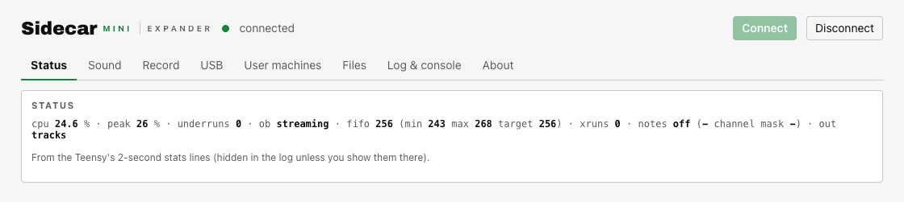
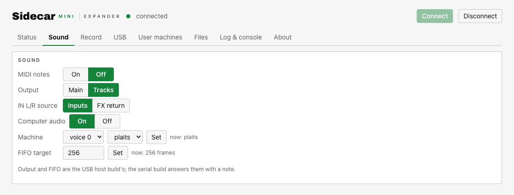
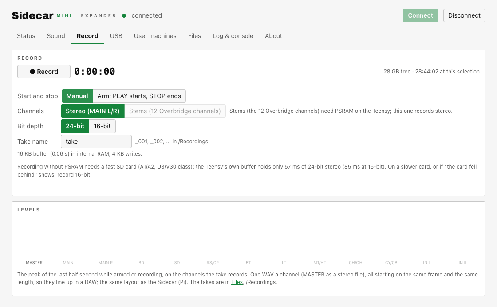
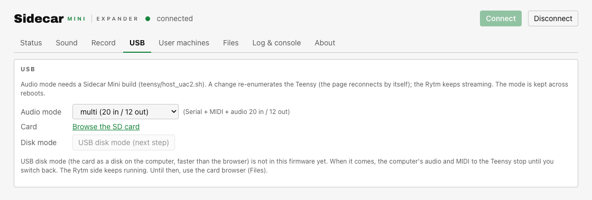
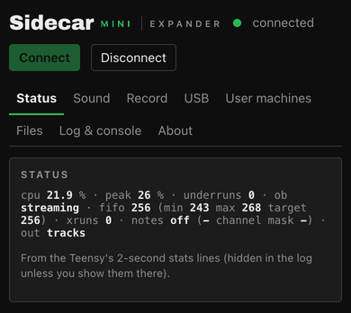

<small>Screenshots: the test line's console with its built-in mock (`?mock`), not a real Teensy.</small>

**Teensy rules:** card writes, deletes and installs wait for the Rytm's transport to stop (the page shows "paused" and continues). Reads go on during play, slowly. `/`, `/Samples` and `/.rytm` are protected.

Use the console to check that the Rytm is streaming (`ob: streaming`, `MIDI attached`) and to copy logs for a tester report.
